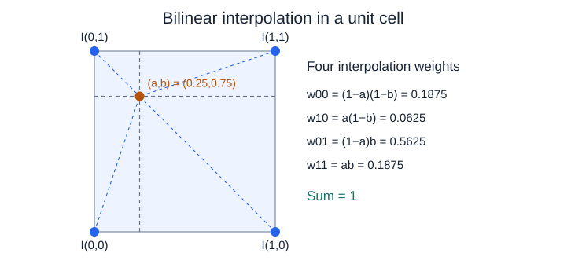
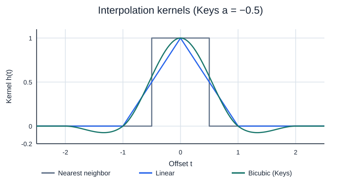

# Week 1, Day 2 — Matrix Refresher, Coordinate Grids, and Interpolation

*90-minute lecture. Source: Week 1 of `syllabus/weekly-schedule.md`, with `syllabus/course-overview.md` and `syllabus/technical-notes.md`.*

> **Assumptions (flagged):** Students have the linear algebra prerequisite, so the refresher is brief and covers only what Weeks 1–2 need. The specific kernel formulas and the frequency-domain statements are standard textbook choices, kept informal because the Fourier transform is formally introduced in Week 4. Timings are suggestions.

## Learning Objectives

By the end of this session students can:

1. Use matrices and matrix–vector products to represent a color pixel, an image, and a linear coordinate map.
2. Describe the coordinate grid of a digital image and how output grid points map back to input coordinates.
3. Explain resampling and why it needs interpolation.
4. Describe nearest-neighbor, bilinear, and bicubic interpolation, and explain why each acts as a low-pass filter.

## Timed Outline (90 min)

| Min | Segment |
|-----|---------|
| 5 | Recap of Day 1 |
| 20 | Linear algebra / matrix refresher |
| 15 | Coordinate grids |
| 5 | Break |
| 15 | Resampling and why interpolation is needed |
| 25 | Interpolation kernels: nearest-neighbor, bilinear, bicubic |
| 5 | Wrap-up and Week 2 preview |
| **90** | **Total** |

## Content Notes

### 1. Recap (5 min)
$f:\mathbb{R}^2\to\mathbb{R}^k$ vs. $I\in\mathbb{Z}^{M\times N\times k}$; injective/surjective/bijective.

### 2. Matrix refresher (20 min)
- A grayscale image is an $M\times N$ matrix $I$; a color image is a stack of $k$ such matrices.
- A point is a column vector $\mathbf{p}=(x,y)^T$. A linear map is $\mathbf{p}'=A\mathbf{p}$ with $A\in\mathbb{R}^{2\times 2}$:

$$
\begin{pmatrix}
x'\\
y'
\end{pmatrix} = \begin{pmatrix}
a&b\\
c&d
\end{pmatrix} \begin{pmatrix}
x\\
y
\end{pmatrix}.
$$

- Examples: scaling $\mathrm{diag}(s_x,s_y)$; rotation by $\theta$:

$$
R_\theta = \begin{pmatrix}
\cos\theta&-\sin\theta\\
\sin\theta&\cos\theta
\end{pmatrix}.
$$

  (The same rotation matrix appears in the swirl transform in `syllabus/technical-notes.md`, used in Week 2.)
- **Invertibility:** $A$ is bijective on $\mathbb{R}^2$ iff $\det A\neq 0$; then $\mathbf{p}=A^{-1}\mathbf{p}'$. If $\det A=0$ the map collapses a direction and is not injective. This ties back to Day 1.
- Per-pixel color operations are matrix–vector products too (e.g. a $1\times 3$ matrix for RGB→gray; not injective).

### 3. Coordinate grids (15 min)
- Pixel $(m,n)$ with $0\le m<M$, $0\le n<N$ is a sample of $f$ at a grid point; with spacing $\Delta$: $I[m,n]\approx f(m\Delta, n\Delta)$.
- A geometric map $T:\mathbb{R}^2\to\mathbb{R}^2$ sends grid points to non-grid points in general.
- **Backward (inverse) mapping:** for each output pixel $\mathbf{q}$, compute $\mathbf{p}=T^{-1}(\mathbf{q})$ and sample the input at $\mathbf{p}$; this avoids holes. Forward mapping can leave gaps and overlaps.
- Assumption: the indexing convention (origin at corner vs. pixel center) is stated explicitly and used consistently in labs.

### 4. Resampling (15 min)
Resampling means estimating $f$ at coordinates that are not grid points (rotation, scaling, fractional shifts). Since only $I$ is known, we need an **interpolation kernel** $h$:

$$
\hat f(x,y) = \sum_{m,n} I[m,n]\, h(x-m,\,y-n).
$$

Interpolation produces values not in the original data, so repeated resampling accumulates error. Since $f$ is not assumed continuous (it may have sharp edges), $\hat f$ is only an estimate and can blur or overshoot at jumps. This is why discrete inverses of geometric transforms are only approximate (technical notes: "Discrete hurdles").

~~~mermaid
flowchart TD
A[Choose output pixel] --> B[Map to source coordinates]
 B --> C[Locate neighboring samples]
 C --> D[Evaluate interpolation weights]
 D --> E[Combine samples]
 E --> F[Assign output value]
~~~

*Figure 1. Backward resampling. Use the specified kernel and boundary convention.*

*Illustration 1. The four neighbors and their bilinear weights at a fractional coordinate. The weights sum to one.*

### 5. Interpolation kernels (25 min)
In 1D (2D kernels are products $h(x)h(y)$ — a standard separability fact):

- **Nearest neighbor:** $h(t)=1$ for $|t|<\tfrac12$, else $0$. Piecewise constant; blocky; uses 1 sample.
- **Bilinear:** $h(t)=1-|t|$ for $|t|<1$, else $0$. Linear blend of the 4 nearest pixels in 2D; continuous but with kinks.
- **Bicubic:** a piecewise cubic kernel with support $|t|<2$ (16 pixels in 2D); smoother. The common Keys form with $a=-0.5$ is assumed as the example:

$$
h(t)=\begin{cases}
\tfrac32|t|^3-\tfrac52|t|^2+1, & |t|\le 1,\\
-\tfrac12|t|^3+\tfrac52|t|^2-4|t|+2, & 1<|t|<2,\\
0, & \text{otherwise.}
\end{cases}
$$

**Why these are low-pass filters (informal):** interpolation is a convolution of the samples with $h$. The smoother and wider the kernel, the more it attenuates high spatial frequencies (fine detail, edges), i.e. it blurs. The ideal low-pass (sinc) kernel is not used in practice because it has infinite support. Treat any ranking of the kernels' attenuation as qualitative until the Fourier transform is covered in Week 4.

*Illustration 2. Nearest-neighbor, linear and Keys cubic kernels with the parameter used above. Negative cubic lobes can cause overshoot.*

### 6. Wrap-up (5 min)
Key message: resampling is information-losing in practice. Week 2 uses geometric warps (swirl, twirl) and shows why their digital inverses are noisy approximations.

## Key Formulas Summary

- Linear map $\mathbf{p}'=A\mathbf{p}$; invertible iff $\det A\ne 0$.
- Backward mapping: $\mathbf{p}=T^{-1}(\mathbf{q})$.
- Interpolation: $\hat f(x,y)=\sum_{m,n} I[m,n]\,h(x-m,y-n)$.

## Exercises

**1.** Is

$$
A=\begin{pmatrix}
2&4\\
1&2
\end{pmatrix}
$$

injective as a map $\mathbb{R}^2\to\mathbb{R}^2$? Describe what it does to the plane.
2. Show $R_\theta$ is bijective and find $R_\theta^{-1}$.
3. Rotate a $3\times 3$ image by $45^\circ$ about its center. Explain why forward mapping may leave holes and how backward mapping fixes this.
4. Given pixel values $10, 20$ at positions $0,1$ (1D), compute the interpolated value at $x=0.3$ using nearest-neighbor and linear interpolation.
5. Verify that the bilinear kernel $h(t)=1-|t|$ gives $h(0)=1$ and $h(k)=0$ for nonzero integers $k$ (so it reproduces the original samples).
6. *(Discussion)* Upscale an image by $2\times$ then downscale by $2\times$ using bilinear interpolation. Is the result identical to the original? Why or why not?
7. *(Optional, Python)* Rotate an image by $10^\circ$ and then by $-10^\circ$ with each of the three interpolation methods in OpenCV; compare with the original.
