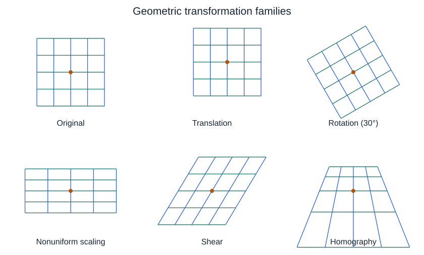

# Week 2, Day 1 — Geometric Mappings: Affine Maps, Homographies, and Resampling

*90-minute lecture. Source: Week 2 of `syllabus/weekly-schedule.md` ("Geometric Warping and Permutation Ciphers"), with `syllabus/technical-notes.md` and `syllabus/course-overview.md`.*

> **Assumptions (flagged):**
> - Day 1 covers the linear/affine/perspective part of Week 2; nonlinear swirl/twirl warps and the *Operation Vico* case study are on Day 2.
> - Mentions of Photoshop (Free Transform, Perspective, Warp) are intended as familiar anchors; exact menu names and behavior vary by version, so verify before class.
> - As in Week 1, $f:\mathbb{R}^2\to\mathbb{R}^k$ is a general function and is **not** assumed continuous (sharp edges and text are the interesting cases).
> - The syllabus table lists "Lab 2 (Part A)" for Week 2 while the weekly outline says "Lab 1"; confirm the lab numbering locally. Timings are suggestions.

## Learning Objectives

By the end of this session students can:

1. Express a geometric transformation $T:\mathbb{R}^2\to\mathbb{R}^2$ as a coordinate mapping and warp an image by $f'=f\circ T^{-1}$.
2. Write affine maps and perspective homographies using homogeneous coordinates, and state when they are invertible.
3. Explain why a permutation of pixel positions is a bijection (a "permutation cipher"), and why resampling breaks exact invertibility.
4. Relate these operations to familiar tools (Free Transform, Perspective, Warp).

## Timed Outline (90 min)

| Min | Segment |
|-----|---------|
| 5 | Recap of Week 1; the question for Week 2 |
| 15 | Warping an image: $f'=f\circ T^{-1}$, forward vs. backward mapping |
| 20 | Affine maps: translation, rotation, scale, shear |
| 20 | Homogeneous coordinates and perspective homographies |
| 5 | Break |
| 15 | Permutations of pixels as "ciphers"; invertibility on the grid |
| 10 | Resampling consequences; in-class activity; Day 2 preview |
| **90** | **Total** |

## Content Notes

### 1. Recap and framing (5 min)
Week 1: $f:\mathbb{R}^2\to\mathbb{R}^k$ vs. $I\in\mathbb{Z}^{M\times N\times k}$; injective/surjective/bijective; interpolation. Week 2 question: *if an image was geometrically rearranged, can the rearrangement be undone?*

### 2. Warping an image (15 min)
A geometric transformation moves positions but (ideally) keeps intensity values. Given $T:\mathbb{R}^2\to\mathbb{R}^2$, the warped image is

$$
f'(\mathbf{q}) = f\big(T^{-1}(\mathbf{q})\big), \qquad \mathbf{q}\in\mathbb{R}^2.
$$

- This is well defined when $T$ is a bijection of the plane (or of the relevant region).
- It does not require $f$ to be continuous: a jump in $f$ is simply carried along (to a moved jump).
- On a pixel grid, **backward mapping** evaluates $f$ at $T^{-1}(\mathbf{q})$ for each output pixel $\mathbf{q}$, using an interpolation kernel from Week 1. Forward mapping can leave holes or overlaps.
- Photoshop connection: Edit → Transform (Scale, Rotate, Skew, Distort, Perspective, Warp) are all of this form, plus an interpolation choice (nearest neighbor / bilinear / bicubic) that students may have seen in the resampling dialog.

~~~mermaid
flowchart TD
A[Source and destination grids] --> B[Forward mapping]
 A --> C[Backward mapping]
 B --> D[Map source samples to destination]
 D --> E[Resolve overlaps and holes]
 C --> F[Choose destination pixel]
 F --> G[Apply inverse coordinate map]
 G --> H[Interpolate source]
~~~

*Figure 1. Forward and backward mapping. Neither discrete procedure guarantees lossless resampling.*

### 3. Affine maps (20 min)

$$
T(\mathbf{p}) = A\mathbf{p} + \mathbf{t}, \qquad A\in\mathbb{R}^{2\times 2},\ \mathbf{t}\in\mathbb{R}^2 .
$$

- Translation ($A=I$), rotation $R_\theta$, scaling, reflection, shear are all affine.
- $T$ is a bijection of $\mathbb{R}^2$ iff $\det A\neq 0$, with $T^{-1}(\mathbf{q})=A^{-1}(\mathbf{q}-\mathbf{t})$.
- Affine maps preserve straight lines and parallelism (parallel lines stay parallel); they need not preserve angles or lengths.
- Composition of affine maps is affine. Practical point: compose the maps first and resample once (see Section 6).

### 4. Homogeneous coordinates and homographies (20 min)
Write $\mathbf{p}=(x,y)$ as $\tilde{\mathbf{p}}=(x,y,1)^T$. An affine map is then a $3\times 3$ matrix with last row $(0,0,1)$. A **perspective homography** allows any invertible $3\times 3$ matrix $H$:

$$
\begin{pmatrix}
u\\
v\\
w
\end{pmatrix} = H \begin{pmatrix}
x\\
y\\
1
\end{pmatrix}, \qquad (x',y') = \left(\frac{u}{w}, \frac{v}{w}\right).
$$

- $H$ is defined up to a nonzero scalar; it has 8 degrees of freedom. Four point correspondences (no three collinear) determine $H$.
- Straight lines map to straight lines, but parallel lines may converge (vanishing points); this is the Photoshop "Perspective" / "Perspective Warp" look.
- **Caveat on bijectivity:** the points with $w=0$ map "to infinity", so a homography is a bijection only between the plane minus a line and the plane minus another line (or on a suitable region, such as the image rectangle when $w>0$ there). Students should state the domain when classifying it.
- Inverse: $H^{-1}$ (also a homography). Rectifying a photographed document or license plate uses this.

~~~mermaid
flowchart TD
A[Rigid] --> B[Similarity]
 B --> C[Invertible affine]
 C --> D[Nonsingular projective]
~~~

*Figure 2. Nested transformation classes. Arrows denote class inclusion, not processing order. Projective maps are understood on the projective plane.*

*Illustration 1. Coordinate grids under explicit affine and projective maps. Parallelism is preserved by the affine examples but not necessarily by the homography.*

### 5. Permutation "ciphers" (15 min)
A pixel permutation keeps every value and only rearranges positions. On an $M\times N$ grid, a permutation $\pi$ of the $MN$ positions gives $I'[\pi(m,n)]=I[m,n]$.

- It is a bijection on the grid, so it is exactly invertible with $\pi^{-1}$ (no information lost, only hidden). That is why the syllabus calls such operations *permutation ciphers*.
- Examples: flips, $90^\circ$ rotations, block shuffles, row/column scrambles.
- Contrast: a rotation by $10^\circ$ is a bijection of $\mathbb{R}^2$ but is **not** a permutation of the pixel grid; grid points land between grid points, so interpolation is needed.
- The security flavor (a keyed permutation as a cipher) is only a motivating analogy; assumed not to be developed further this week.

### 6. Consequences of resampling (5 min of the 10-min closing segment)
- Interpolation values are not in the original data, so warping followed by the inverse warp does not return the original exactly. For $f$ with sharp edges (text), bilinear or bicubic interpolation blurs or overshoots at the jump.
- Applying $T_1$ then $T_2$ with two resamplings differs from one resampling with $T_2\circ T_1$; errors accumulate.
- Forensic hook for Day 2: even for bijective $T$, the *digital* inverse is only an approximation (`syllabus/technical-notes.md`, "Discrete hurdles").

### 7. Activity (5 min of the closing segment)
Pairs match each Photoshop operation (Rotate, Skew, Perspective, Flip, Warp) with: affine / homography / neither, and bijective or not. Close with a preview of Day 2 (swirl and twirl).

## Key Definitions Summary

- Warp: $f'=f\circ T^{-1}$ for a bijection $T$; no continuity of $f$ is assumed.
- Affine: $T(\mathbf{p})=A\mathbf{p}+\mathbf{t}$; invertible iff $\det A\ne 0$.
- Homography: $(x',y')=(u/w, v/w)$ with $(u,v,w)^T=H(x,y,1)^T$, $H$ invertible.
- Pixel permutation: bijection of grid positions; exactly invertible.

## Exercises

**1.** Find $A$ and $\mathbf{t}$ for a rotation by $30^\circ$ about the point $(2,1)$. Give $T^{-1}$.

**2.** Is $T(x,y)=(2x+y, 4x+2y)$ a bijection of $\mathbb{R}^2$? What does it do to the plane? Can the warp $f\circ T^{-1}$ be formed?

**3.** A homography has

$$
H=\begin{pmatrix}
1&0&0\\
0&1&0\\
0.01&0&1
\end{pmatrix}.
$$

Compute the image of $(100,50)$. Which line is sent to infinity?

**4.** Show that composing two affine maps is affine, and give the resulting $A$ and $\mathbf{t}$.

**5.** Count: how many pixel permutations exist for a $3\times 3$ image? How many keyed block-shuffles of four $2\times 2$ blocks in a $4\times 4$ image?

**6.** A photo of text is rotated by $10^\circ$ and rotated back using bilinear interpolation. Predict qualitatively what changes near the letter edges.

**7.** *(Optional, Python/OpenCV)* Use `cv2.getAffineTransform`, `cv2.getPerspectiveTransform`, and `cv2.warpAffine` / `cv2.warpPerspective` to warp a test image and invert it; compare with the original under each interpolation flag.
