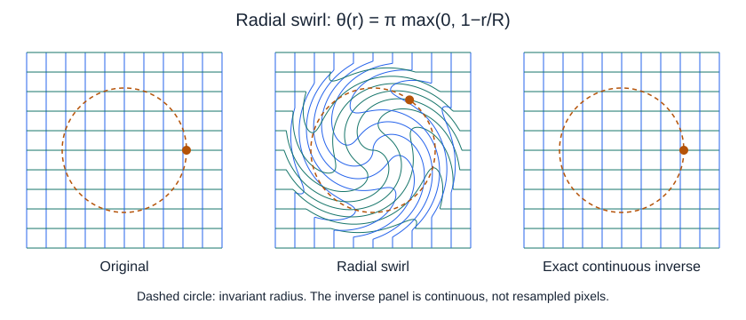
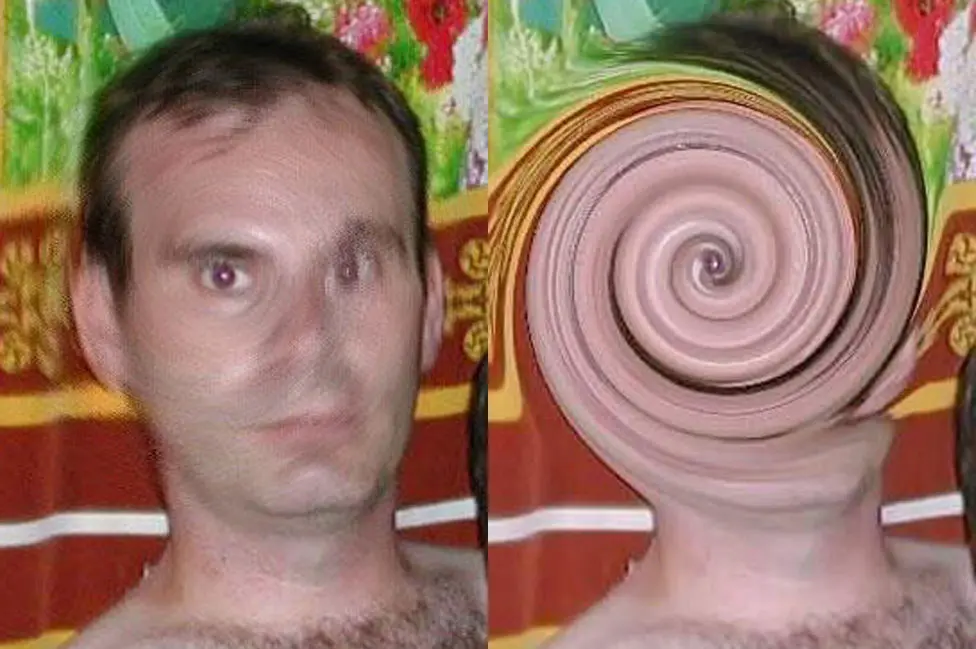

# Week 2, Day 2 — Swirl and Twirl Warps, Inversion, and a First Look at *Operation Vico*

*90-minute lecture. Source: Week 2 of `syllabus/weekly-schedule.md` ("Geometric Warping and Permutation Ciphers"), with `syllabus/technical-notes.md` and `syllabus/course-overview.md`.*

> **Assumptions (flagged):**
> - The swirl profile $\theta(r)$ used for examples is an illustrative choice; the syllabus only specifies a rotation by an angle $\theta(r)$ about a center $(x_0,y_0)$. The parameter-estimation procedure is a plausible scheme consistent with "edge continuity" in the syllabus, not a documented description of the actual casework.
> - Photoshop's *Twirl* filter (Filter → Distort) and *Liquify* (Twirl tool) are anchors; exact behavior and parameters differ by version, so verify before class.
> - The *Operation Vico* segment is **brief and introductory**, factual and cautious. Details beyond the syllabus are only widely reported public facts and are marked "to verify". The legal framework (*Daubert*, *Mohan*, etc.) is Weeks 8–9; do not cover it here.
> - As before, $f:\mathbb{R}^2\to\mathbb{R}^k$ is not assumed continuous.
> - Lab numbering for Week 2 differs between syllabus sections (Lab 1 vs. Lab 2 Part A); confirm locally. Timings are suggestions.

## Learning Objectives

By the end of this session students can:

1. Define a radial swirl/twirl warp with center $(x_0,y_0)$ and angle profile $\theta(r)$, and show it is a bijection of the plane.
2. Write the inverse warp and explain why it is exactly $-\theta(r)$ with the same center.
3. Explain why the digital inverse is only approximate, and describe a parameter-estimation strategy based on edge continuity.
4. Summarize, in a few sentences, what *Operation Vico* (2007) was and why it is used as a case study.

## Timed Outline (90 min)

| Min | Segment |
|-----|---------|
| 5 | Recap of Day 1 (affine, homography, permutations) |
| 10 | Nonlinear mappings in general; Photoshop Twirl / Liquify demo |
| 20 | Radial swirl: definition and bijectivity |
| 10 | Inverse swirl and discrete hurdles |
| 5 | Break |
| 20 | Parameter estimation by edge continuity (grid search) |
| 15 | Case study: *Operation Vico* (2007), brief introduction |
| 5 | Wrap-up; lab preview |
| **90** | **Total** |

## Content Notes

### 1. Recap (5 min)
Warp $f'=f\circ T^{-1}$; affine maps; homographies (bijective on a suitable domain); permutation ciphers are exactly invertible on the grid.

### 2. Nonlinear mappings (10 min)
Swirl, twirl, pinch, ripple, and mesh warps are not affine: lines generally become curves. Live demo (if available): apply Twirl to a photo of text and observe what happens to straight strokes. Key question: *a twirled picture looks destroyed; is information actually lost?*

### 3. The radial swirl (20 min)
Fix a center $(x_0,y_0)$ and let $r=\sqrt{(x-x_0)^2+(y-y_0)^2}$. The swirl rotates each point about the center by an angle depending only on its radius (from `syllabus/technical-notes.md`):

$$
\begin{pmatrix}
x'\\
y'
\end{pmatrix} = \begin{pmatrix}
x_0\\
y_0
\end{pmatrix} + \begin{pmatrix}
\cos\theta(r)&-\sin\theta(r)\\
\sin\theta(r)&\cos\theta(r)
\end{pmatrix} \begin{pmatrix}
x - x_0\\
y - y_0
\end{pmatrix}.
$$

- Intensities are carried along: $f'(x',y')=f(x,y)$. Positions are permuted, values are preserved.
- **Illustrative profile (assumed):** a twirl-like choice $\theta(r)=\theta_0 (1-r/R)$ for $r<R$ and $\theta(r)=0$ for $r\ge R$, where $\theta_0$ is the central twist angle and $R$ the radius of effect. The parameters are $(x_0,y_0,R,\theta_0)$.
- **Bijectivity:** a rotation preserves distance to the center, so $T$ maps each circle $r=\text{const}$ onto itself by a rigid rotation. Hence $T$ is a bijection of $\mathbb{R}^2$ for *any* function $\theta(r)$ (the center is fixed). If $\theta$ is discontinuous, $T$ is still bijective but tears the plane; continuity of $\theta$ only affects how nice the picture looks.
- This is the "permutation cipher" idea from Day 1, now on the continuous plane: a keyed rearrangement, where the key is the parameter set.

*Illustration 1. A radial swirl and its exact continuous inverse, computed using the profile above with central angle π. The dashed circle and marked point illustrate radius preservation. Discrete resampling need not be exactly reversible.*

### 4. Inverse and discrete hurdles (10 min)
Because $T$ preserves $r$, the inverse is a rotation by the opposite angle at the same radius:

$$
T^{-1}:\quad \begin{pmatrix}
x\\
y
\end{pmatrix} = \begin{pmatrix}
x_0\\
y_0
\end{pmatrix} + \begin{pmatrix}
\cos\theta(r)&\sin\theta(r)\\
-\sin\theta(r)&\cos\theta(r)
\end{pmatrix} \begin{pmatrix}
x' - x_0\\
y' - y_0
\end{pmatrix},
$$

$$
r=\sqrt{(x'-x_0)^2+(y'-y_0)^2}.
$$

In the continuous model this recovers $f$ exactly. On a pixel grid:
- Warping then unwarping involves two interpolations, which blur sharp edges and text (Week 1: interpolation kernels are low-pass filters).
- Warped coordinates are rounded or interpolated; near the center the rotation angle changes rapidly with $r$, so neighboring pixels are spread far apart and the sampling is poor.
- If the warped image was then JPEG compressed (Week 3), quantization noise is added on top. Practical inverses are therefore noisy approximations (`syllabus/technical-notes.md`, "Discrete hurdles").

### 5. Parameter estimation by edge continuity (20 min)
In a forensic setting only the swirled image $f'$ is available, so the parameters $(x_0,y_0,R,\theta_0)$ must be estimated.

Idea (assumed scheme, consistent with the syllabus's "edge continuity"): in a correctly unswirled image, edges and contours of the scene should be continuous and plausible (straight lines straight, contours unbroken across the swirl boundary $r=R$), whereas a wrong guess leaves bent or broken edges.

1. Choose a candidate $(x_0,y_0,R,\theta_0)$ from a grid.
2. Apply $T^{-1}$ with backward mapping and interpolation.
3. Score the result by an edge-continuity measure (e.g. how well edge directions agree across $r=R$, or how straight detected line segments are).
4. Pick the best parameters; refine locally (coarse-to-fine search).

Notes:
- Scoring is the hard part; this is a design problem for the lab (Python / OpenCV), not a settled recipe.
- Edge continuity does not require $f$ to be continuous: we compare the geometry of edges (where $f$ jumps), not smoothness of $f$ itself.
- Search cost grows quickly with the number of parameters; this motivates coarse-to-fine strategies.
- **Forensic caution (preview of Weeks 8–9):** a visually plausible result does not prove the parameters are correct; validation uses control images processed with the same filter.

~~~mermaid
flowchart TD
A[Warped observation] --> B[Candidate grid]
 B --> C[Inverse warp each candidate]
 C --> D[Score edge continuity]
 D --> E[Select best candidate]
 E --> F{Stopping rule met?}
 F -->|No| G[Refine grid]
 G --> C
 F -->|Yes| H[Report estimate and limitations]
~~~

*Figure 1. Coarse-to-fine parameter search. Illustrative search, not a historical account; a high score does not establish uniqueness.*

### 6. Case study: *Operation Vico* (2007), brief (15 min)
*Keep this short and factual; it is an introduction, not the legal unit.*

*Operation Vico (2007): historical illustration of the swirl distortion.*

From the syllabus (`syllabus/technical-notes.md`): forensic specialists with Germany's BKA reversed a digital swirl filter by estimating its center, radius, and twist angle via edge continuity and applying the inverse rotation $-\theta(r)$.

Widely reported public context (to verify against primary sources before class):
- In 2007, images of a suspect's face had been digitally swirled to hide his identity in material involved in a child-abuse investigation; the case was handled by Interpol under the name *Operation Vico*.
- The swirl was undone computationally, and the recovered face was released in a public appeal.
- The identity of the individual and details of the prosecution are **deliberately not covered** here; focus on the mathematics.

Discussion points (no legal analysis yet):
- Why was an invertible, parameterized warp a weak way to hide a face? (Bijective; a small parameter space.)
- What would have changed if the face had been blurred or pixelated instead? (Connects to Weeks 4–6: many-to-one operators are not invertible.)
- Reconstructed imagery as an investigative lead vs. evidence (technical notes) is mentioned only; admissibility standards come in Weeks 8–9.
- Sensitivity: the underlying material involves serious crimes against children; avoid graphic detail and use only synthetic images in class and labs.

### 7. Wrap-up (5 min)
Lab preview: implement a forward swirl and an automated inverse grid search (syllabus: "Lab 1: Implement forward swirl distortion and automated inverse grid search in Python / OpenCV"). Week 3 preview: JPEG quantization and information loss.

## Key Definitions Summary

- Radial swirl: rotation about $(x_0,y_0)$ by angle $\theta(r)$, $r$ = distance from the center.
- Inverse swirl: rotation by $-\theta(r)$ about the same center; a bijection for any function $\theta(r)$.
- Discrete inverse: only an approximation (interpolation blur, quantization).
- Parameter estimation: search over $(x_0,y_0,R,\theta_0)$ using an edge-continuity score.

## Exercises

1. With $\theta(r)=\theta_0(1-r/R)$ for $r<R$ and $0$ otherwise, find where the point at distance $r=R/2$ from the center goes if $\theta_0=\pi$. Write $T^{-1}$ for this point.
2. Prove that the swirl $T$ preserves $r$, and conclude that it is injective. Give an explicit formula for its inverse.
3. Suppose $\theta(r)$ is allowed to be discontinuous at some radius $r_0$. Is $T$ still a bijection? Sketch what the warped image of a straight line looks like.
4. A swirl with unknown $(x_0,y_0,R,\theta_0)$ is searched on a grid with 100 values for each parameter. How many candidate inverses must be evaluated? Suggest two ways to reduce the cost.
5. Propose a concrete edge-continuity score for an image of printed text. What failure modes does it have?
6. Why is a swirl a poor "redaction" method, compared with a heavy blur? Use the words injective and invertible.
7. *(Discussion)* A reconstructed face looks convincing. List what additional checks you would need before calling it reliable (forward-and-reverse control tests are previewed in `syllabus/technical-notes.md`).
8. *(Optional, Python/OpenCV)* Implement forward swirl with `cv2.remap`, then unswirl using the true parameters and a slightly wrong center; compare results under each interpolation flag.
