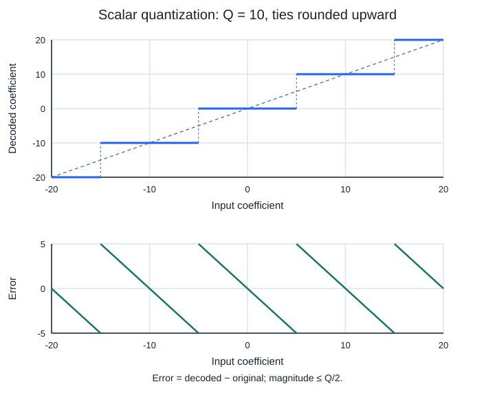
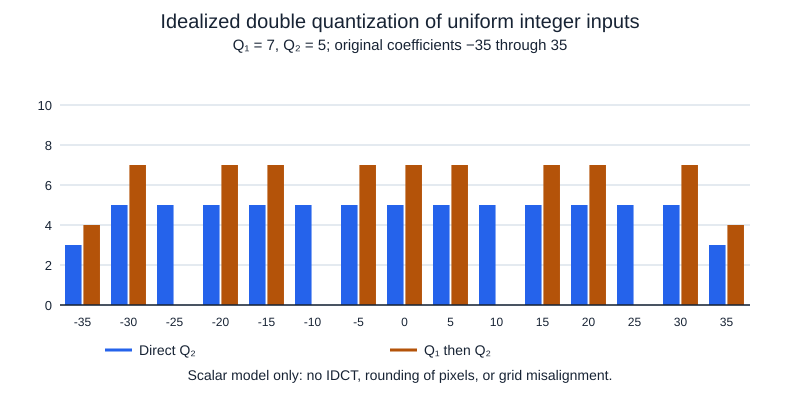

# Week 3, Day 2 — Quantization, Information Loss, and Forensic Traces of Compression and Resampling

*90-minute lecture. Source: Week 3 of `syllabus/weekly-schedule.md` ("Compression, Quantization, and Information Loss"), with `syllabus/technical-notes.md` and `syllabus/course-overview.md`.*

> **Assumptions (flagged):**
> - The quantization table is the commonly cited example luminance table; quality settings scale it. Real files carry their own tables (readable in the JPEG header), so verify specifics before class.
> - The double-JPEG and resampling-trace descriptions are well-known forensic ideas in outline form (periodic artifacts in coefficient histograms; periodic correlations between neighboring pixels). They are presented qualitatively; the syllabus gives only the topic titles. Cite primary sources (see `syllabus/references.md`) before using specific methods.
> - Forensic detectors give evidence of *processing history*, not proof of intent. The legal standards are Weeks 8–9; only a one-line pointer here.
> - $f:\mathbb{R}^2\to\mathbb{R}^k$ is not assumed continuous. Timings are suggestions.

## Learning Objectives

By the end of this session students can:

1. Define DCT-coefficient quantization and show that it is many-to-one (non-injective).
2. Explain how lossy compression turns an invertible transform into a noisy, non-injective mapping, and why this limits unwarping (Week 2).
3. Describe why double JPEG compression leaves detectable traces.
4. Describe why resampling (Weeks 1–2) leaves periodic traces, and how that connects to interpolation as filtering.

## Timed Outline (90 min)

| Min | Segment |
|-----|---------|
| 5 | Recap of Day 1 (YCbCr, subsampling, block DCT) |
| 25 | Quantization: definition, tables, rounding error |
| 10 | Information loss: non-injectivity and its effect on inverse problems |
| 5 | Break |
| 20 | Double JPEG compression and detection |
| 15 | Resampling traces |
| 10 | Putting it together; in-class activity; lab preview |
| **90** | **Total** |

## Content Notes

### 1. Recap (5 min)
The block DCT is bijective; the only lossy steps are chroma subsampling and quantization.

### 2. Quantization (25 min)
Each DCT coefficient $G[u,v]$ is divided by an entry $Q[u,v]$ of a quantization table and rounded; decoding multiplies back:

$$
G_q[u,v] = \left\lfloor \frac{G[u,v]}{Q[u,v]} + \frac12 \right\rfloor \text{ (stored)}, \qquad \tilde{G}[u,v] = Q[u,v] G_q[u,v] \text{ (decoded)}.
$$

- The stored value is the integer nearest to $G/Q$ (ties rounded up; codecs differ in tie handling).
- Error: $|G[u,v]-\tilde{G}[u,v]|\le Q[u,v]/2$. Large $Q$ at high frequencies means coarse steps there (the visual system is less sensitive to fine detail).
- **Non-injective:** all $G$ values in an interval of width $Q$ map to the same stored integer. Many different images decode identically, so the map from images to JPEG data is many-to-one, and no inverse exists (Week 1 classification: destructive).
- Many high-frequency coefficients round to $0$ ("zeroed out"), which is where the compression comes from.
- **Sharp edges/text:** the many non-negligible high-frequency coefficients of an edge block are all perturbed, so the reconstructed block shows ringing near the edge (Gibbs-like harmonics), which is the Week 1 teaser made precise. Smooth regions suffer little.
- Quality setting scales $Q$: lower quality means bigger steps and more loss.

*Illustration 1. Ideal scalar quantization with Q = 10 and ties rounded upward. The error is the decoded value minus the original value.*

### 3. Consequences for inverse problems (10 min)
- Week 2's swirl inverse assumed exact pixel values. If the swirled image was saved as JPEG, the data we hold is $\tilde f$, differing from the true values by quantization noise of size up to $Q/2$ per coefficient.
- Unwarping applies a spatially varying resampling, so quantization noise is moved around and amplified or smeared; the blocks no longer align with the grid. Hence "practical inverses are noisy approximations" (`syllabus/technical-notes.md`).
- This foreshadows Weeks 4–7: noise and non-injectivity limit what any deconvolution can recover.

### 4. Double JPEG compression (20 min)
Suppose an image is compressed with table $Q_1$, decoded (and possibly edited), then compressed again with $Q_2$.

- After the first compression, decoded DCT coefficients (if the block grid is unchanged) lie near multiples of $Q_1[u,v]$.
- Re-quantizing with $Q_2$ maps these onto a new lattice. When the step sizes are incommensurate, some quantized bins receive more first-generation lattice points than others, so the coefficient histogram shows periodic peaks or gaps (assumed standard observation).
- Detection idea: histograms of $G[u,v]$ for a given frequency; periodicity suggests double compression; estimating $Q_1$ may reveal the original quality.
- Caveats: the effect disappears if the image was cropped or warped so that the 8×8 grid misaligns (this ties directly to Week 2 geometric edits); images from different cameras/software have different tables; false positives occur.
- Forensic reading: evidence the file was recompressed, not proof of tampering by itself.

~~~mermaid
flowchart TD
A[Reference raster] --> B[JPEG encode at Q2]
 A --> C[JPEG encode at Q1]
 C --> D[Decode]
 D --> E[Optional crop or resampling]
 E --> F[JPEG encode at Q2]
 B --> G[Inspect coefficient statistics]
 F --> G
 G --> H[Compare compression traces]
~~~

*Figure 1. Single versus double JPEG. Quality and alignment affect detectability; traces alone do not establish manipulation.*

*Illustration 2. Idealized scalar coefficient histograms for Q1 = 7 and Q2 = 5. The experiment assumes a uniform finite integer range and does not simulate a complete JPEG codec.*

### 5. Resampling traces (15 min)
When an image is resized or rotated (Weeks 1–2), each interpolated pixel is a fixed linear combination of its neighbors.

- Interpolated pixels are **correlated** with their neighbors in a periodic pattern across the image (period tied to the scale factor), while original samples are not (assumed standard forensic observation).
- Detectors estimate these inter-pixel linear relations and look for periodic structure (for instance, in the residual spectrum).
- Link to Week 1: the interpolation kernel is a low-pass filter, so resampling also suppresses high frequencies in a characteristic way.
- JPEG compression after resampling weakens the traces; detecting them under compression is hard, which is a motivating theme for the lab.

### 6. Activity and wrap-up (10 min)
Small groups: given a hypothetical pipeline "photo → crop → rotate 3° → resize → JPEG", list where traces of each step may remain, and which later steps hide earlier ones. Lab preview: unwarping under JPEG compression (syllabus: "Lab 2 (Part B)"; confirm the lab numbering locally). Pointer: how such findings are validated and presented belongs to Weeks 8–9.

## Key Definitions Summary

- Quantization: $\tilde G=Q\cdot(\text{nearest integer to } G/Q)$, error at most $Q/2$; non-injective.
- Double JPEG: periodic histogram artifacts when grids align.
- Resampling traces: periodic inter-pixel correlations from interpolation.

## Exercises

1. With $Q=16$, list the stored integers and decoded values for $G=\{-27, -7, 3, 8, 9, 25\}$. Which of these map to the same stored value?
2. If one 8×8 block has all 64 coefficients quantized with the same $Q=10$, bound the worst-case error per coefficient. By orthonormality, bound the total squared error in the block.
3. Show that for the 1D rounding map $x\mapsto Q\cdot\text{round}(x/Q)$, applying it a second time with the same $Q$ changes nothing (idempotent). What does this imply about repeated saves at the same quality?
4. Quantize with $Q_1=7$, then with $Q_2=5$. Which values of the original integer coefficient in $[0,35]$ map to each final value? Explain the unequal bin counts.
5. A JPEG is cropped by 3 pixels from the left and saved again. Why might the double-compression trace be much harder to see?
6. *(Discussion)* An analyst finds resampling traces in one region only. List innocent explanations.
7. *(Optional, Python)* Use Pillow to save an image at two JPEG qualities in sequence; plot a histogram of one DCT coefficient (e.g. via `scipy.fft.dctn` on 8×8 blocks) and look for periodicity.
