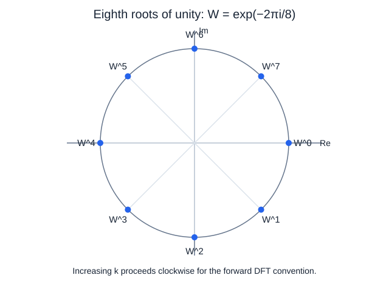
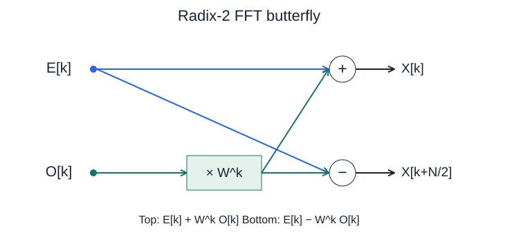
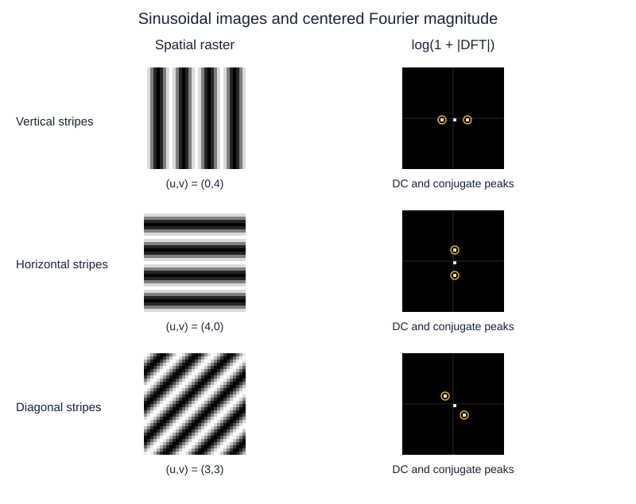

# Week 4, Day 1 — DFT/FFT Fundamentals

*90-minute lecture. Source: Week 4 of `syllabus/weekly-schedule.md` (Lecture 1 = DFT/FFT fundamentals), with `syllabus/technical-notes.md` and `syllabus/course-overview.md`. This is the technically hardest lecture of Part II for the instructor and students alike, so it includes extra instructor support (misconceptions, pacing risks, answer key, demos).*

> **Assumptions (flagged):**
> - Students are fluent with sines/cosines and with transformations of $\mathbb{R}^2$ (Weeks 1–2), but **not** assumed to know the DFT. The course overview now says the DFT is developed from first principles in Week 4.
> - Complex numbers and Euler's formula $e^{i\phi}=\cos\phi+i\sin\phi$ are assumed. Spend 2 minutes recalling them if the room looks unsure.
> - We work with the **discrete** transform of finite arrays. The continuous Fourier transform is mentioned only by analogy (Day 2). Because the DFT acts on arrays, nothing here requires $f:\mathbb{R}^2\to\mathbb{R}^k$ to be continuous; sharp edges and text are important examples.
> - Convention (matches `numpy.fft`): forward transform has no scale factor; the inverse carries $1/N$ (or $1/(MN)$ in 2D). Other books put $1/\sqrt N$ in both; state the convention on the board.
> - Operation counts are order-of-magnitude (constants and cache effects ignored). Timings are suggestions.
> - Week 3's DCT is referred back to as a "cosine cousin"; no DCT derivation is repeated.

## Learning Objectives

By the end of this session students can:

1. Write the 1D DFT and inverse DFT, and explain the DFT as an expansion in an orthogonal basis of complex exponentials (a change of basis).
2. Compute a 4-point DFT by hand and interpret the index $k$ as frequency (cycles per record), including the symmetry $X[N-k]=\overline{X[k]}$ for real input.
3. Define the 2D DFT, show it is separable into row and column transforms, and interpret its basis functions as plane waves.
4. Derive the radix-2 FFT recursion and its $O(N\log N)$ cost.
5. Read a centered log-magnitude spectrum: DC at the center, distance = frequency, orientation perpendicular to image structure, and know what the phase carries.

## Timed Outline (90 min)

| Min | Segment |
|-----|---------|
| 5 | Motivation: why frequency? (bridge from Week 3's DCT and Week 1's low-pass filters) |
| 20 | The 1D DFT as a change of basis: definition, orthogonality, worked $N=4$ example |
| 10 | Properties to know: real signals, Nyquist, shift, Parseval, edges and leakage |
| 5 | Break |
| 15 | The 2D DFT: separability and plane waves |
| 20 | The FFT: divide-and-conquer, derivation, cost |
| 15 | Reading a centered magnitude spectrum; live numpy demos; wrap-up and Day 2 preview |
| **90** | **Total** |

## Instructor Notes: Pacing Risks and Misconceptions

**Pacing risks**
- Segment 2 (orthogonality) tends to overrun. If needed, state the orthogonality sum, do the geometric-series proof only for $N=4$ on the board, and put the general proof in the exercises.
- The FFT derivation (Segment 6) is the part students most often fail to follow. Do the $N=4$ example *before* the general derivation, and keep the butterfly picture to one slide.
- If you are behind at the break, cut the Parseval and shift items from Segment 3 (they are in the exercises) and keep Segment 7 intact: reading spectra is what students need for Day 2 and the labs.

**Common student misconceptions (address explicitly)**
1. *"Frequency $k$ means $k$ Hz."* Here $k$ counts cycles per record of $N$ samples, i.e. $k/N$ cycles per sample. There is no physical time unit unless a sampling rate is given.
2. *"The DFT of a real signal is real."* It is complex in general; only the symmetry $X[N-k]=\overline{X[k]}$ holds. The magnitude is what we usually plot.
3. *"High $k$ means high frequency."* Only up to $N/2$ (Nyquist). Index $N-1$ is the same frequency as $-1$ (slowly varying), not the highest.
4. *"The DFT tells you where in the image a feature is."* Basis functions are global; location information lives in the phase. (Misconception test: swap phases between two images in the demo.)
5. *"The spectrum of a photo has a bright cross, so the photo has horizontal and vertical structure."* Often this is an artifact of the implicit periodic extension (the left/right and top/bottom borders do not match), not scene content.
6. *"The FFT is an approximation of the DFT."* It computes the DFT **exactly** (up to floating-point rounding), only faster.
7. *"The DFT needs a continuous (smooth) signal."* No. Any finite array has a DFT; a jump just spreads energy across many frequencies (slowly decaying spectrum).

## Content Notes

### 1. Motivation (5 min)
- Week 1: interpolation kernels act as low-pass filters, "attenuating high spatial frequencies". Week 3: the DCT shows smooth blocks are compact in a cosine basis. We now make "frequency" precise for whole images.
- Today's goal is a tool, not a theory: write an array as a sum of simple waves, and compute it fast. Day 2 uses it to turn blur (a convolution) into multiplication.

### 2. The 1D DFT as a change of basis (20 min)
Let $x=(x[0],\dots,x[N-1])$ be a sequence (a row of pixels, say). Define $W=e^{-2\pi i/N}$ (an $N$-th root of unity, $W^N=1$). The DFT and its inverse are

$$
X[k]=\sum_{n=0}^{N-1}x[n]\,W^{kn},\qquad x[n]=\frac1N\sum_{k=0}^{N-1}X[k]\,W^{-kn}.
$$

**Intuition (say this first).** The functions $e_k[n]=e^{2\pi i kn/N}=\cos(2\pi kn/N)+i\sin(2\pi kn/N)$ are $N$ sampled waves; $e_k$ completes $k$ cycles over the $N$ samples. The inverse formula says *$x$ is a weighted sum of these waves*, with weights $X[k]/N$. The forward formula says *to find the weight of wave $k$, correlate $x$ with that wave*, i.e. take $\sum_n x[n]\,\overline{e_k[n]}$.

**Why it works: orthogonality.** For integers $k,l$:

$$
\sum_{n=0}^{N-1}e_k[n]\,\overline{e_l[n]}=\sum_{n=0}^{N-1}\big(e^{2\pi i (k-l)/N}\big)^n=
\begin{cases}N,&k\equiv l \pmod N,\\[2pt]0,&\text{otherwise.}\end{cases}
$$

*Derivation.* Let $q=e^{2\pi i(k-l)/N}$. If $k\equiv l\pmod N$ then $q=1$ and the sum is $N$. Otherwise $q\neq1$ but $q^N=1$, so by the geometric series $\sum_{n=0}^{N-1}q^n=\dfrac{1-q^N}{1-q}=0$.

Consequently, putting the vectors $e_0,\dots,e_{N-1}$ as columns, $\frac1{\sqrt N}\big(e_0\ \cdots\ e_{N-1}\big)$ is a unitary matrix. In matrix form $X=\mathcal{W}x$ with $\mathcal{W}_{kn}=W^{kn}$ and $\mathcal{W}^{-1}=\frac1N\overline{\mathcal{W}}$. This is the "change of basis" statement: **the DFT is a bijection $\mathbb{C}^N\to\mathbb{C}^N$**, exactly as for the DCT in Week 3 and the invertible matrices in Week 1. No information is lost by the transform itself.

**Worked example, $N=4$** (here $W=e^{-2\pi i/4}=-i$, so $W^{kn}=(-i)^{kn}$):

Take $x=(1,2,3,4)$.

- $X[0]=1+2+3+4=10$ (the sum; $k=0$ is the DC term, $X[0]/N$ is the mean).
- $X[1]=1+2(-i)+3(-i)^2+4(-i)^3=1-2i-3+4i=-2+2i$.
- $X[2]=1+2(-1)+3(1)+4(-1)=-2$.
- $X[3]=1+2(-i)^3+3(-i)^6+4(-i)^9=1+2i-3-4i=-2-2i$.

So $X=(10,\,-2+2i,\,-2,\,-2-2i)$. Check the inverse at $n=0$: $\frac14(10+(-2+2i)+(-2)+(-2-2i))=\frac14\cdot4=1=x[0]$. ✓

**Interpretation.** $|X[k]|$ is the strength of wave $k$; $\arg X[k]$ is its phase (shift). For $x[n]=\cos(2\pi k_0n/N)$ with $0<k_0<N/2$: $X[k_0]=X[N-k_0]=N/2$ and all other $X[k]=0$. (Because $\cos\phi=\tfrac12(e^{i\phi}+e^{-i\phi})$, and $e^{-2\pi i k_0n/N}=e_{N-k_0}[n]$.)



*Illustration 1. The eight roots of unity under the forward DFT convention. Increasing the exponent rotates clockwise.*

### 3. Properties to know (10 min)
- **Real input.** If $x$ is real, $X[N-k]=\overline{X[k]}$. So only $k=0,\dots,\lfloor N/2\rfloor$ are independent; the rest are mirrors. (Check with the example: $X[3]=\overline{X[1]}$.)
- **Nyquist.** The highest distinct frequency is $k=N/2$ (alternating $+1,-1,\dots$), i.e. 2 samples per cycle. Higher "frequencies" alias to lower ones: $k$ and $k+N$ give the same samples $e_k$. This is the same aliasing we saw with nearest-neighbor resampling.
- **Circular shift.** If $y[n]=x[(n-n_0)\bmod N]$ then $Y[k]=W^{kn_0}X[k]$. Shifting changes phase only; $|Y[k]|=|X[k]|$. (Proof: exercise 3.)
- **Parseval.** $\sum_n|x[n]|^2=\frac1N\sum_k|X[k]|^2$: energy is preserved up to the convention factor. (Exercise 5.)
- **Edges and leakage (not-continuous $f$).** A sampled step (a sharp edge, as in text) has $|X[k]|$ decaying only like $1/k$: many frequencies are needed. If you drop the high-frequency terms, the reconstruction rings near the jump (Gibbs phenomenon), the same mechanism behind JPEG ringing in Weeks 1 and 3. A smooth signal has rapidly decaying $X[k]$.
- **Implicit periodicity.** The DFT treats $x$ as one period of an infinite periodic signal. If $x[0]$ and $x[N-1]$ differ a lot, that wrap-around is an artificial jump and creates a spread of high frequencies (spectral leakage). This is the origin of the "cross" artifact in 2D and of the wrap-around pitfalls in Day 2.

### 4. The 2D DFT (15 min)
For an $M\times N$ array $I[m,n]$ (one channel at a time; $k$ channels are transformed independently):

$$
F[u,v]=\sum_{m=0}^{M-1}\sum_{n=0}^{N-1}I[m,n]\,e^{-2\pi i\left(\frac{um}{M}+\frac{vn}{N}\right)},\qquad
I[m,n]=\frac1{MN}\sum_{u=0}^{M-1}\sum_{v=0}^{N-1}F[u,v]\,e^{2\pi i\left(\frac{um}{M}+\frac{vn}{N}\right)}.
$$

(Convention: $u$ indexes the row direction $m$, $v$ the column direction $n$; matches `numpy.fft.fft2`.)

**Basis functions are plane waves.** $e^{2\pi i(um/M+vn/N)}$ has constant phase along lines $um/M+vn/N=\text{const}$. Its real part is a sinusoidal grating: spatial frequency $\sqrt{(u/M)^2+(v/N)^2}$ cycles per pixel, oscillating in the direction of $(u/M,v/N)$, with stripes perpendicular to that direction. (A grating with intensity varying along $n$ only, i.e. vertical stripes, has $u=0$.)

**Separability (derivation).** Factor the exponential:

$$
F[u,v]=\sum_{m=0}^{M-1}e^{-2\pi i\,um/M}\left(\sum_{n=0}^{N-1}I[m,n]\,e^{-2\pi i\,vn/N}\right).
$$

The inner sum is the 1D DFT of row $m$ (length $N$), producing an intermediate array $R[m,v]$. The outer sum is then the 1D DFT of column $v$ of $R$ (length $M$). Hence: **2D DFT = 1D DFTs along every row, then 1D DFTs along every column** (the order does not matter).

Cost (with $M=N$): direct double sum for every $(u,v)$ costs $\sim(MN)^2=N^4$; separable with naive 1D DFTs costs $\sim 2N\cdot N^2=2N^3$; separable with the FFT costs $\sim 2N\cdot N\log_2N$.

A consequence of separability worth stating: if $I[m,n]=a[m]\,b[n]$ (an outer product), then $F[u,v]=A[u]\,B[v]$ (exercise 6).

~~~mermaid
flowchart TD
A[M x N spatial samples] --> B[Length-N DFT of every row]
 B --> C[Intermediate row spectra]
 C --> D[Length-M DFT of every column]
 D --> E[M x N frequency coefficients]
~~~

*Figure 1. Separable two-dimensional DFT. Separability permits either row-first or column-first evaluation.*

### 5. The FFT (20 min)
The matrix-vector product $X=\mathcal{W}x$ costs $N^2$ complex multiplications. The FFT (Cooley–Tukey, radix-2) computes **exactly the same $X$** using $O(N\log N)$ operations, by exploiting the structure of $W^{kn}$. Take $N$ even and split $x$ into even- and odd-indexed samples. Write $n=2r$ or $n=2r+1$:

$$
X[k]=\sum_{r=0}^{N/2-1}x[2r]\,W^{2rk}+W^{k}\sum_{r=0}^{N/2-1}x[2r+1]\,W^{2rk}.
$$

Now $W^{2}=e^{-2\pi i/(N/2)}$ is the primitive $N/2$-th root of unity, so each sum is an $(N/2)$-point DFT, $E[k]$ of the even samples and $O[k]$ of the odd samples:

$$
X[k]=E[k]+W^{k}O[k],\qquad k=0,\dots,N-1,
$$

where $E,O$ are periodic with period $N/2$ (the DFT of an $N/2$-point sequence repeats). Use $W^{k+N/2}=-W^{k}$ (since $W^{N/2}=e^{-i\pi}=-1$) to get, for $k=0,\dots,N/2-1$:

$$
\boxed{X[k]=E[k]+W^{k}O[k],\qquad X[k+N/2]=E[k]-W^{k}O[k].}
$$

This "butterfly" yields two outputs from one multiplication $W^kO[k]$.

**Cost.** Let $T(N)$ be the cost. Two half-size DFTs plus $N/2$ twiddle multiplications and $N$ additions:

$$
T(N)=2\,T(N/2)+cN\ \Longrightarrow\ T(N)=cN\log_2N+N\,T(1).
$$

(Unroll: $\log_2N$ levels, each costing $cN$.) For $N=1024$: $N^2\approx10^6$ vs. $\tfrac N2\log_2N=5120$ complex multiplications (about $200\times$ fewer); for a $512\times512$ image the saving is far bigger (see exercise 7).

**Worked example, $N=4$, $x=(1,2,3,4)$** (continuing the earlier example):
- Even samples $(1,3)$: $E=(1+3,\ 1-3)=(4,-2)$. Odd samples $(2,4)$: $O=(6,-2)$.
- $W^0=1$, $W^1=-i$. $X[0]=E[0]+O[0]=10$; $X[2]=E[0]-O[0]=-2$.
- $X[1]=E[1]+W^1O[1]=-2+(-i)(-2)=-2+2i$; $X[3]=E[1]-W^1O[1]=-2-2i$. ✓ Matches the direct computation.

**Practical remarks (flagged as standard facts).**
- Radix-2 needs $N$ a power of two, but libraries (e.g. `numpy.fft`) handle other sizes with mixed-radix or other algorithms; sizes with only small prime factors are fast, large prime sizes are slow. This matters for zero-padding choices on Day 2.
- The inverse FFT is the same algorithm with $W^{-1}$ and a factor $1/N$.
- 2D: apply the 1D FFT along rows and columns (separability), cost $O(MN\log(MN))$.

~~~mermaid
flowchart TD
A[Length-N sequence, N a power of two] --> B{N = 1?}
 B -->|Yes| C[Return single sample]
 B -->|No| D[Split even and odd indices]
 D --> E[Recursively compute even DFT]
 D --> F[Recursively compute odd DFT]
 E --> G[Combine with twiddle factors and butterflies]
 F --> G
 G --> H[Return length-N DFT]
~~~

*Figure 2. Radix-2 FFT recursion. Each branch has half the input length; linear work in the combination stage yields O(N log N) overall.*



*Illustration 2. A radix-2 butterfly combines the even and odd DFT coefficients through a twiddle factor, a sum and a difference.*

### 6. Reading a centered magnitude spectrum (15 min incl. demos)
Raw `fft2` output puts the DC term $F[0,0]$ at the corner and negative frequencies in the second half of each axis. `fftshift` rearranges so that $F[0,0]$ is at the center. Because dynamic range is huge, display $\log(1+|F|)$.

Reading rules (assumed standard, demonstrate on test images):
1. **Center = mean brightness (DC).** Distance from center = spatial frequency. Energy near the center = smooth content; far from center = fine detail, edges, noise.
2. **Direction.** Spectral energy lies along the direction in which the image *varies*, so image edges and stripes produce a line in the spectrum **perpendicular** to the edges. Vertical stripes give peaks on the horizontal-frequency axis.
3. **Sharp edges and text** produce long streaks and slowly decaying spectra; smooth gradients produce a compact blob. A low-pass filter (Week 1 interpolation, Week 4 blur) darkens the outer region.
4. **Symmetry.** For real images, $|F[-u,-v]|=|F[u,v]|$ (point symmetry about the center), so only half the plane is informative.
5. **Cross artifact.** Bright horizontal and vertical lines through the center usually come from border discontinuities (implicit periodicity). A window (e.g. Hann) or padding with smooth extension reduces it.
6. **Phase carries structure.** Swapping the phase of two images while keeping each magnitude reproduces the image whose *phase* was kept. (Demo A below.)

**Demos (Python / numpy).**

*Demo A: the DFT matrix, orthogonality, and the recursive FFT*
```python
import numpy as np

N = 8
n = np.arange(N); k = n.reshape(-1, 1)
Wm = np.exp(-2j*np.pi*k*n/N)                    # DFT matrix
x = np.random.randn(N)
print(np.allclose(Wm @ x, np.fft.fft(x)))        # True
print(np.allclose(Wm.conj().T @ Wm, N*np.eye(N)))  # orthogonality

def fft_rec(x):
    N = len(x)
    if N == 1:
        return x.astype(complex)
    E, O = fft_rec(x[0::2]), fft_rec(x[1::2])
    w = np.exp(-2j*np.pi*np.arange(N//2)/N)
    return np.concatenate([E + w*O, E - w*O])

print(np.allclose(fft_rec(x), np.fft.fft(x)))    # True
```

*Demo B: centered log spectrum and phase swap* (`img1`, `img2` same-size grayscale float arrays, e.g. a text image and a smooth photo)
```python
import numpy as np
import matplotlib.pyplot as plt

F1, F2 = np.fft.fft2(img1), np.fft.fft2(img2)
S = np.log1p(np.abs(np.fft.fftshift(F1)))        # centered log magnitude
mix = np.fft.ifft2(np.abs(F1) * np.exp(1j*np.angle(F2))).real  # |F1| with phase of img2
fig, ax = plt.subplots(1, 3, figsize=(10, 3))
for a, im in zip(ax, (img1, S, mix)):
    a.imshow(im, cmap="gray"); a.axis("off")
plt.show()
```
Expected: `mix` looks like `img2` (phase carries structure).

*Demo C: timing*
```python
import numpy as np, time
x = np.random.randn(2**12)
n = np.arange(len(x)); Wm = np.exp(-2j*np.pi*np.outer(n, n)/len(x))
t0 = time.time(); Wm @ x; t1 = time.time(); np.fft.fft(x); t2 = time.time()
print(t1 - t0, t2 - t1)   # FFT is orders of magnitude faster
```



*Illustration 3. Three sampled cosine patterns and their analytically computed centered DFT magnitudes. The conjugate peaks identify the direction and frequency of spatial variation.*

### 7. Wrap-up (within the final segment)
Three sentences: (1) the DFT is an invertible change of basis into plane waves; (2) 2D = rows then columns; (3) the FFT computes the same thing in $O(N\log N)$. Preview Day 2: blur is a convolution, and in this basis convolution becomes pointwise multiplication, which will explain why some blurs destroy certain frequencies entirely.

## Key Formulas Summary

- $X[k]=\sum_{n=0}^{N-1}x[n]\,e^{-2\pi i kn/N}$; $x[n]=\frac1N\sum_{k}X[k]\,e^{2\pi i kn/N}$.
- Orthogonality: $\sum_n e^{2\pi i (k-l)n/N}=N$ if $k\equiv l\pmod N$, else $0$.
- Real input: $X[N-k]=\overline{X[k]}$. Shift: $x[n-n_0]\leftrightarrow W^{kn_0}X[k]$. Parseval: $\sum|x|^2=\frac1N\sum|X|^2$.
- 2D: $F[u,v]=\sum_{m,n}I[m,n]\,e^{-2\pi i(um/M+vn/N)}$, separable.
- FFT: $X[k]=E[k]+W^kO[k]$, $X[k+N/2]=E[k]-W^kO[k]$; cost $\sim N\log_2N$.

## Exercises

1. Compute the 4-point DFT of (a) $x=(1,0,0,0)$, (b) $x=(1,1,1,1)$, (c) $x=(1,0,-1,0)$.
2. Compute the 4-point DFT of $x=(1,2,3,4)$ yourself and verify $X[3]=\overline{X[1]}$.
3. Show the circular shift property: if $y[n]=x[(n-n_0)\bmod N]$ then $Y[k]=W^{kn_0}X[k]$. What happens to $|Y[k]|$?
4. Prove the orthogonality relation $\sum_{n=0}^{N-1}W^{(k-l)n}=N\,\delta_{k,l}$ for $k,l\in\{0,\dots,N-1\}$, and use it to prove the inverse DFT formula.
5. Verify Parseval for $x=(1,2,3,4)$.
6. If $I[m,n]=a[m]\,b[n]$, show $F[u,v]=A[u]\,B[v]$.
7. Operation counts (order of magnitude): (a) $N=1024$, direct DFT vs. FFT, in complex multiplications. (b) For a $512\times512$ image, compare the direct 2D sum ($(MN)^2$), separable naive ($MN(M+N)$), and separable FFT ($\approx MN\log_2(MN)$).
8. Run the radix-2 FFT by hand on $x=(1,2,3,4)$ and match it with exercise 2.
9. A $128\times128$ image consists of vertical stripes with period 8 pixels. Where are the nonzero entries of $F[u,v]$ (indices, ignoring the DC term)?
10. A photograph's centered spectrum shows a bright horizontal and vertical cross through the center, although the scene has no particular such structure. Give one explanation and one remedy.
11. A black-and-white image of printed text and a smooth sky photo have the same size. Which has the slower-decaying spectrum, and why? (Connect to Weeks 1 and 3.)
12. *(Python)* Using Demo A, check that `fft_rec` also matches `np.fft.fft` when `x` has complex entries. Then change $N$ to 6 and observe what breaks (radix-2 assumption) and why.

## Instructor Answer Key

1. (a) $X=(1,1,1,1)$ (an impulse contains all frequencies equally). (b) $X=(4,0,0,0)$ (constant = DC only). (c) $X[k]=1-(-1)^k$, so $X=(0,2,0,2)$ (this is $\cos(2\pi n/4)$: $N/2=2$ at $k=1,3$).
2. $X=(10,\,-2+2i,\,-2,\,-2-2i)$; indeed $X[3]=\overline{X[1]}$.
3. $Y[k]=\sum_n x[(n-n_0)\bmod N]W^{kn}$; substitute $m=(n-n_0)\bmod N$, so $n\equiv m+n_0$ and $W^{kn}=W^{km}W^{kn_0}$ (because $W^N=1$). Hence $Y[k]=W^{kn_0}X[k]$ and $|Y[k]|=|X[k]|$ since $|W^{kn_0}|=1$: shifting changes only phase.
4. Geometric series with ratio $q=W^{k-l}$, as in the text. For the inverse: $\frac1N\sum_kX[k]W^{-kn}=\frac1N\sum_m x[m]\sum_kW^{k(m-n)}=\frac1N\sum_m x[m]\,N\delta_{m,n}=x[n]$.
5. $\sum|x|^2=1+4+9+16=30$. $\sum|X|^2=100+8+4+8=120$, and $120/4=30$. ✓
6. $F[u,v]=\sum_m\sum_na[m]b[n]e^{-2\pi i um/M}e^{-2\pi ivn/N}=\big(\sum_ma[m]e^{-2\pi ium/M}\big)\big(\sum_nb[n]e^{-2\pi ivn/N}\big)=A[u]B[v]$.
7. (a) Direct: $N^2=1{,}048{,}576$. FFT: $\tfrac N2\log_2N=5120$ twiddle multiplications (about $200\times$ fewer; some texts quote $N\log_2N\approx10^4$). (b) $MN=2^{18}$. Direct: $(2^{18})^2=2^{36}\approx6.9\times10^{10}$. Separable naive: $2^{18}\cdot2^{10}=2^{28}\approx2.7\times10^8$. Separable FFT: $2^{18}\cdot18\approx4.7\times10^6$. (Constants ignored.)
8. See the worked example: $E=(4,-2)$, $O=(6,-2)$, combine with $W^0=1,W^1=-i$ to get $(10,-2+2i,-2,-2-2i)$.
9. Period 8 means 16 cycles across 128 columns, so the stripes vary along $n$ only: $u=0$ and $v=\pm16$, i.e. $F[0,16]$ and $F[0,112]$ (for a pure sinusoidal grating). A 50%-duty square wave also has odd harmonics at multiples $3\cdot16,5\cdot16,\dots$ (taken mod 128) with decreasing magnitude, still on the row $u=0$.
10. Border mismatch: the DFT assumes periodic extension, so the opposite edges create artificial jumps. Remedy: apply a window (Hann/Tukey), or pad/extend with a smooth (e.g. mirrored) border before the transform.
11. Text: it has sharp black/white jumps (not continuous $f$), so its spectrum decays slowly (like $1/k$); the sky has smooth content with fast decay. This is the Week 3 reason block-DCT quantization visibly damages text.
12. `fft_rec` works for complex inputs. For $N=6$ the first split gives length-3 halves, and the next split gives halves of lengths 2 and 1, which the combine step assumes are equal; the output has the wrong length or wrong values (the recursion presumes a power of two). Radix-2 needs an even size at every level; libraries use mixed-radix algorithms for sizes like 6.
