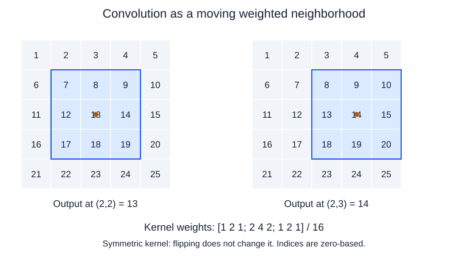
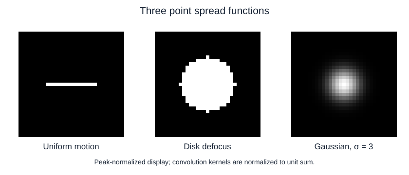
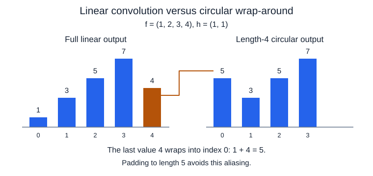
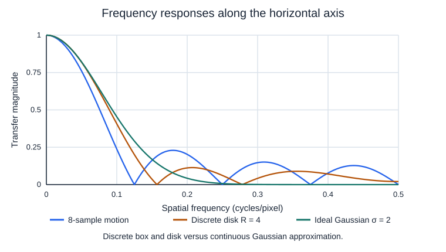

# Week 4, Day 2 — Spatial Convolution, PSFs, and the Convolution Theorem

*90-minute lecture. Source: Week 4 of `syllabus/weekly-schedule.md` (Lecture 2), with `syllabus/technical-notes.md` ("Convolution, Blur, and Deconvolution") and `syllabus/course-overview.md`. Builds directly on Day 1 (DFT/FFT). Includes extra instructor support: misconceptions, pacing risks, answer key, and demos.*

> **Assumptions (flagged):**
> - Day 1 has been taught: 1D/2D DFT, orthogonality, separability, FFT, and the `numpy.fft` convention (forward unscaled, inverse with $1/N$).
> - The degradation model $B=(I*G)+N$ is taken from `syllabus/technical-notes.md`; noise $N$ is *not* analyzed until Week 5. Today it is mentioned only as a reason attenuation matters.
> - PSF formulas below are standard idealizations. Real blur has more structure: motion may be non-uniform or curved, bokeh shapes follow the aperture (e.g. polygons), and turbulence is random. The Kolmogorov long-exposure turbulence model and the Bessel-function transform of a disk are quoted as standard results to **verify** against a reference (e.g. Gonzalez & Woods, listed in `syllabus/references.md`).
> - The image function $f:\mathbb{R}^2\to\mathbb{R}^k$ is **not** assumed continuous: convolution with a PSF is well defined for any bounded $f$ (including sharp edges and text), and the result is smoothed.
> - Pixel PSFs are assumed normalized, $\sum h=1$ (preserves mean brightness), and shift-invariant (the same blur everywhere). Real lenses are shift-variant; flagged as a limitation.
> - Timings are suggestions.

## Learning Objectives

By the end of this session students can:

1. Define discrete and continuous 2D convolution and state its basic properties (linear, shift-invariant, commutative, mass-preserving for normalized PSFs).
2. Write down PSFs for linear motion blur, an out-of-focus (pillbox) disk, and a Gaussian-like turbulence model.
3. State and **derive** the (circular) Convolution Theorem: $G[k]=F[k]\,H[k]$.
4. Explain circular vs. linear convolution, wrap-around, zero-padding size rules, and PSF centering pitfalls.
5. Explain why some blur kernels have exact zeros in their spectra and others merely attenuate, and why zeros make the blur non-injective (lead-in to Week 5).
6. Distinguish commutativity of convolution from commutativity of blur and geometric warping.

## Timed Outline (90 min)

| Min | Segment |
|-----|---------|
| 5 | Recap of Day 1; the question: what does blur do in the frequency basis? |
| 15 | Convolution: definition, intuition, properties, forward model $B=(I*G)+N$ |
| 20 | PSFs: linear motion, out-of-focus disk, atmospheric turbulence |
| 5 | Break |
| 20 | The Convolution Theorem: full derivation, 2D, use in computing |
| 15 | Circular vs. linear convolution; zero-padding and centering pitfalls; demos |
| 10 | Zeros and attenuation of blur spectra; lead-in to Week 5; wrap-up |
| **90** | **Total** |

## Instructor Notes: Pacing Risks and Misconceptions

**Pacing risks**
- The derivation of the theorem (Segment 5) is short but algebraically dense. Do it first for $N=3$ with explicit sums on the board, then generalize with the change of variable.
- Segment 6 (padding pitfalls) is where students lose points in the lab; do not cut it. If time is short, shorten the PSF zoo (Segment 3) to motion + Gaussian, and leave the disk as reading.
- Zeros/attenuation (Segment 7) is the bridge to Week 5; limit it to the $N=4$ example and one plot rather than introducing noise.

**Common student misconceptions**
1. *"Convolution is the same as multiplication."* Only in the frequency domain, and only for **circular** convolution of the DFTs.
2. *"Blur just averages nearby pixels, so it can't remove information."* It can: if the PSF's spectrum has zeros, some components are wiped out exactly (non-injective, Week 1 language).
3. *"`fft2` of a PSF array is the filter."* Only if the PSF is **embedded in an array of the image size** with its origin at index $[0,0]$ (circular shift). Otherwise the output is shifted.
4. *"Using the FFT gives the same result as `convolve2d`."* Only after zero-padding to avoid wrap-around, and after matching boundary conventions.
5. *"Blur by a bigger kernel always has more zeros."* A Gaussian has *no* exact zeros but decays extremely fast; a box has regularly spaced exact zeros. Both are bad to invert, for different reasons.
6. *"Real images are continuous so blur is only a small effect near edges."* Convolution is defined for any bounded $f$; a jump becomes a smooth ramp of width about the PSF size.

## Content Notes

### 1. Recap (5 min)
Day 1: the DFT is an invertible change of basis into plane waves, computable by FFT. Question for today: if blur is "local averaging", what does it do to each plane-wave coefficient? Answer in advance: it multiplies each by a number.

### 2. Convolution (15 min)
**Continuous.** For a PSF $h:\mathbb{R}^2\to\mathbb{R}$ (nonnegative, $\iint h=1$) and a bounded function $f:\mathbb{R}^2\to\mathbb{R}$, not necessarily continuous,

$$
(f*h)(x,y)=\iint f(x-s,\,y-t)\,h(s,t)\,ds\,dt.
$$

Interpretation: each output value is a weighted average of $f$ around $(x,y)$, with weights given by the flipped PSF. A jump in $f$ becomes a smooth ramp whose width is about the PSF's width.

**Discrete.** For arrays $I$ and $G$ (PSF) of finite support,

$$
(I*G)[m,n]=\sum_{i}\sum_{j}I[m-i,\,n-j]\;G[i,j].
$$

**Properties** (all follow from the definition; state them, prove one):
- Linear in $I$; shift-invariant: shifting the input shifts the output; commutative and associative.
- If $\sum G=1$: $\sum(I*G)=\sum I$ (mass is preserved), so the mean brightness is unchanged (exercise 2).
- A point source $I=\delta$ (impulse) gives output $G$: that is why $G$ is called the **point spread function**.

**Convolution and geometric warping.** Recall Week 2's warp $W_T f=f\circ T^{-1}$ for a bijective coordinate transformation $T$. Write $H_h f=f*h$ for convolution with a fixed PSF $h$. Although convolution is commutative in its two arguments, this does not imply that $H_h$ commutes with $W_T$.

For an invertible affine map $T(x)=Ax+b$ on the plane, a change of variables in the convolution integral gives

$$
W_T H_h f=H_{h_A}W_T f,\qquad h_A(x)=\frac{1}{|\det A|}h(A^{-1}x).
$$

Indeed, writing $x$ and $u$ as two-dimensional vectors,

$$
(W_T H_h f)(x)=\int_{\mathbb{R}^2} f(A^{-1}(x-b)-u)h(u)\,du
$$

and substituting $v=Au$ gives the convolution of $W_T f$ with $h_A$. Thus the warp transforms the PSF as well as the image.

For a concrete counterexample, let $h$ be a horizontal motion-blur PSF and let $T$ rotate the plane by $90^\circ$. Blurring a small circular spot and then rotating it produces a vertical smear; rotating the spot first and then applying the same horizontal blur produces a horizontal smear. Hence in general

$$
H_h W_T\ne W_T H_h.
$$

There are important exceptions on the full plane: translations commute with shift-invariant convolution, and rotations commute with radially symmetric PSFs such as an isotropic Gaussian. For nonlinear warps, the transformed blur need not even be shift-invariant. Discrete resampling, cropping, and boundary conventions can further break these ideal continuous identities.

Use the spot example during the properties discussion (about 2–3 minutes); the affine change-of-variables derivation can be assigned as reading if time is short.

**Forward model** (from the technical notes): $B=(I*G)+N$ where $I$ is the true image, $G$ the PSF, and $N$ sensor/quantization noise. Inverse problem (Weeks 5–6): given $B$ and (maybe) $G$, find $I$.



*Illustration 1. Two positions of a moving symmetric weighted neighborhood. The output values are computed from the displayed samples and the normalized kernel.*

### 3. Point spread functions (20 min)
Write each PSF as a normalized nonnegative array/function.

1. **Linear (uniform) motion blur**, length $L$ pixels, direction angle $\varphi$: the image moves during exposure, so each point is smeared along a line segment. Along the horizontal direction:
$$
h[0,j]=\frac1L,\quad j=0,\dots,L-1\ (\text{zero elsewhere}).
$$
For other angles the segment is rasterized (interpolation again!). Assumed: constant velocity over exposure; real camera shake is a curved path.

2. **Out-of-focus blur (pillbox / "bokeh disk")** of radius $R$: a point source becomes a uniform disk,
$$
h(x,y)=\begin{cases}\dfrac{1}{\pi R^2},&x^2+y^2\le R^2,\\[4pt]0,&\text{otherwise.}\end{cases}
$$
Real bokeh depends on the aperture shape (polygonal) and often has bright edges; the pillbox is the standard idealization. Link to Photoshop: *Lens Blur* / *Field Blur* (assumed familiar; behavior varies by version).

3. **Atmospheric turbulence** (long-exposure, approximated): often modeled as Gaussian blur,
$$
h(x,y)=\frac{1}{2\pi\sigma^2}\exp\!\left(-\frac{x^2+y^2}{2\sigma^2}\right).
$$
*Flag:* the Kolmogorov long-exposure model has a transfer function proportional to $\exp\!\big(-c\,\rho^{5/3}\big)$ in radial frequency $\rho$ (to verify); the Gaussian is a convenient simplification. Short exposures are random and not shift-invariant. The same Gaussian is used for "Gaussian blur" in Photoshop and in this course's labs ($\sigma=1.5,3.0,5.0$ in `labs/lab-specifications.md`).

Demo (numpy): build the three PSFs as small arrays and print their sums (should be 1).



*Illustration 2. Representative motion, defocus disk and Gaussian kernels, displayed with peak normalization; the kernels used for convolution are normalized to unit sum.*

### 4. The Convolution Theorem (20 min)

**Statement (1D circular, same length $N$).** Define circular convolution $g=f\circledast h$ by

$$
g[n]=\sum_{m=0}^{N-1}f[m]\;h[(n-m)\bmod N].
$$

Then for the DFT $G[k]=\sum_n g[n]W^{kn}$ with $W=e^{-2\pi i/N}$:

$$
\boxed{G[k]=F[k]\,H[k]}.
$$

**Derivation (intermediate steps).**

$$
\begin{aligned}
G[k]&=\sum_{n=0}^{N-1}\sum_{m=0}^{N-1}f[m]\,h[(n-m)\bmod N]\,W^{kn}\\
&=\sum_{m=0}^{N-1}f[m]\sum_{n=0}^{N-1}h[(n-m)\bmod N]\,W^{kn}\qquad(\text{swap sums}).
\end{aligned}
$$

For fixed $m$, substitute $r=(n-m)\bmod N$. As $n$ runs through $0,\dots,N-1$, $r$ also runs through $0,\dots,N-1$ (each once), and $n\equiv m+r\pmod N$. Since $W^N=1$, $W^{kn}=W^{k(m+r)}=W^{km}W^{kr}$. Hence

$$
G[k]=\sum_{m}f[m]\,W^{km}\sum_{r=0}^{N-1}h[r]\,W^{kr}=F[k]\,H[k].\qquad\blacksquare
$$

(Key idea to stress: the plane waves $e_k$ are **eigenvectors of every circular convolution**: $e_k\circledast h=H[k]\,e_k$. Blur cannot mix frequencies; it only rescales each by $H[k]$.)

**2D.** For $M\times N$ arrays with circular indices, $g[m,n]=\sum_{i,j}f[i,j]\,h[(m-i)\bmod M,(n-j)\bmod N]$ and, by the same computation applied in each index (or by separability from Day 1),

$$
G[u,v]=F[u,v]\,H[u,v].
$$

**Continuous version (statement only).** With $\mathcal{F}$ the Fourier transform, $\mathcal{F}\{f*h\}=\mathcal{F}\{f\}\,\mathcal{F}\{h\}$ for integrable $f,h$ (no continuity of $f$ needed). $H=\mathcal{F}\{h\}$ is the **optical transfer function** (OTF); $|H|$ is the modulation transfer function (standard terminology; assumed). The technical notes write $\mathcal{F}(G)$ for the PSF's transform.

**Why this matters computationally.** Direct 2D convolution with a $P\times P$ PSF costs about $MNP^2$; via FFT: transform, multiply pointwise, inverse transform, about $MN\log(MN)$, independent of $P$ (large PSFs especially). It also explains *deconvolution*: dividing $B$'s spectrum by $H$ (Week 5).

~~~mermaid
flowchart TD
A[Spatial arrays f and h] -->|Circular convolution| B[g = f convolved with h]
 A -->|DFT of each array| C[Frequency arrays F and H]
 C -->|Pointwise multiplication| D[G = F H]
 B -->|DFT| D
~~~

*Figure 1. Convolution theorem. The paths agree for circular convolution under the stated DFT convention. Linear convolution requires appropriate zero-padding and output extraction.*

### 5. Circular vs. linear convolution; padding and centering (15 min)

**Linear convolution** of lengths $L_1$ and $L_2$ has length $L_1+L_2-1$. The DFT product corresponds to **circular** convolution; to make them agree, zero-pad both sequences to a common length $N\ge L_1+L_2-1$.

Worked example: $f=(1,2,3,4)$, $h=(1,1)$.
- Linear: $f*h=(1,3,5,7,4)$.
- Circular with $N=4$ (pad $h$ to $(1,1,0,0)$): $(5,3,5,7)$. The last linear value $4$ **wrapped around** onto index 0 ($1+4=5$).
- With $N=5$ (pad both to length 5): $(1,3,5,7,4)$, matching the linear result.

In images, wrap-around means the blur of the left edge picks up content from the right edge (and top from bottom): the artificial periodic extension from Day 1. Remedies: zero-pad (dark bleed at the border), replicate/mirror pad, then crop.

**Pitfalls checklist (put on a slide).**
1. **Size.** For an $M\times N$ image and $P\times Q$ PSF, pad to at least $(M+P-1)\times(N+Q-1)$ for exact linear convolution. Choose "fast" sizes (powers of two or products of small primes) rather than large primes.
2. **PSF centering.** `fft2(psf_padded)` assumes the PSF origin is at index $[0,0]$. If the PSF is drawn centered in the array, the output is **translated**; use `np.fft.ifftshift` on the padded PSF (or `np.roll` by minus half its size) before `fft2`.
3. **Normalization.** Normalize $\sum h=1$, else brightness changes.
4. **Real part.** For real inputs the imaginary part of `ifft2` should be rounding noise; take `.real` (and check it is tiny).
5. **Boundary conventions** differ between libraries (`scipy.signal.convolve2d` boundary modes, `cv2.filter2D` border types); validate the FFT pipeline against one reference on a small example.

**Demo (numpy).**
```python
import numpy as np

# 1D wrap-around
f = np.array([1, 2, 3, 4.]); h = np.array([1, 1.])
print(np.convolve(f, h))                                           # [1 3 5 7 4]
N = 4
print(np.fft.ifft(np.fft.fft(f, N) * np.fft.fft(h, N)).real)       # [5 3 5 7] (wrapped)
N = len(f) + len(h) - 1
print(np.fft.ifft(np.fft.fft(f, N) * np.fft.fft(h, N)).real)       # [1 3 5 7 4]

# 2D: PSF to transfer function, with origin at [0,0]
def psf_to_otf(psf, shape):
    big = np.zeros(shape)
    big[:psf.shape[0], :psf.shape[1]] = psf
    big = np.roll(big, (-(psf.shape[0] // 2), -(psf.shape[1] // 2)), axis=(0, 1))
    return np.fft.fft2(big)

def blur(img, psf):
    return np.fft.ifft2(np.fft.fft2(img) * psf_to_otf(psf, img.shape)).real   # circular!
```



*Illustration 3. Linear and circular convolution of the worked example above. The final linear sample wraps into the first circular sample when the FFT length is four.*

### 6. Zeros and attenuation of blur spectra (10 min)

**Motion blur: exact zeros.** The 1D box $h[n]=1/L$ for $n=0,\dots,L-1$ (zero-padded to length $N$) has, for $k\ne0$,

$$
H[k]=\frac1L\sum_{n=0}^{L-1}W^{kn}=\frac1L\cdot\frac{1-W^{kL}}{1-W^{k}},\qquad
|H[k]|=\frac{\left|\sin(\pi kL/N)\right|}{L\left|\sin(\pi k/N)\right|}.
$$

(Use $|1-e^{-i\theta}|=2|\sin(\theta/2)|$ with $\theta=2\pi kL/N$ in the numerator and $\theta=2\pi k/N$ in the denominator.) The numerator vanishes whenever $kL/N$ is an integer, i.e. at $k=jN/L$ (for those $j$ giving integer $k$). So **a uniform motion blur has exact spectral zeros**, regularly spaced; in 2D they form lines perpendicular to the motion direction (for horizontal motion, lines $v=jN/L$ for every $u$).

**Consequence (non-injectivity).** If $H[k_0]=0$, then $G[k_0]=F[k_0]\cdot0=0$ whatever $F[k_0]$ is: that frequency of the true image is *erased*. Two images differing by a wave $e_{k_0}$ produce identical blurred images, so the (circular) blur is **not injective** (Week 1 vocabulary: destructive, not bijective). The missing components cannot be recovered by *any* method without prior assumptions.

**Out-of-focus disk.** The continuous Fourier transform of a pillbox of radius $R$ is $\dfrac{2J_1(2\pi R\rho)}{2\pi R\rho}$ ($J_1$ the Bessel function of the first kind, $\rho$ radial frequency; standard result, to verify), with **ring-shaped zeros**, the first at $\rho\approx0.61/R$.

**Gaussian: no exact zeros, but catastrophic attenuation.** The continuous transform of the Gaussian $h$ above is $\exp(-2\pi^2\sigma^2\rho^2)$ ($\rho$ in cycles per pixel). It is never zero but decays faster than any power; for $\sigma=3$ and $\rho=0.25$ it is about $1.5\times10^{-5}$, far below the $1/255\approx0.0039$ step of 8-bit data. Frequencies attenuated by such factors are not erased exactly but are buried below quantization and noise.

**Lead-in to Week 5.** Naive inversion divides by $H$: $\hat F[k]=B[k]/H[k]$. At zeros this is division by zero; near zeros/at strong attenuation it multiplies the noise spectrum $N[k]$ by $1/H[k]$, which may be huge (this is the "noise explosion", technical notes). Motion and defocus blur have structured, partly recoverable spectra; Gaussian blur destroys high frequencies smoothly and fatally.

**Demo (numpy/matplotlib).** Plot $\log(1+|H|)$ (centered) for a motion PSF ($L=15$), a disk ($R=7$), and a Gaussian ($\sigma=3$) on a $256\times256$ grid; mark the zero lines/rings.



*Illustration 4. Horizontal frequency responses for an eight-sample motion kernel, a discrete radius-four disk and an ideal continuous Gaussian with standard deviation two pixels.*

### 7. Wrap-up
Three sentences: (1) blur is convolution with a PSF; (2) in the DFT basis convolution is pointwise multiplication $G=FH$, valid for *circular* convolution, so pad; (3) zeros or tiny values of $H$ erase or bury frequencies, which makes inversion ill-posed (Week 5). Lab 3 Part A (`labs/lab-specifications.md`): synthesize motion and Gaussian blurs with `numpy.fft.fft2`.

## Key Formulas Summary

- Discrete convolution: $(I*G)[m,n]=\sum_{i,j}I[m-i,n-j]\,G[i,j]$; model $B=(I*G)+N$.
- Motion PSF: $1/L$ on a segment; pillbox: $1/(\pi R^2)$ on a disk; Gaussian: $\frac1{2\pi\sigma^2}e^{-(x^2+y^2)/(2\sigma^2)}$.
- Convolution Theorem (circular): $G[u,v]=F[u,v]\,H[u,v]$.
- Padding rule: $N\ge L_1+L_2-1$ per axis for linear convolution via FFT.
- Box spectrum: $|H[k]|=\dfrac{|\sin(\pi kL/N)|}{L\,|\sin(\pi k/N)|}$, zeros at $kL/N\in\mathbb{Z}$.
- Gaussian transform: $\exp(-2\pi^2\sigma^2\rho^2)$.

## Exercises

1. Compute the linear convolution of $(1,2,3)$ with $(1,1)$ and its circular convolution with $N=3$ (pad $h$ to $(1,1,0)$). Compare.
2. Show that $\sum(f*h)=\big(\sum f\big)\big(\sum h\big)$ for finite arrays. What does this say about brightness when $\sum h=1$?
3. For $N=4$ and $h=(\tfrac12,\tfrac12,0,0)$, compute $H[k]$ for $k=0,1,2,3$. Which frequency is annihilated?
4. Using exercise 3, give two different length-4 inputs with the same circular-blurred output. What does this say about injectivity?
5. A horizontal motion blur of length $L=8$ pixels is applied to a $64$-pixel-wide image (circular). At which $v$ indices does $H$ vanish (ignoring the DC term)?
6. Compute the Gaussian transform value $\exp(-2\pi^2\sigma^2\rho^2)$ at $\rho=0.25$ cycles/pixel for $\sigma=1$ and $\sigma=3$. Compare with $1/255$.
7. An $512\times512$ image is to be blurred by a $31\times31$ PSF via FFT with exact linear (non-wrapping) results. What is the minimum FFT size per axis? Suggest a practical size.
8. In `blur()` above, what happens if the PSF is placed in the *middle* of the padded array and `psf_to_otf` omits the `np.roll`? Why?
9. A photograph of printed text is blurred (circularly) by a wide Gaussian and the right-hand border of the text is dark while the left-hand border is white. Describe visible wrap-around artifacts and how to prevent them.
10. *(Discussion)* Why can a motion-blurred license plate be partially recoverable, while a heavily Gaussian-blurred one typically is not? (Use zeros versus attenuation.)
11. *(Python)* Verify the Convolution Theorem numerically: compare `np.fft.fft(blur)` with `np.fft.fft(f)*np.fft.fft(h)` for random $f,h$ of length 16 under circular convolution computed by a direct loop.
12. Give a counterexample to commutativity of a geometric warp and a fixed blur operator. Explain why a rotation and isotropic Gaussian blur do commute on the full plane. *(Extension)* Derive the transformed PSF for an invertible affine warp.

## Instructor Answer Key

1. Linear: $(1,3,5,3)$. Circular $N=3$: wrap the last entry onto index 0: $(1+3,\,3,\,5)=(4,3,5)$. (Both sum to $12=6\cdot2$.)
2. $\sum_{m,n}\sum_{i,j}f[i,j]h[m-i,n-j]=\sum_{i,j}f[i,j]\sum_{m,n}h[m-i,n-j]=\big(\sum f\big)\big(\sum h\big)$. With $\sum h=1$, total (hence mean) brightness is preserved.
3. $H[k]=\tfrac12(1+W^k)$ with $W=-i$: $H[0]=1$; $H[1]=\tfrac12(1-i)$, $|H[1]|=\tfrac{\sqrt2}{2}$; $H[2]=\tfrac12(1+(-1))=0$; $H[3]=\tfrac12(1+i)$. Frequency $k=2$ (the alternating $(1,-1,1,-1)$ wave) is annihilated.
4. $f_1=(0,0,0,0)$ and $f_2=(1,-1,1,-1)$: $f_2\circledast h=(\tfrac12-\tfrac12,\ \tfrac12-\tfrac12,\dots)=(0,0,0,0)$. Different inputs give identical outputs, so the blur is not injective. (Any input $a+c\,(1,-1,1,-1)$ gives the same output for every $c$.)
5. Zeros at $k=jN/L=8j$: $k=8,16,24,32,40,48,56$ (7 values), for all $u$ (lines perpendicular to the motion direction).
6. $\sigma=1$: $\exp(-2\pi^2\cdot0.0625)=\exp(-1.234)\approx0.29$. $\sigma=3$: $\exp(-2\pi^2\cdot9\cdot0.0625)=\exp(-11.10)\approx1.5\times10^{-5}$, much smaller than $1/255\approx3.9\times10^{-3}$.
7. $512+31-1=542$ per axis. Practical: $576=2^6\cdot3^2$ (or $640$, or $1024$); avoid primes and sizes with large prime factors. Crop to the valid region afterward.
8. The result is the correct blur **translated** by about half the PSF size (circularly), because `fft2` assumes the PSF origin at $[0,0]$ and a shifted PSF contributes a linear phase factor (Day 1 shift property).
9. The dark right border bleeds onto the left (and vice versa), causing a dark/bright halo along the image edges; likewise top/bottom. Prevent by zero-padding (or mirror padding) by at least the PSF extent and cropping, i.e. doing a linear convolution.
10. Motion blur has exact zeros only at specific frequencies and a structured spectrum: most other frequencies are kept at moderate gain, so regularized methods can recover much. A wide Gaussian attenuates all high frequencies smoothly to below the quantization/noise floor, so the information is effectively gone.
11. Loop: `g[n] = sum(f[m]*h[(n-m)%N] for m in range(N))`; then `np.allclose(np.fft.fft(g), np.fft.fft(f)*np.fft.fft(h))` is `True`.
12. A quarter-turn rotates a horizontal motion-blur smear into a vertical one, whereas applying horizontal blur after rotating a circular spot gives a horizontal smear. For an isotropic Gaussian and a rotation $A$, $|\det A|=1$ and $h(A^{-1}x)=h(x)$, so the operators commute. The affine identity follows by substituting $v=Au$ in the integral above.
