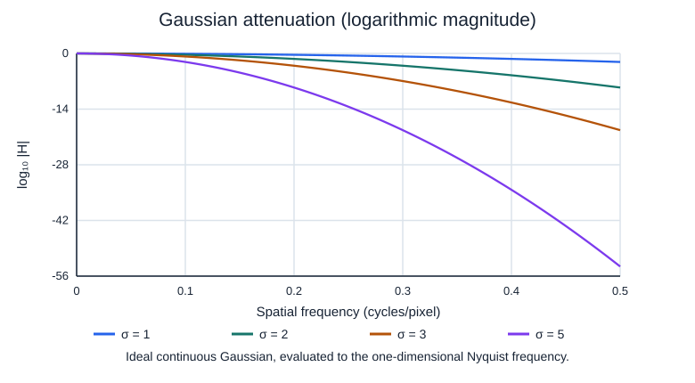
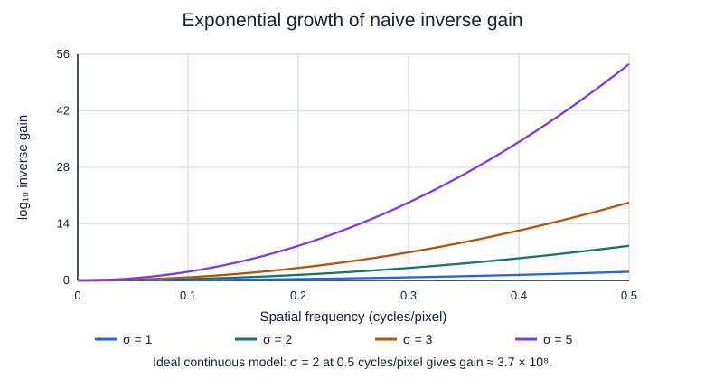

# Week 5, Day 1 — Hadamard Ill-Posedness and Frequency-Domain Noise Explosion

*90-minute lecture. Source: Week 5 of `syllabus/weekly-schedule.md` ("Why Naive Inversion Fails"), with `syllabus/technical-notes.md` and `syllabus/course-overview.md`.*

> **Assumptions and cautions:**
> - Use the continuous, normalized 2D Gaussian PSF as the model for the frequency-response derivation. A sampled and truncated kernel has a discrete DFT that only approximates this response; state the convention used in any numerical demo.
> - A Gaussian transfer function has no exact zeros in the ideal model, but it decays rapidly. This makes its inverse unstable; distinguish that from kernels with exact frequency zeros, which also cause non-uniqueness.
> - In a finite image, the DFT has finitely many bins. The inverse may be algebraically defined if all sampled transfer values are nonzero, but can still be catastrophically ill-conditioned. The continuous model makes the unbounded-instability argument precise.
> - “Noise” includes sensor noise and quantization/compression error. It need not be white or independent of the image.

## Learning Objectives

By the end of this session students can:

1. State Hadamard's three requirements for a well-posed problem: existence, uniqueness, and stability of the solution.
2. Write the blur-plus-noise model in the spatial and Fourier domains and derive the naive inverse-filter estimate.
3. Explain why dividing by a small transfer-function value amplifies noise, even when the blur kernel has no exact frequency zeros.
4. Distinguish loss of uniqueness from instability, and explain why regularization is needed before attempting practical deconvolution.

## Timed Outline (90 min)

| Min | Segment |
|-----|---------|
| 5 | Recap: convolution, PSFs, and the Convolution Theorem (Week 4) |
| 15 | Hadamard's definition and examples of well-/ill-posedness |
| 15 | Forward model and naive inverse filtering |
| 5 | Break |
| 20 | Gaussian frequency response and noise amplification |
| 15 | Demonstration: clean, blurred, noisy, naively restored |
| 10 | In-class diagnosis, wrap-up, and Lab 3 preview |
| **90** | **Total** |

## Content Notes

### 1. Recap and motivating question (5 min)

Week 4 established that spatial convolution becomes multiplication in the Fourier domain. If an image `f` is blurred by a point spread function `h`, then its observed version is `b = h * f` (with the boundary convention specified by the implementation). Ask: if the blur is known, can we recover the original just by undoing that multiplication?

The algebra says “divide.” The central lesson today is that algebraic invertibility alone does not guarantee a useful reconstruction.

### 2. Hadamard well-posedness (15 min)

A problem is **well-posed in the sense of Hadamard** if, for every admissible observation:

1. a solution exists;
2. the solution is unique; and
3. the solution depends continuously on the observation (small data changes cause only small solution changes).

If any condition fails, the problem is ill-posed. In imaging, small observation changes include sensor noise, quantization, and small modeling errors in the PSF.

- **Existence:** noisy observations may not be exactly consistent with the ideal blur model, so an exact solution may not exist in the chosen model class.
- **Uniqueness:** if the blur transfer function is zero at a frequency, image components there are erased; different images can produce the same blurred observation.
- **Stability:** even if a unique exact inverse exists, small perturbations can become large reconstruction errors when the transfer function is very small.

These are different failure modes. A Gaussian blur in the ideal continuous model has a strictly positive transfer function, so exact noiseless recovery is unique in principle. Its rapid decay nevertheless makes the inverse unstable. By contrast, some motion-blur transfer functions have exact zeros, causing non-uniqueness as well as instability near those zeros.

### 3. Forward model and naive inverse (15 min)

Model the observation as

$$
b(x,y) = (h * f)(x,y) + n(x,y),
$$

where `f` is the unknown image, `h` is a known PSF, and `n` collects noise and model error. Taking Fourier transforms gives

$$
B(\nu_x,\nu_y) = H(\nu_x,\nu_y)F(\nu_x,\nu_y) + N(\nu_x,\nu_y).
$$

The **naive inverse filter** divides by the transfer function:

$$
\widehat F_{\mathrm{naive}} = \frac{B}{H}
= F + \frac{N}{H}, \qquad H \ne 0.
$$

The first term is the desired signal; the second is amplified noise. The magnitude of the inverse filter is `1 / |H|`. Where `|H|` is small, even modest `|N|` can dominate. If `H=0`, division is undefined and the lost component cannot be uniquely recovered from the observation alone.

**Observation models: additive Gaussian noise versus Poisson counts.** The algebraic representation of an observation as signal plus error does not imply that the error is statistically independent of the signal. In a simple additive Gaussian model, write $\mu=Hf$ and

$$
b_i=\mu_i+n_i,\qquad n_i\sim\mathcal N(0,\sigma^2),
$$

with independent noise samples of fixed variance, independent of the underlying image. In an ideal photon-counting model with nonnegative expected counts $\mu_i$, instead assume conditionally independent observations

$$
b_i\mid f\sim\mathrm{Poisson}(\mu_i),\qquad \mu_i=(Hf)_i.
$$

For a Poisson variable with mean $\mu$, its probability at integer $k\ge 0$ is $e^{-\mu}\mu^k/k!$ (at $\mu=0$, the count is zero almost surely), and its mean and variance both equal $\mu$. Hence the centered error $n_i=b_i-\mu_i$ has conditional mean zero and conditional variance $\mu_i$. Its distribution depends on the signal; it is not independent additive noise with constant variance.

For example, expected counts of 4 and 100 have standard deviations of 2 and 10 counts, respectively, but relative standard deviations of 50% and 10%. At high counts a Gaussian approximation to Poisson observations may be useful, but its variance is still intensity-dependent. Read noise may add a separate approximately Gaussian component. Week 6 will connect these models to different data-fit objectives.

For a short board example, compare these two count levels with a fixed-variance Gaussian model. The frequency-domain error identity above still holds algebraically when the centered Poisson error is used, but the statistical assumptions and resulting estimators differ.

In an implementation, blindly dividing by exact zeros or machine-level values is not a solution. Replacing small denominators by a threshold prevents numerical overflow but changes the method and acts as an implicit frequency cutoff; it does not restore information that the measurement did not retain.

~~~mermaid
flowchart TD
A[Original image f] --> B[Blur H]
 B --> C[Add observation error]
 D[Noise or centered error n] --> C
 C --> E[Observation b]
 E --> F[Transform to frequency domain]
 F --> G[Divide by nonzero transfer function]
 G --> H[Inverse DFT]
 H --> I[Signal plus amplified error]
~~~

*Figure 1. Forward degradation and inverse noise amplification. The algebraic model is b = Hf + n. Small transfer-function values amplify errors; exact zeros cannot be inverted. The error need not be independent of the signal.*

### 4. Gaussian smoothing and frequency-domain explosion (20 min)

For the normalized 2D Gaussian PSF with spatial standard deviation `σ`,

$$
h(x,y) = \frac{1}{2\pi\sigma^2}\exp\left(-\frac{x^2+y^2}{2\sigma^2}\right),
$$

using spatial frequencies in cycles per unit distance, its Fourier transform is

$$
H(\nu_x,\nu_y) = \exp\left(-2\pi^2\sigma^2(\nu_x^2+\nu_y^2)\right).
$$

This response is positive at every finite frequency, but decays exponentially with squared frequency. The inverse gain is

$$
\frac{1}{|H|} = \exp\left(2\pi^2\sigma^2(\nu_x^2+\nu_y^2)\right),
$$

which grows exponentially. Thus a mathematically nonzero response can still be practically indistinguishable from zero in the presence of noise and finite precision.

**Numerical illustration:** take `σ = 2` pixels and examine one frequency axis, using the ideal continuous formula as an approximation to the sampled case. At `ν = 0.25` cycles/pixel, `H ≈ 0.0072`, so inverse filtering multiplies that frequency's noise by about `139`. At the 1D Nyquist frequency `ν = 0.5` cycles/pixel, the idealized gain is about `3.7 × 10^8`. The exact discrete values depend on how the PSF is sampled, truncated, and transformed, but the trend is the point.

Connect this to Week 3: quantization/compression perturbations are also present in the observation. Smoothing attenuates high-frequency image detail; the inverse filter cannot tell whether a weak high-frequency coefficient is a faint real edge, sensor noise, or quantization error. It boosts all of them together.

*Illustration 1. Logarithmic magnitude of the ideal Gaussian transfer function for several blur strengths. Even without exact zeros, the attenuation can be extreme.*

*Illustration 2. Logarithmic naive inverse gain for the same ideal Gaussian responses. The reciprocal magnifies errors exponentially with squared spatial frequency.*

### 5. Demonstration: where did the “detail” come from? (15 min)

Use a known test image with both smooth areas and sharp edges or fine text. Show the following sequence side by side:

1. original image;
2. Gaussian-blurred image;
3. blurred image with modest additive noise (optionally quantized to 8-bit values);
4. naive inverse-filter output;
5. magnitude spectra before and after inversion.

Keep the PSF and noise realization fixed. Invite students to identify which restored high-frequency patterns are supported by the observation and which are noise amplification (grain, ringing, or extreme oscillation). Explain that clipping the output to the display range can hide how large the numerical values became; inspect a floating-point range or error metric as well as the displayed image. A noise-free reconstruction is a useful control: it can look good at moderate blur while still being sensitive to even tiny perturbations.

**Instructor caution:** use a stable numerical demo and disclose any denominator floor or frequency mask. If a floor is used for visualization, label the result as thresholded inverse filtering, not an exact inverse.

### 6. Activity, synthesis, and Lab 3 preview (10 min)

In pairs, give students three frequency bins with gains `|H| = 1`, `0.1`, and `0.001`, and noise magnitudes `|N| = 0.01`. Have them compute the recovered noise magnitudes and rank the bins by reliability. Then ask which Hadamard condition is implicated if a fourth bin has `H=0`.

Wrap-up: the forward blur can be stable while its inverse is unstable. Naive inversion is therefore not a general restoration method. Week 6 will add prior information or constraints through Wiener filtering, Tikhonov regularization, and iterative restoration. Preview **Lab 3 (Part B)**: compare naive inverse filtering on synthetic and noisy blurred images, report the degradation and explain it using Hadamard's conditions.

## Key Definitions Summary

- **Well-posed (Hadamard):** a solution exists, is unique, and depends continuously on the data.
- **Naive inverse filter:** `F̂ = B/H`; with noise, its error term is `N/H`.
- **Frequency-domain noise explosion:** frequencies attenuated by the forward blur are amplified by the reciprocal transfer function during inversion.
- **Ill-conditioned:** small data or model perturbations can cause large output changes, even when a finite-dimensional algebraic inverse exists.

## Exercises

*Additional observation-model exercise:* For two pixels with expected photon counts 25 and 400, compute their conditional noise variances, standard deviations, and relative standard deviations. Explain why fixed-variance independent additive Gaussian noise is not the exact model.

1. For `b = h * f + n`, derive the Fourier-domain naive inverse and isolate the reconstruction error. State what happens when `H=0`.
2. A frequency component has `|H|=0.02` and noise magnitude `|N|=0.004`. What is the magnitude of the noise in the naively recovered component? What if `|H|=0.0002`?
3. Explain why “the Gaussian Fourier transform is never zero” does not imply stable deconvolution.
4. Match each failure to a Hadamard condition: (a) a motion-blur kernel has an exact frequency zero; (b) a slightly noisy observation has no exact solution under the assumed noiseless model; (c) a tiny perturbation causes a very large change in the recovered image.
5. *(Discussion)* A naively restored image looks sharper than the blurred input. Give two reasons this alone does not show that the recovered details are correct.

## Instructor Answer Sketch

*Observation-model exercise:* Variances are 25 and 400 counts squared; standard deviations are 5 and 20 counts; relative standard deviations are 20% and 5%. The conditional error distribution varies with the underlying expected count.

1. `B=HF+N`, so `F̂=B/H=F+N/H` for `H≠0`; the error is `N/H`. For `H=0`, that component cannot be obtained by division and is not identified by the data.
2. The amplified magnitudes are `0.004/0.02 = 0.2` and `0.004/0.0002 = 20`.
3. The inverse gain `1/|H|` becomes arbitrarily large at high frequencies as `|H|` decays. Any nonzero perturbation there can therefore produce an arbitrarily large reconstruction error in the continuous model; a finite grid can still have a very large condition number.
4. (a) uniqueness; (b) existence; (c) stability.
5. Inversion amplifies noise and modeling errors as well as signal; display clipping or sharpening artifacts can also make an output look crisp without making its fine structure evidentially reliable.
