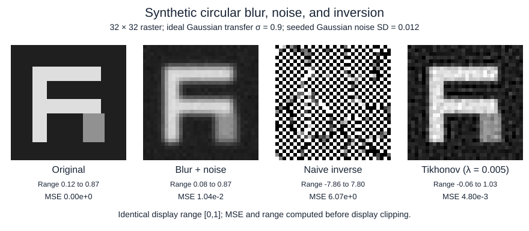

# Week 5, Day 2 — Naive Inverse Filtering: Failure Analysis

*90-minute lecture. Source: Week 5 of `syllabus/weekly-schedule.md` ("Why Naive Inversion Fails"). This session continues the Hadamard and frequency-domain analysis from Day 1 through controlled experiments; regularized restoration methods begin in Week 6.*

> **Assumptions and cautions:**
> - Use synthetic images with a known PSF and noise seed for controlled comparisons. A sampled/truncated PSF and boundary handling affect its discrete transfer function; state those implementation choices.
> - A denominator floor or frequency cutoff is a diagnostic safeguard for naive inverse filtering, not recovery of missing data and not a substitute for the regularization methods in Week 6.
> - Keep numerical arrays separate from display-clipped images. Clipping can conceal severe errors and make a failed reconstruction look plausible.

## Learning Objectives

By the end of this session students can:

1. Design a controlled experiment that isolates the effects of blur, noise, and PSF mismatch on naive inverse filtering.
2. Explain how noise amplification and model error appear in the recovered image and spectrum.
3. Distinguish genuine data-supported detail from ringing, boundary artifacts, and amplified noise.
4. Evaluate a reconstruction using known-reference metrics and residuals rather than visual sharpness alone.
5. Separate calibration and parameter selection from held-out reconstruction evaluation.

## Timed Outline (90 min)

| Min | Segment |
|-----|---------|
| 5 | Recap: Hadamard stability and inverse gain (Day 1) |
| 15 | Design a controlled naive-inversion experiment |
| 20 | Noise and blur-strength sweep |
| 20 | PSF mismatch, boundaries, and display artifacts |
| 5 | Break |
| 15 | Quantitative evaluation and residuals |
| 10 | Lab 3 analysis and bridge to Week 6 |
| **90** | **Total** |

## Content Notes

### 1. Recap (5 min)

For `B = HF + N`, naive inversion produces `F̂ = F + N/H`. Day 1 used Hadamard's stability condition and the Gaussian transfer function to explain why this can be unstable. Today the goal is to investigate that failure systematically and report it honestly, not to introduce a restoration method that claims to solve it.

### 2. Design a controlled experiment (15 min)

Use a reference image containing smooth regions, edges, and fine text. Fix the image, PSF, boundary convention, and random seed; then vary one factor at a time:

- **Blur strength:** weak versus strong Gaussian blur, or two stated motion-blur lengths.
- **Noise level:** no added noise as a control, then increasing additive noise. If quantizing to 8-bit, keep this as a separate experiment.
- **PSF knowledge:** first invert with the exact forward PSF, then with a slightly incorrect width, angle, or support.

Record the clean reference, blurred observation, noise realization, assumed PSF, and all scaling conventions. The noise-free/exact-PSF result is a baseline, not evidence that the inverse is robust.

**Calibration versus held-out evaluation.** A known-reference demonstration is useful for understanding failure mechanisms, but it is not an independent test of a reconstruction procedure chosen using that reference. Use separate synthetic calibration examples to choose thresholds, model assumptions, or other settings. For a held-out test, supply only the degraded observation and the metadata that would legitimately be available in practice; withhold the clean image, hidden PSF parameters in blind cases, and noise realization. Fix the method and selection rule before the test, then record the reconstruction and selected settings before revealing the reference. A predeclared observation-based rule may select settings from the test observation itself.

The instructor or data generator may retain all ground truth privately. Use it afterward to compute reference metrics; do not use those scores to revise the reported test result. If the same reference is used to choose a method and score it, label the result exploratory or an oracle benchmark rather than independent evidence of performance. A new held-out example is needed for a fresh independent evaluation after retuning.

~~~mermaid
flowchart TD
A[Calibration data] --> B[Choose settings or predeclare selection rule]
 C[Independent held-out reference] --> D[Generate degraded observation]
 D --> E[Reconstruct using fixed rule]
 B --> E
 E --> F[Record output and settings]
 C --> G[Reveal reference for evaluation]
 F --> G
 G --> H[Measure errors and residuals]
~~~

*Figure 1. Controlled reconstruction experiment. Keep held-out references and hidden degradation information out of reconstruction and parameter selection.*

### 3. Noise and blur-strength sweep (20 min)

For a fixed PSF and exact assumed transfer function, compare `F̂ = B/H` across noise levels. Inspect the output and centered Fourier magnitude. Students should see that noise concentrated where `|H|` is small can dominate the estimate, producing grain, oscillation, and ringing. Stronger blur lowers more of the transfer spectrum and makes the inverse more sensitive.

A useful diagnostic is to plot the inverse gain `1/|H|` alongside the observed spectrum. Ask students to predict which frequency bands will be unreliable before viewing the reconstruction. A denominator threshold can be tested to prevent division by tiny values, but students must record the threshold: it suppresses those bands and therefore leaves residual blur. It does not reveal the original coefficients.

*Illustration 1. A reproducible synthetic circular-blur experiment with seeded additive Gaussian noise. All panels use the same display range; the reported numerical ranges and MSE precede clipping.*

### 4. PSF mismatch, boundaries, and display artifacts (20 min)

If the true PSF is `H_t` but the inverse uses `H_a`, then

$$
\widehat F = \frac{H_t}{H_a}F + \frac{N}{H_a}.
$$

The first term shows model error; the second shows noise amplification. Even without added noise, a small PSF-width or motion-angle error can produce large frequency-dependent distortion where `H_a` is small.

Also test boundary mismatch. The DFT naturally represents circular convolution; applying a circular inverse to data produced with a different boundary convention can create wraparound seams and edge artifacts. Compare appropriate padding/cropping choices, and connect them to Week 4's circular-versus-linear convolution discussion.

**Operator-order mismatch.** Recall Week 4, Day 2: a geometric warp $W_T$ and fixed convolution operator $H$ need not commute. If the true noise-free forward model is $g=HW_T f$ but the assumed model is $W_T Hf$, even exact knowledge of the warp and PSF does not eliminate model error. When both operators are invertible, the correct formal inverse is $(HW_T)^{-1}=W_T^{-1}H^{-1}$: deblur first, then unwarp. In practice, non-injectivity, instability, and interpolation may prevent exact recovery.

As a short controlled demonstration, compare the two forward orders using a quarter-turn and a horizontal motion-blur PSF on a synthetic square image, with consistent boundary conventions. Inspect their difference before adding noise. This illustrates a model error distinct from PSF mismatch and prepares for the Week 7 reconstruction challenge.

For every run, compare the floating-point estimate with the displayed image. Clipping to `[0,255]`, rescaling each image independently, or changing contrast can make noise look like detail. Report the unclipped range and use a consistent display scale.

~~~mermaid
flowchart TD
A[Original image f] --> B[Geometric warp W]
 A --> C[Convolution H]
 B --> D[Convolution H]
 C --> E[Geometric warp W]
 D --> F[HWf]
 E --> G[WHf]
 F --> H[Compare outputs]
 G --> H
~~~

*Figure 2. Noncommutativity of warp and convolution. Outputs generally differ, although particular operators may commute. Use consistent coordinates and boundaries.*

### 5. Quantitative evaluation and residuals (15 min)

When the synthetic reference is known, compute mean-squared error or PSNR against the reference, and inspect the residual `f̂ - f`. For held-out tests, do this only after recording the reconstruction; distinguish reference error from the observation-space residual available during reconstruction. No single metric proves that a reconstruction is perceptually or evidentially correct: MSE can penalize small shifts heavily, while a visually sharp output can still contain unsupported high-frequency structure.

Plot error against noise level and blur strength. Compare exact-PSF and mismatched-PSF curves. Students should explain why a reconstruction can be good in a noise-free control and fail abruptly once modest noise or model error is introduced. For real unknown images, a reference-based score is unavailable; residuals and sensitivity tests can expose instability but cannot certify the true image.

### 6. Lab 3 analysis and bridge to Week 6 (10 min)

Have students write a short failure analysis for each experiment: what was changed, what amplified, which Hadamard condition was implicated, and what cannot be inferred from the output. Preview Week 6: Tikhonov and Wiener methods will control inverse gain using regularization or noise statistics; Richardson–Lucy and blind deconvolution will introduce different observation models and constraints. Each method will add assumptions, not restore measurements that were erased.

## Key Definitions Summary

- **Noise amplification:** the inverse error term is `N/H`, so weakly transmitted frequencies can dominate.
- **PSF mismatch:** using `H_a` when the true response is `H_t` adds the distortion factor `H_t/H_a`.
- **Sensitivity test:** vary noise or model assumptions while holding other factors fixed; large output changes indicate instability.
- **Display artifact:** clipping or independent contrast scaling can hide numerical failure.

## Exercises

1. Let `|H|=0.02` and `|N|=0.003` at one frequency. Find the noise magnitude after naive inversion. What happens if `|H|` is halved?
2. Starting with `B=H_tF+N`, derive the reconstruction produced by dividing by an assumed `H_a`. Identify the signal-model error and noise term.
3. A noise-free image is reconstructed accurately with the exact PSF, but adding small noise causes strong oscillation. Which Hadamard condition does this demonstrate, and why does the noise-free result not contradict it?
4. Why can a DFT-based inverse create edge or wraparound artifacts if the forward image was formed with a different boundary convention?
5. A clipped reconstruction looks sharper and has lower displayed contrast variation than an unclipped one. Why is that not a valid quality comparison? Name two measurements you would report for a synthetic test.
6. If the forward model is $HW_T$, in which order should the formal inverses be applied? Why might reversing the order fail even with exact parameters?
7. A student chooses the denominator threshold that minimizes error against a test reference and reports that same error as independent test performance. What is wrong with the experiment, and how should it be redesigned?

## Instructor Answer Sketch

1. The amplified noise is `0.003/0.02=0.15`; halving `|H|` doubles it to `0.30`.
2. `F̂=B/H_a=(H_t/H_a)F+N/H_a`. The factor `(H_t/H_a)` distorts the signal; `N/H_a` amplifies noise.
3. Stability. The exact, noise-free case tests only one datum; stability asks whether nearby data produce nearby solutions.
4. The DFT assumes periodic extension, so opposing boundaries can interact. A mismatch between circular and linear convolution or padding conventions introduces discontinuities and wraparound structure.
5. Clipping discards out-of-range values and rescales can mask error. For a known reference, report an unclipped error metric such as MSE/PSNR and inspect the residual or error-versus-noise curve, using consistent scaling.
6. Apply $H^{-1}$ first and $W_T^{-1}$ second, assuming both exist. Reversing the order assumes commutativity, which fails in general (Week 4, Day 2). Actual inversion may also be unstable or impossible.
7. The test reference influenced parameter selection, so the score is not independent and can be optimistically biased. Select the threshold on separate calibration data or by a predeclared observation-only rule; freeze the reconstruction before revealing the held-out reference.
