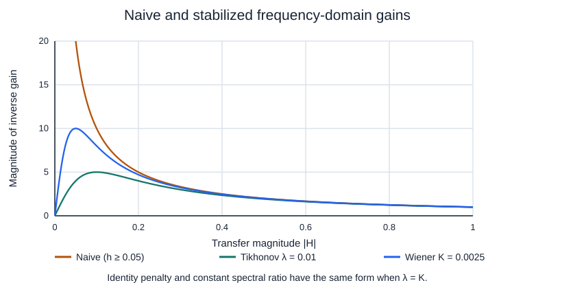
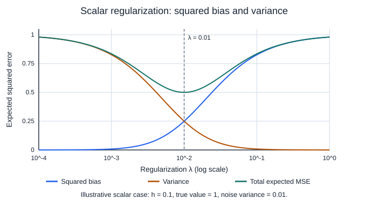

# Week 6, Day 1 — Tikhonov Regularization and Wiener Filtering

*90-minute lecture. Source: Week 6 of `syllabus/weekly-schedule.md` ("Regularized and Iterative Deconvolution in Practice"). Builds on Week 5's diagnosis of noise and model-error amplification.*

> **Assumptions and cautions:**
> - Tikhonov and Wiener filtering stabilize an inverse by adding a penalty or statistical prior; neither recovers components absent from the data.
> - The simple Wiener formula assumes stationary signal/noise statistics and a known PSF. Its power spectra and parameters are estimates that should be validated.
> - Boundary conditions and PSF normalization must be consistent between forward and inverse operators. The frequency-wise formulas below assume compatible convolution conventions.

## Learning Objectives

By the end of this session students can:

1. Derive the Tikhonov solution for a linear blur model and explain the role of its regularization parameter.
2. Derive and interpret the Wiener filter using signal and noise power spectra.
3. Explain how both methods limit the unstable gain of naive inverse filtering.
4. Compare the statistical interpretation of Wiener filtering with the penalty-based interpretation of Tikhonov regularization.
5. Select and evaluate parameters using synthetic references without treating visual sharpness as proof of correctness.

## Timed Outline (90 min)

| Min | Segment |
|-----|---------|
| 5 | Recap: Week 5 inverse-filter failure analysis |
| 20 | Tikhonov objective and frequency response |
| 20 | Wiener estimator and noise-to-signal power ratio |
| 5 | Break |
| 15 | Worked parameter and frequency-bin examples |
| 15 | Parameter selection and controlled evaluation |
| 10 | Method comparison and preview of Day 2 |
| **90** | **Total** |

## Content Notes

### 1. From failure to regularization (5 min)

Week 5 showed that `B=HF+N` leads naive division to `F̂=F+N/H`. A regularized method limits the contribution of frequencies where the inverse would be unreliable. The trade-off is deliberate: reduce noise amplification at the cost of some bias or residual blur.

### 2. Tikhonov regularization (20 min)

For a linear observation `b=Hf+n`, define the estimate as the minimizer

$$
\widehat f_\lambda = \arg\min_f \left\lbrace\|Hf-b\|_2^2 + \lambda\|Lf\|_2^2\right\rbrace, \qquad \lambda>0.
$$

The first term asks the blurred estimate to fit the observation; the second penalizes solutions that violate the chosen prior. As discussed in Week 5, Day 1, a squared-error data term is proportional to the negative log-likelihood for independent additive Gaussian noise of common variance (up to a constant and scale). It is not the exact Poisson negative log-likelihood; Day 2 develops the alternative. With `L=I`, large-amplitude solutions are discouraged. With `L` as a discrete derivative, rapidly varying solutions are penalized, expressing a smoothness preference. The normal equations are

$$
(H^*H+\lambda L^*L)\widehat f=H^*b.
$$

For `L=I` and compatible convolution/DFT conventions,

$$
\widehat F_\lambda(\nu)=\frac{H^*(\nu)}{|H(\nu)|^2+\lambda}B(\nu).
$$

Unlike `1/H`, this gain remains bounded when `|H|` is small. Increasing `λ` makes the estimate more conservative and generally blurrier; decreasing it approaches the unstable inverse. The value is not a universal constant: it depends on blur, noise scale, image scale, and the penalty.

### 3. Wiener filtering (20 min)

Assume the image and additive noise are zero-mean, stationary, and uncorrelated, with power spectral densities `S_f(ν)` and `S_n(ν)`. The linear minimum-mean-square-error Wiener estimate is

$$
\widehat F_{\mathrm W}(\nu)=
\frac{H^*(\nu)}{|H(\nu)|^2+S_n(\nu)/S_f(\nu)}B(\nu).
$$

The ratio `S_n/S_f` is the frequency-dependent noise-to-signal power ratio. Where signal dominates noise, the filter behaves more like an inverse; where noise dominates or blur strongly attenuates the signal, it suppresses the unreliable frequency. A common simplified form uses a constant `K`:

$$
\widehat F_{\mathrm W}=\frac{H^*}{|H|^2+K}B.
$$

`K` approximates a spectral ratio in this simplified model; it is not a universal optimal setting. Increasing it generally reduces noise amplification but leaves more blur. Decreasing it increases apparent sharpness and sensitivity to noise.

The Tikhonov formula with `L=I` and the constant-`K` Wiener formula have the same algebraic form. Their interpretations differ: Tikhonov specifies a penalty, while Wiener filtering specifies an LMMSE estimator under a signal/noise model. If the spectra are known and the assumptions hold, Wiener filtering provides the statistical choice; in practice spectra are estimated, and performance can degrade when those estimates are wrong.

### 4. Worked parameter examples (15 min)

For a frequency bin with `|H|=0.05`, naive inverse gain is `20`. With `K=0.0025`, the simplified Wiener gain is

$$
\frac{|H|}{|H|^2+K}=\frac{0.05}{0.0025+0.0025}=10.
$$

It accepts less high-frequency content, reducing noise sensitivity but leaving more blur. For Tikhonov with `λ=0.01`, the gain is `0.05/(0.0025+0.01)=4`. This example illustrates how the parameter changes the bias–variance balance; it does not identify a universally best value.

*Illustration 1. Comparison of naive, identity-penalty Tikhonov and constant-ratio Wiener gains. The chosen positive regularization parameters differ; equal parameters would give the same gain formula.*

*Illustration 2. Analytical squared bias, variance and expected squared error in a scalar Tikhonov example with fixed truth and additive zero-mean noise. The optimum is specific to this model.*

### 5. Parameter selection and evaluation (15 min)

On synthetic calibration data with known references, sweep several logarithmically spaced parameter values. Plot reference error and inspect residuals; report the selected value and the criterion used. Following Week 5, Day 2, reserve separate held-out test images: choose parameters on calibration data or use a predeclared observation-only selection rule, record the test reconstruction and settings, and only then reveal the test reference. If no held-out data are available, describe reference-tuned results as exploratory or oracle results, not independent test performance. For real unknown data, report sensitivity across plausible settings and avoid claiming that a visually preferred output is the true image.

Check for model mismatch as well as parameter choice: an incorrect PSF or boundary convention can leave structured residuals that no choice of `λ` or `K` repairs. Compare the restored output with the forward projection of the estimate, `H f̂`, and examine the residual `b-H f̂` in addition to the image.

~~~mermaid
flowchart TD
A[Calibration or predeclared observation-only criterion] --> B[Fix parameter or selection rule]
 C[Held-out degraded observation] --> D[Reconstruct]
 B --> D
 D --> E[Record result and chosen parameter]
 F[Withheld reference] --> G[Evaluate after reconstruction]
 E --> G
~~~

*Figure 1. Regularization parameter selection. Do not tune against the held-out reference.*

### 6. Wrap-up and Day 2 preview (10 min)

Both methods make the inverse less sensitive by declining to trust weakly measured frequencies. Their assumptions differ, and both can oversmooth or retain artifacts if the prior, parameter, or PSF is wrong. Day 2 turns to iterative methods: Richardson–Lucy for Poisson observations and constrained blind deconvolution when the PSF is unknown.

## Key Definitions Summary

- **Tikhonov regularization:** minimize data-fit error plus a penalty `λ||Lf||²` that encodes a prior.
- **Wiener filter:** an LMMSE estimator that weights frequency components according to signal and noise power.
- **Regularization parameter:** controls how strongly the estimate favors the prior over exact data fit.
- **Bias–variance trade-off:** reducing sensitivity to noise usually introduces bias or residual blur.

## Exercises

1. For `|H|=0.1`, compare naive inverse gain, Tikhonov gain with `λ=0.01`, and simplified Wiener gain with `K=0.01`.
2. What prior does `L=I` penalize? What changes conceptually if `L` is a discrete gradient operator?
3. Why do the `L=I` Tikhonov and constant-`K` Wiener formulas look the same, yet represent different modeling choices?
4. If increasing `λ` reduces noise but also removes fine text strokes, explain this trade-off and describe a controlled way to choose the parameter on synthetic examples.
5. A restored image looks good but the residual `b-Hf̂` contains strong edges. What might this indicate?

## Instructor Answer Sketch

1. Naive gain is `10`. Tikhonov gain is `0.1/(0.01+0.01)=5`. Wiener gain is also `5` for this constant `K`; the numerical match reflects the formula, not identical assumptions.
2. `L=I` penalizes solution energy. A gradient penalty discourages rapid spatial changes and favors smoother images.
3. Same algebra under special assumptions; Tikhonov is defined by a penalty objective, Wiener by an LMMSE signal/noise model.
4. More regularization reduces noise sensitivity but biases away fine detail. Sweep parameters on known blurred/noisy images, compare reference error and residuals, and keep test data out of tuning.
5. Structured residuals may signal PSF/boundary mismatch, model inadequacy, or a parameter that prevents fitting important observed structure.
