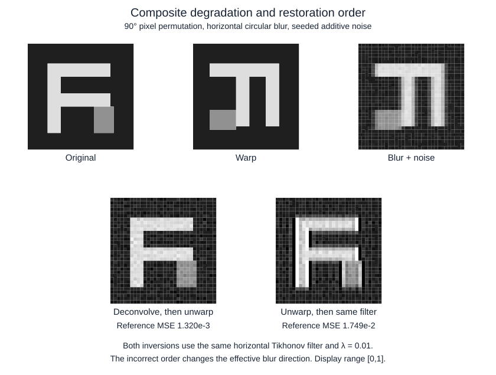

# Week 7, Day 2 — Applied Reconstruction Challenge

*90-minute practical session. Source: Week 7 of `syllabus/weekly-schedule.md` ("Midterm Exam and Applied Reconstruction Challenge"). Consolidates Weeks 1–6 and prepares students for the forensic validation module beginning in Week 8.*

> **Assumptions and cautions:**
> - Use synthetic targets with known ground truth; do not use real identifying information.
> - A plausible-looking reconstruction is not necessarily a faithful reconstruction.
> - Keep ground truth withheld until evaluation. Document all assumptions and distinguish measured results from inferred features.

## Learning Objectives

By the end of this session students can:

1. Formulate a composite forward degradation model using geometric warping, blur, noise, and quantization.
2. Select reconstruction methods appropriate to the degradation and the available information.
3. Recognize when operator ordering, unknown parameters, or boundary conditions invalidate a proposed inverse.
4. Evaluate reconstruction quality using reference-based metrics, residuals, and uncertainty.
5. Explain why successful numerical restoration does not by itself establish forensic reliability.

## Timed Outline (90 min)

| Min | Segment |
|-----|---------|
| 10 | Challenge briefing and experimental methodology |
| 15 | Analysis of degraded test images |
| 20 | Geometric reconstruction and parameter estimation |
| 5 | Break |
| 25 | Deconvolution and regularized reconstruction |
| 10 | Quantitative evaluation against ground truth |
| 5 | Discussion of reconstruction limits and forensic implications |
| **90** | **Total** |

## Content Notes

### 1. Challenge briefing and experimental methodology (10 min)

Provide a small set of degraded synthetic images containing text, geometric patterns, and fictitious license plates. Include isolated degradations and at least one composite degradation. Provide a mixture of known and unknown parameters, with enough information for a meaningful comparison rather than requiring unique blind recovery.

Prepare the data and starter notebook in advance so that students can reuse their implementations from Labs 1–4. Use a common floating-point intensity scale and specify the available metadata and permitted parameter-search ranges.

### 2. Analysis of degraded test images (15 min)

Introduce the composite forward model

$$
g=Q(HW_\theta f+n),
$$

where $f$ is the reference image, $W_\theta$ is a geometric warping operator, $H$ is convolution with a point spread function, $n$ represents additive noise, and $Q$ represents quantization.

For JPEG cases, explicitly extend the model to include the relevant compression and decoding stages. For Poisson-count cases, use an observation drawn from a Poisson distribution with a nonnegative intensity determined by the forward operator, rather than treating Poisson noise as independent additive noise.

Ask students to inspect the available observations and propose plausible degradation models. Record which parameters are known, estimated, or not identifiable. Even if the underlying warp and convolution are invertible, the complete observation process need not be.

Operator order matters in general:

$$
HW_\theta \ne W_\theta H.
$$

Discuss the consequences for reconstruction: for the displayed model, deconvolution before unwarping corresponds to reversing the forward order, but resampling and regularization can make sequential restoration approximate. Do not assume that geometric reconstruction must always precede deconvolution.

~~~mermaid
flowchart TD
A[Hidden synthetic reference] --> B[Geometric warp]
 B --> C[Convolution]
 C --> D[Add noise]
 D --> E[Quantize]
 E --> F[Available observation]
 F --> G[Estimate parameters and select restoration]
 G --> H[Record reconstructed result]
 A --> I[Reveal reference for evaluation]
 H --> I
~~~

*Figure 1. Composite degradation and restoration challenge. Illustrates the additive-noise model. Poisson observations and JPEG require their appropriate forward models.*

### 3. Geometric reconstruction and parameter estimation (20 min)

Reuse the geometric transformation and parameter-estimation methods from Labs 1–2. Compare known-parameter and estimated-parameter cases, documenting interpolation and boundary conventions. Students may estimate warp parameters or test candidate mappings during this segment, then apply the selected restoration sequence in the next segment.

### 4. Deconvolution and regularized reconstruction (25 min)

Reuse the forward and inverse models from Labs 3–4. Compare naive inversion with suitable regularized methods for motion-blur and Gaussian-blur cases. Use Tikhonov or Wiener filtering where the assumptions are appropriate, and Richardson–Lucy for suitable nonnegative Poisson observations. For an unknown PSF, allow a constrained estimation procedure.

Require students to record parameter choices, stopping criteria, operator ordering, and any deviations from the assumed observation model. Select parameters without access to the challenge ground truth, using a separate calibration example or an observation-based criterion.

*Illustration 1. A synthetic experiment comparing restoration orders for a 90-degree pixel permutation followed by horizontal circular blur and additive noise. Both use the same filter; the correct order is specific to the forward model.*

### 5. Quantitative evaluation against ground truth (10 min)

Release the corresponding reference images after students have recorded their reconstruction choices. Compare reference error, PSNR, and, where appropriate, SSIM and text accuracy. Evaluate the forward-model residual before any display-only clipping, with quantization or compression accounted for where relevant. Compare results with a simple baseline and identify evidence of model mismatch.

Ground truth is for evaluation, not retrospective tuning of the reported challenge result. Any later exploratory tuning should be labeled separately.

### 6. Discussion and transition to Week 8 (5 min)

Discuss which features are supported by the observations, which depend on priors or assumptions, and which cannot be reliably recovered. Ask:

> Under what circumstances can a reconstructed image be regarded as evidence about the original image, rather than merely a plausible approximation to it?

Use this question to motivate the next module on digital forensics, chain of custody, and scientific validation.

## Instructor Preparation

- Generate reproducible synthetic data with documented degradation parameters, random seeds, operator ordering, and boundary conventions.
- Include cases of different blur strengths and noise levels, plus a deliberately ambiguous or severely degraded case.
- Provide a separate calibration example and keep challenge reference images and hidden parameters apart from student inputs until evaluation.
- Test the notebook, dependencies, and expected execution time in advance. Avoid requiring a new implementation of every algorithm during the session.
- Use the Week 7 tutorials and completed Lab 4 work to support preparation.

## Suggested Assessment Criteria

| Criterion | Weight |
|-----------|--------|
| Mathematical analysis of the degradation model | 25% |
| Appropriate selection of reconstruction methods | 25% |
| Computational implementation and reproducibility | 20% |
| Quantitative evaluation of reconstruction quality | 15% |
| Recognition of uncertainty and limitations | 15% |
| **Total** | **100%** |

These weights apply to the challenge itself, not to the overall course grade. Award credit for a well-supported conclusion that some information cannot be recovered reliably. Do not reward unsupported identification or visual sharpness alone.

## Deliverable

A reproducible notebook or script with the reconstructed images, documented assumptions and parameters, comparison against the baseline, quantitative evaluation, and a short discussion of the limitations of the reconstruction. Keep the student-facing challenge materials and reference solutions separate from this instructor-facing plan.
