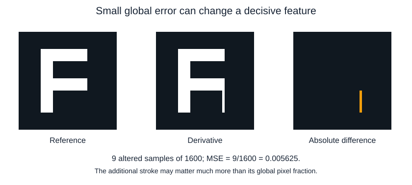
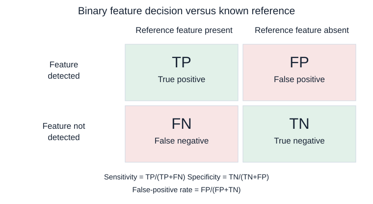
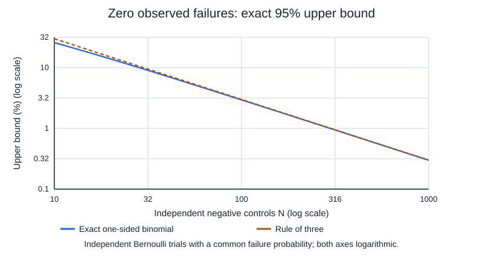
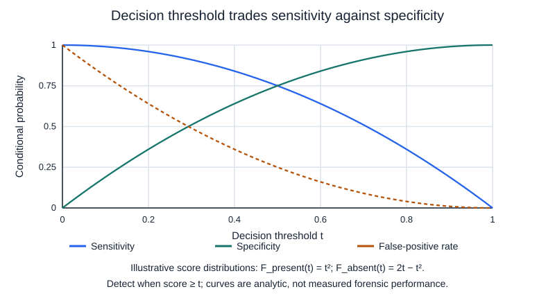

# Week 9, Day 2 — Experimental Validation of Image Reconstruction

*90-minute lecture. Source: Week 9 of syllabus/weekly-schedule.md ("Scientific Validation and Legal Standards"). Builds on Week 8's reproducible forensic pipeline and Day 1's discussion of expert evidence. Prepares for Lab 5 (Part B).*

> **Scope:** Validate a specified method for a specified forensic task and operating domain. Use synthetic or appropriately consented imagery with independently known reference features. A favorable validation result does not establish a particular identification or guarantee legal admissibility. The numerical examples below are illustrative, not measured performance of a real forensic method.

## Learning Objectives

By the end of this lecture students can:

1. Distinguish implementation verification, method validation, and case-specific applicability.
2. Design independent forward-and-reverse experiments with positive and negative controls and withheld ground truth.
3. Define feature-specific measurements and compute sensitivity, specificity, and false-positive rates.
4. Derive the exact one-sided binomial upper confidence bound for zero observed failures and its rule-of-three approximation.
5. Recognize model mismatch, dependent trials, selection bias, and the inverse crime; report the limitations of validation.

## Timed Outline (90 min)

| Min | Segment |
|-----|---------|
| 10 | Verification versus validation |
| 20 | Forward-and-reverse control experiments |
| 15 | Positive and negative controls; experimental design |
| 5 | Break |
| 20 | False-positive rates, sensitivity, and statistical uncertainty |
| 15 | Model mismatch and robustness testing |
| 5 | Reporting limitations and conclusions |
| **90** | **Total** |

## Content Notes

### 1. Verification versus validation (10 min)

Return to Day 1: the proposed expert opinion must have a scientific foundation appropriate to its scope. A hash-verified input and a repeatable processing pipeline are necessary safeguards, but neither measures the probability of recovering a genuine feature.

Distinguish three questions:

| Question | Meaning | Example |
|----------|---------|---------|
| Implementation verification | Does the code implement the specified mathematical method correctly? | Compare FFT-based convolution with direct convolution under the same boundary convention. |
| Method validation | Does the method reliably accomplish its intended forensic task under defined conditions? | Measure recovery and false creation of a distinguishing character stroke. |
| Case-specific applicability | Are the assumptions and conditions of the actual examination adequately represented by validation? | Determine whether the observed blur, compression, noise, and parameter uncertainty fall within the tested domain. |

These are complementary inquiries, not a guarantee of admissibility or a prescribed accreditation procedure.

~~~mermaid
flowchart TD
    A["Specified forensic task and method"] --> B["Verify mathematical implementation"]
    B --> C["Validate performance on independent controls"]
    C --> D["Define supported operating domain"]
    E["Conditions of the submitted image"] --> F["Assess case-specific applicability"]
    D --> F
    F --> G{"Adequately supported?"}
    G -->|Yes| H["Report bounded conclusions and uncertainty"]
    G -->|No or uncertain| I["Restrict conclusion or obtain further validation"]
~~~

*Figure 1. Verification, validation, and applicability are distinct parts of a scientific foundation.*

An algorithm may be implemented exactly and still be inappropriate. For example, a Wiener filter designed for stationary additive noise and spatially invariant blur may not support identification in an image with strong spatially varying motion blur. Reproducibility allows the error to be reproduced; validation is needed to characterize it.

### 2. Forward-and-reverse control experiments (20 min)

**Formal model (8 min).** Let $f$ be an independently known reference image, $A_{\theta}$ a specified degradation operator, and $R_{\lambda}$ a reconstruction method. For a stochastic observation model include a realization $\xi$ of the random variables:

$$
g=A_{\theta}(f;\xi).
$$

$$
\hat f=R_{\lambda}(g).
$$

The control experiment applies the composite operator

$$
C_{\theta,\lambda,\xi}(f)=R_{\lambda}(A_{\theta}(f;\xi)).
$$

Here $\lambda$ denotes all reconstruction settings, possibly including estimated degradation parameters. If these are chosen adaptively, the selection rule is part of the method under test; hidden reference information is not available to that rule. Randomness in reconstruction, if present, is recorded and included in the experimental design.

The degradation model should represent relevant geometric transformations, blur, noise, quantization, and compression from Weeks 1–7. For Poisson-count observations, sample from the specified nonnegative mean rather than adding independent Poisson draws as additive noise.

~~~mermaid
flowchart TD
    A["Independent reference image and known feature labels"] --> B["Apply specified degradation"]
    B --> C["Degraded observation"]
    C --> D["Reconstruct using fixed method or selection rule"]
    E["Separate calibration data"] --> D
    D --> F["Record reconstruction and settings"]
    A --> G["Reveal reference and labels for evaluation"]
    F --> G
    G --> H["Compare pixels and evidential features"]
~~~

*Figure 2. Forward-and-reverse control validation. The reference and hidden degradation information are withheld from reconstruction and parameter selection when the intended examination does not have that information.*

The phrase "forward-and-reverse" does not imply a true inverse. A restoration procedure may return a preferred estimate even when the degradation is many-to-one. The purpose is to measure the behavior of the complete procedure against known truth.

**Feature-specific error (8 min).** Let $\mathcal I$ denote an image space. Define a measurement functional

$$
\Phi:\mathcal I\longrightarrow\mathbb R^k.
$$

For example, $\Phi$ may measure the contrast of a stroke in a registered region, an edge position, or several geometric dimensions. Compare global image error with feature error:

$$
e_{\mathrm{image}}=\|\hat f-f\|_2.
$$

$$
e_{\mathrm{feature}}=\|\Phi(\hat f)-\Phi(f)\|.
$$

The two quantities answer different questions. On an image of $M\times N$ scalar samples, an error of amplitude $\delta$ at just $s$ samples contributes

$$
\mathrm{MSE}=\frac{s\delta^2}{MN}.
$$

For small $s/(MN)$, the global MSE can be small even if the affected samples constitute an entire identifying stroke. PSNR and SSIM remain useful descriptive metrics, but neither by itself validates a feature interpretation.

A simple classroom measurement uses a fixed stroke region $S$ and nearby background region $B$ on a normalized grayscale image $I$:

$$
\phi(I)=\frac{1}{|S|}\sum_{j\in S}I_j
-\frac{1}{|B|}\sum_{j\in B}I_j.
$$

For a bright stroke on a darker background, declare a detection if $\phi(I)\ge t$, with the threshold $t$ established on separate calibration data. Specify region geometry, polarity, normalization, registration, and display processing. For a dark stroke use the opposite contrast convention. This is an illustrative feature detector, not a validated character-recognition method.

If a human examiner rather than a numerical detector interprets a derivative, define the decision categories, viewing conditions, qualifications, and blinding procedure. The tested method then includes the interpretation stage, not just the restoration algorithm.

**Worked ambiguity (4 min).** Suppose two different references differ by a localized feature that is suppressed by the forward operator. Both can lead to very similar observations, while regularization favors one reconstructed structure. A small observation residual does not demonstrate that the selected feature was present.

For the noiseless linear example, if $Hv=0$ then $H(f+v)=Hf$. Even with no exact null space, noise and quantization may make the observations practically indistinguishable. Reuse the Week 8 B-versus-8 example to motivate controls.

*Illustration 1. Synthetic reference and derivative differing only at nine pixels that form a localized stroke. A small global MSE can conceal a task-relevant error.*

### 3. Positive and negative controls; experimental design (15 min)

A positive control contains the predefined feature of interest. A negative control lacks that feature but should still represent relevant alternative structures. Both undergo the same specified degradation and reconstruction procedures.

For the distinguishing stroke example, prepare paired synthetic glyph or geometric targets with and without the stroke. Vary font or target design, contrast, location, blur direction and strength, noise level, compression, and other relevant conditions. Negative controls should include plausible confusable alternatives, not only empty backgrounds.

~~~mermaid
flowchart TD
    A["Positive controls: feature present"] --> C["Apply matched degradation conditions"]
    B["Negative controls: feature absent"] --> C
    C --> D["Reconstruct without access to feature labels"]
    D --> E["Apply predefined feature decision rule"]
    E --> F["Record decisions before revealing labels"]
    F --> G["Compare with independent ground truth"]
    G --> H["Measure true and false detections"]
~~~

*Figure 3. Positive and negative controls test feature recovery and false-feature creation under comparable conditions.*

Additional controls:

- Undegraded reference or identity-operator check: test the basic implementation and feature measurement.
- Unprocessed degraded baseline: measure whether enhancement actually improves the intended task.
- Independent calibration controls: develop the decision threshold and reconstruction settings without using the held-out evaluation images.

Predeclare the unit of analysis (for example, one independent target image), feature definition, decision threshold or selection rule, degradation ranges, primary performance measures, and treatment of inconclusive results. Record the code and parameter versions using the Week 8 audit manifest.

Avoid leakage: split references before generating variants, so that near-duplicates of a target do not appear on both sides of the calibration/test split. The examiner may know the observation and any metadata that would legitimately be available in the intended application, but must not use the clean test reference, feature label, or hidden PSF to select the reported result.

Do not discard unfavorable results or change the criterion after revealing the labels. Exploratory analysis is useful but must be identified separately; a new independent evaluation is needed after tuning.

### 4. False-positive rates, sensitivity, and statistical uncertainty (20 min)

**Confusion matrix (6 min).** For a fixed binary feature decision rule, classify each result against the reference label.

| Decision | Feature present | Feature absent |
|----------|-----------------|----------------|
| Feature detected | True positive (TP) | False positive (FP) |
| Feature not detected | False negative (FN) | True negative (TN) |

~~~mermaid
flowchart TD
    A["Reference feature label"] --> B["Present"]
    A --> C["Absent"]
    B --> D{"Feature detected?"}
    C --> E{"Feature detected?"}
    D -->|Yes| F["True positive"]
    D -->|No| G["False negative"]
    E -->|Yes| H["False positive"]
    E -->|No| I["True negative"]
~~~

*Figure 4. Classification of a binary detection against independently established ground truth.*

Define

$$
\mathrm{Sensitivity}=\frac{\mathrm{TP}}{\mathrm{TP}+\mathrm{FN}}.
$$

$$
\mathrm{Specificity}=\frac{\mathrm{TN}}{\mathrm{TN}+\mathrm{FP}}.
$$

$$
\mathrm{FPR}=\frac{\mathrm{FP}}{\mathrm{FP}+\mathrm{TN}}.
$$

The false-negative rate is one minus sensitivity; the false-positive rate is one minus specificity. These ratios are undefined when their relevant denominators are zero.

For illustration, suppose 80 of 100 positive controls and 5 of 100 negative controls are detected. Sensitivity is 80%, specificity is 95%, and the observed false-positive rate is 5%. These are point estimates from hypothetical counts.

If an inconclusive category is permitted, report it separately for each truth category and declare how it enters the denominators. Do not silently exclude difficult cases. An increase in abstentions may reduce errors at the cost of fewer resolved cases.

**Binomial uncertainty and the rule of three (10 min).** Suppose $N$ independent negative-control trials have the same false-positive probability $p$. Let $X$ be the number of false positives:

$$
X\sim\mathrm{Binomial}(N,p).
$$

The observed rate is $\hat p=X/N$. Under the stated model,

$$
\Pr(X=0\mid p)=(1-p)^N.
$$

To construct the exact one-sided 95% binomial upper confidence bound after observing zero false positives, solve

$$
(1-p_{\mathrm{upper}})^N=0.05.
$$

Thus

$$
p_{\mathrm{upper}}=1-0.05^{1/N}.
$$

More generally, replace 0.05 by $\alpha$ for a one-sided confidence level of $1-\alpha$. This is the zero-count case of the exact Clopper–Pearson interval construction.

For large $N$, expand the exponential:

$$
p_{\mathrm{upper}}=1-\exp\left(\frac{\log 0.05}{N}\right).
$$

$$
p_{\mathrm{upper}}=\frac{-\log 0.05}{N}+O(N^{-2}).
$$

Since $-\log 0.05\approx 2.996$, the familiar approximation is

$$
p_{\mathrm{upper}}\approx\frac{3}{N}.
$$

| Independent negative controls, all without false positives | Exact upper 95% bound | Rule of three |
|------------------------------------------------------------|-----------------------|---------------|
| 10 | 25.89% | 30% |
| 30 | 9.50% | 10% |
| 100 | 2.95% | 3% |
| 300 | 0.994% | 1% |
| 1000 | 0.299% | 0.3% |

The confidence bound is a frequentist procedure, not a posterior probability that $p$ lies below the calculated value. It describes the coverage of the procedure under repeated sampling, subject to the binomial assumptions. It does not establish that future failures are impossible.

For a desired upper bound $\epsilon$ conditional on observing no failures, solve

$$
N\ge\frac{\log\alpha}{\log(1-\epsilon)}.
$$

Round up to an integer. For example, a one-sided 95% bound of at most 1% requires 299 independent negative trials with zero false positives. This is a planning calculation, not a guarantee of obtaining zero failures.

For nonzero counts, introduce Wilson score intervals or exact Clopper–Pearson intervals for a binomial proportion. Avoid the unadjusted normal approximation when counts are small or the estimate lies near 0 or 1. Specify whether intervals are one-sided or two-sided. Apply the same reasoning to sensitivity using the independent positive controls.

The independence and common-probability assumptions matter. Many pixels from the same image, multiple frames from one clip, or many degraded variants of one reference are generally not independent representative trials. Shared target features or acquisition conditions can induce dependence. Use independent target-level sampling where possible; for clustered designs, consider cluster-aware inference and report the number of independent units. Stratify by important conditions when error probabilities differ.

**Conditional-probability caution (4 min).** A false-positive rate is the probability of detection given absence, not the probability of absence given detection.

Let $s$ be sensitivity, $r$ the false-positive probability, and $\pi$ the prevalence of the feature in a specified population. By Bayes' theorem,

$$
\Pr(\text{present}\mid\text{detected})
=\frac{s\pi}{s\pi+r(1-\pi)}.
$$

This quantity depends on the population and the applicability of the model. For example, with sensitivity 80%, false-positive probability 5%, and prevalence 1%, the positive predictive value is about 13.9%, despite the apparently low false-positive rate.

The balanced positive/negative control dataset need not reflect real-world prevalence. Do not transfer its class balance into a case-specific probability, or treat a feature-level false-positive rate as the probability that an accused person is innocent or guilty.

*Illustration 2. The four outcomes of binary feature detection against independently known reference labels.*

*Illustration 3. The exact one-sided 95% zero-failure confidence bound compared with the rule of three on logarithmic axes, assuming independent Bernoulli trials with common error probability.*

*Illustration 4. Analytic threshold-dependent sensitivity, specificity and false-positive rate for two illustrative score distributions. These curves are not measured forensic performance.*

### 5. Model mismatch and robustness testing (15 min)

**Operating domain (7 min).** Define the tested range of degradation conditions and the intended use of the method. Report performance by relevant strata rather than only pooling all cases. For example:

| Variable | Matched condition | Robustness test |
|----------|-------------------|-----------------|
| PSF | Known calibrated kernel | Incorrect width, direction, support, or spatial invariance |
| Noise | Assumed observation distribution | Different noise level, count scale, or distribution |
| Geometry | Known warp and alignment | Estimated parameters, shifted crop, interpolation mismatch |
| Compression | None or specified JPEG setting | Recompression and misaligned block grids |
| Boundaries | Matched padding convention | Different boundary treatment or unknown exterior content |
| Regularization | Fixed calibrated rule | Sensitivity to plausible parameter variation |

Change individual factors to isolate effects and include representative combinations when practical. Use multiple independent reference targets and repeat random trials with documented random seeds. Ground truth remains withheld from parameter estimation unless the stated task explicitly supplies the corresponding information.

Report feature-specific errors, false detections, missed features, inconclusive outcomes, and uncertainty for each important condition. Avoid interpreting the results beyond the sampled domain. If the actual degradation is uncertain, test plausible alternatives and acknowledge which conditions cannot be established from the evidence.

**The inverse crime (5 min).** In inverse-problem research, an inverse crime is an unrealistically favorable evaluation produced by using essentially the same discretization or numerical model to generate observations and to reconstruct them. A matched simulation is useful for checking implementation; it does not by itself establish performance on independently generated or real observations.

For example, circular FFT convolution followed by inversion using exactly the same discretized PSF may produce a deceptively favorable result compared with an acquisition involving finite support, nonperiodic boundaries, resampling, and JPEG quantization.

Use a separate forward implementation or a finer simulation grid followed by sensor sampling where appropriate. Include independently generated reference acquisitions with known feature labels when feasible, along with model mismatch. Independent implementation alone does not guarantee that the experimental model represents the real imaging process.

~~~mermaid
flowchart TD
    A["Verified reconstruction implementation"] --> B["Matched-model synthetic check"]
    A --> C["Independent validation observations"]
    B --> D["Implementation baseline"]
    C --> E["Independent forward model or controlled acquisition"]
    E --> F["Vary blur, noise, compression and boundaries"]
    F --> G["Measure feature errors and uncertainty by condition"]
    D --> H["Compare baseline and robustness results"]
    G --> H
    H --> I["Describe supported operating domain and limitations"]
~~~

*Figure 5. Matched-model checks and independent robustness experiments serve different purposes; a favorable matched simulation is not sufficient validation.*

**Worked comparison (3 min).** Suppose the method performs well in a matched Gaussian model but creates false strokes when the PSF is slightly rotated or the image has been recompressed. The correct conclusion is conditional: reliability has been demonstrated only to the extent supported by the tested conditions, not for arbitrary blurred images. The inability to establish an operating condition in a particular case may itself limit the inference.

### 6. Reporting limitations and conclusions (5 min)

A validation report should connect the actual proposed claim to the evidence of method performance. Record the task, decision rule, reference selection, calibration/test separation, sample counts, degradation ranges, implementation version, metrics and confidence intervals, and relevant failure examples. Preserve the manifests and outputs, including unfavorable results.

Distinguish observed errors from inferred probabilities and do not assert a universal error rate from a narrow test set. If the case lies outside the validated conditions, say so. Even within a validated domain, an individual feature conclusion is not certain merely because aggregate performance was favorable.

A defensible classroom conclusion might state: "No false strokes were detected among 100 independent negative controls under the specified conditions. Under the independent common-probability binomial model, the one-sided 95% upper confidence bound is approximately 2.95%. These tests do not establish performance under untested compression or PSF conditions." This is an illustrative statement, not a case result.

Week 10 will apply the same framework to generative restoration, where a visually plausible detail may be synthesized rather than recovered.

## Instructor Preparation

- Prepare distinct synthetic reference targets with independently labeled positive and negative features, including confusable alternatives.
- Partition calibration and evaluation references before generating degraded variants. Keep held-out labels and hidden parameters unavailable during reconstruction.
- Prepare matched-model and independent or mismatched forward simulations, using controlled noise and compression conditions.
- Reuse the verified pipeline and audit manifest from Week 8. Supply enough prepared data and code to keep the in-class experiments feasible.
- Prepare hypothetical confusion-matrix counts and the zero-failure example for board calculations. A large validation study is not expected to be completed within the lecture.

## Tutorial and Lab Connection

Extend Lab 5 (Part A) into Part B using the same hash-verified enhancement pipeline.

- Define a feature-specific measurement and a decision rule, with separate calibration and held-out references.
- Run positive and negative controls and compare with the unprocessed degraded baseline.
- Record the reconstruction settings and decisions before revealing the independent labels.
- Produce confusion counts, sensitivity, specificity, false-positive rate, and appropriate confidence bounds. Report inconclusive outcomes and the independent sampling unit.
- Test a matched condition and at least one relevant mismatch. Describe the tested operating domain, failure modes, and limitations in the mock forensic report.

The detailed dataset, sample sizes, starter code, and assessment rubric will be specified in the individual Lab 5 assignment. A small classroom experiment demonstrates methodology; it is not an operational forensic certification study.

## Exercises

1. An image has one million scalar samples. A false stroke affects 25 samples by 0.5 intensity units, with all other samples unchanged. Compute the MSE and explain why it may underestimate the importance of the error.
2. A held-out experiment yields TP = 72, FN = 18, FP = 4, and TN = 76. Compute sensitivity, specificity, and false-positive rate.
3. Derive the exact one-sided upper 95% bound after observing zero false positives in 50 independent negative controls. Compare it with the rule of three.
4. How many independent negative controls with zero false positives are needed to obtain a one-sided 95% upper bound of at most 0.5%?
5. A study uses 20 reference images, with 50 noise realizations per image. Explain why treating all 1000 results as independent representative targets may be unjustified.
6. Design an experiment to distinguish implementation verification from realistic validation of an FFT-based inverse filter. Identify a possible inverse crime and explain how to reduce it.
7. Explain why a 1% false-positive rate does not imply that an individual detected feature has a 99% probability of being genuine.

## Instructor Answer Sketch

1. The MSE is 25 times 0.25 divided by one million, or 0.00000625. The affected samples may comprise a decisive feature despite the low global error.
2. Sensitivity = 72/90 = 80%; specificity = 76/80 = 95%; false-positive rate = 4/80 = 5%.
3. The exact upper bound is $1-0.05^{1/50}$, approximately 5.82%; the rule of three gives 6%.
4. Round $\log(0.05)/\log(0.995)$ upward: 598 trials, conditional on zero observed failures.
5. Replicates share the underlying reference structure and may be correlated in task difficulty. The independent target count is 20, not necessarily 1000. Use a sampling and inference method appropriate to the clustered design.
6. First check the code against direct convolution and a matched simulation. Then use separate reference targets, an independently implemented or higher-resolution forward model, and realistic mismatches; withhold ground truth during reconstruction. Compare feature-specific errors, not only global reconstruction quality.
7. The false-positive rate conditions on absence, whereas the requested probability conditions on detection. The latter additionally depends on sensitivity, prevalence, and applicability of the statistical model.

## References

- Course notes: Weeks 4–8 and Week 9, Day 1.
- See syllabus/references.md and Week 9, Day 1 for SWGDE image-processing and admissibility guidance. The experimental design and statistical examples in this lecture are instructional choices, not mandated numerical acceptance criteria.
- Clopper, C. J., & Pearson, E. S. (1934). The use of confidence or fiducial limits illustrated in the case of the binomial. *Biometrika*, 26(4), 404–413.
- Hanley, J. A., & Lippman-Hand, A. (1983). If nothing goes wrong, is everything all right? Interpreting zero numerators. *JAMA*, 249(13), 1743–1745.
- Kaipio, J., & Somersalo, E. (2007). Statistical inverse problems: Discretization, model reduction and inverse crimes. *Journal of Computational and Applied Mathematics*, 198(2), 493–504.
