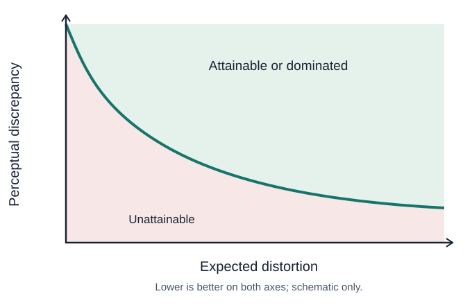

# Week 10, Day 1 — Mathematical Foundations of Neural Image Restoration

*90-minute lecture. Source: Week 10 of syllabus/weekly-schedule.md ("The Generative AI Boundary in Court"). Connects the inverse problems of Weeks 4–7 and the validation principles of Weeks 8–9 to learned image restoration.*

> **Scope:** Introduce the mathematical principles of learned priors, neural super-resolution, adversarial training, and diffusion. Full network architectures, backpropagation, and stochastic differential equations are beyond the scope of this session. A realistic-looking output is not necessarily a faithful reconstruction of the observed scene.

## Learning Objectives

By the end of this lecture students can:

1. Interpret classical regularization as Bayesian estimation under explicit assumptions.
2. Explain the non-identifiability of downsampled images using rank-nullity.
3. Distinguish pixel-wise, perceptual, and adversarial objectives.
4. Describe the basic GAN training objective and the forward and reverse processes of diffusion models.
5. Explain how GFPGAN and CodeFormer use learned facial priors and distinguish perceptual realism from evidentiary fidelity.

## Timed Outline (90 min)

| Min | Segment |
|-----|---------|
| 10 | Classical reconstruction versus learned restoration |
| 15 | Bayesian inverse problems and learned image priors |
| 15 | Neural super-resolution and loss functions |
| 5 | Break |
| 15 | Generative adversarial networks |
| 15 | Diffusion models and conditional generation |
| 10 | GFPGAN and CodeFormer |
| 5 | Perceptual realism versus evidentiary fidelity |
| **90** | **Total** |

## Content Notes

### 1. Classical reconstruction versus learned restoration (10 min)

Recall the forward model $g=Hf+n$ from Week 5, with a linear imaging operator $H$ and additive observation error $n$. Even when the noiseless operator is injective, small singular values can make inversion unstable. When the operator is non-injective, the observation cannot uniquely determine the original.

The classical regularizers of Week 6 resolve some ambiguity by preferring particular solutions: small norm, smoothness, or frequency content consistent with a statistical model. A neural restoration system can instead learn complex statistical regularities from example images.

Both classical and learned methods introduce assumptions. The distinction is not simply deterministic versus stochastic, nor mathematical versus nonmathematical: a neural network can be deterministic at inference, and a conventional Bayesian estimator can be stochastic. The important question is what information the observation supports and what the model supplies.

~~~mermaid
flowchart TD
    A["Degraded observation"] --> B["Classical reconstruction"]
    A --> C["Learned restoration"]
    D["Explicit forward model and regularizer"] --> B
    E["Training distribution and learned parameters"] --> C
    B --> F["Estimated image"]
    C --> G["Estimated or synthesized image"]
    F --> H["Independent validation of evidential features"]
    G --> H
~~~

*Figure 1. Both approaches rely on assumptions and require validation for the intended forensic inference.*

### 2. Bayesian inverse problems and learned image priors (15 min)

**Posterior distribution (5 min).** For continuous image variables with suitable probability densities, Bayes' theorem gives

$$
p(f\mid g)=\frac{p(g\mid f)p(f)}{p(g)}.
$$

Here $p(g\mid f)$ is the likelihood, $p(f)$ the prior, and $p(g)$ the marginal observation density. The evidence $p(g)$ is independent of the candidate image $f$ for fixed $g$.

A maximum a posteriori (MAP) estimate therefore minimizes

$$
J(f)=-\log p(g\mid f)-\log p(f).
$$

This objective is meaningful on the support of the posterior; densities of zero may be assigned infinite negative log cost. MAP is not generally the posterior mean or a sample from the posterior.

~~~mermaid
flowchart TD
    A["Observed degraded image"] --> B["Likelihood or data-fidelity model"]
    C["Assumptions or training image distribution"] --> D["Image prior"]
    B --> E["Posterior or conditional estimation model"]
    D --> E
    E --> F["MAP estimate, posterior mean, or posterior sample"]
~~~

*Figure 2. The observation and prior jointly constrain inference. A learned restorer need not explicitly compute a normalized Bayesian posterior.*

**Connection to Tikhonov regularization (7 min).** Assume $n$ is a zero-mean Gaussian vector with covariance $\sigma^2 I$. Then, up to constants independent of $f$,

$$
-\log p(g\mid f)=\frac{1}{2\sigma^2}\|Hf-g\|_2^2.
$$

For a zero-mean Gaussian prior with precision proportional to $L^*L$, take

$$
-\log p(f)=\frac{\gamma}{2}\|Lf\|_2^2+\mathrm{constant}.
$$

A proper Gaussian density of this form requires positive-definite precision. If $L$ has a null space, the penalty may represent an improper prior or require additional constraints; existence and uniqueness must be assessed separately.

Multiplying the posterior objective by $2\sigma^2$ gives the Week 6 Tikhonov form

$$
J_{\lambda}(f)=\|Hf-g\|_2^2+\lambda\|Lf\|_2^2,
$$

with $\lambda=\gamma\sigma^2$.

The likelihood must match the acquisition model. For Poisson-count observations the Gaussian squared-error likelihood is not generally the appropriate one; recall Richardson–Lucy and Poisson data fitting from Week 6.

**Learned priors (3 min).** A model trained on images may learn distributions of textures, shapes, or facial structures. It need not represent the prior density explicitly. Statistical regularity learned from a population is not a measurement of the particular original image. Distribution shift, training bias, and unsuitable degradation assumptions can undermine the resulting estimate.

### 3. Neural super-resolution and loss functions (15 min)

**Rank-nullity and missing information (6 min).** Model a low-resolution observation by

$$
g=SHf+n,
$$

where $H$ is blur and $S$ is spatial sampling. Suppose $f$ has $N$ scalar components and $g$ has $M<N$ components. Let $A=SH$ be a linear map from $\mathbb R^N$ to $\mathbb R^M$.

Rank-nullity gives

$$
\dim\ker A=N-\mathrm{rank}(A)\ge N-M.
$$

Consequently, even in the noiseless case, every $v\in\ker A$ satisfies $A(f+v)=Af$. Additional image-domain restrictions may exclude some alternatives, but arbitrary missing components cannot be recovered uniquely from the observation alone.

~~~mermaid
flowchart LR
    A["High-resolution image: N samples"] --> B["Blur and downsample"]
    B --> C["Low-resolution observation: M samples"]
    C --> D["Neural super-resolution"]
    E["Learned image regularities"] --> D
    D --> F["Output: N estimated samples"]
~~~

*Figure 3. Increasing the number of output samples does not increase the number of independently measured input samples.*

**Training losses (9 min).** Let $F_{\omega}$ be a restoration network with parameters $\omega$, and let $(g,f)$ denote a degraded/reference training pair. A pixel-wise squared-error objective is

$$
\mathcal L_{\mathrm{pixel}}(\omega)=
\mathbb E\|F_{\omega}(g)-f\|_2^2.
$$

Under an ideal population-risk model with unrestricted function class and finite second moments, the squared-error minimizer is the conditional mean:

$$
F^*(g)=\mathbb E[f\mid g].
$$

To see this, condition on $g$ and write $m=\mathbb E[f\mid g]$. For any candidate $a$,

$$
\mathbb E[\|f-a\|_2^2\mid g]
=\mathbb E[\|f-m\|_2^2\mid g]+\|m-a\|_2^2.
$$

The cross term vanishes by the definition of conditional expectation. This explains why ambiguous fine-scale structures can average into a blurred-looking result.

A perceptual loss instead compares representations in a feature network $\Psi$:

$$
\mathcal L_{\mathrm{perc}}(\omega)=
\mathbb E\|\Psi(F_{\omega}(g))-\Psi(f)\|_2^2.
$$

Adversarial losses favor outputs that resemble images from a training distribution, as developed below. A composite objective may combine these terms with application-specific weights. Pixel fidelity, feature similarity, and population realism are distinct objectives.

### 4. Generative adversarial networks (15 min)

**Original GAN formulation (7 min).** Let $G$ map a latent variable $z$ drawn from a specified distribution into an image, and let $D(x)$ denote a discriminator's estimate that an image comes from the training distribution. The original minimax objective is

$$
\min_G\max_D V(D,G).
$$

Write the value function as the sum of two expectations:

$$
V(D,G)=V_{\mathrm{real}}(D)+V_{\mathrm{generated}}(D,G).
$$

$$
V_{\mathrm{real}}(D)=
\mathbb E_{x\sim p_{\mathrm{data}}}[\log D(x)].
$$

$$
V_{\mathrm{generated}}(D,G)=
\mathbb E_{z\sim p_z}[\log(1-D(G(z)))].
$$

The discriminator seeks to distinguish real training examples from generated examples. The generator seeks to produce outputs that the discriminator cannot reliably distinguish. Practical GAN implementations often use modified objectives and training strategies; the original minimax game is the conceptual starting point.

~~~mermaid
flowchart TD
    A["Training images"] --> D["Discriminator"]
    B["Latent variables"] --> C["Generator"]
    C --> D
    D --> E["Adversarial objective"]
    E -->|Training update| C
    E -->|Training update| D
~~~

*Figure 4. Adversarial training shapes the generator toward a training distribution; the diagram is not an inference-time feedback loop.*

**Conditional restoration (8 min).** In restoration, a generator may be conditioned on a degraded observation, for example $\hat f=G(g,z)$. Some systems use a deterministic network and no inference-time latent sampling. Others produce multiple possible outputs.

A conditional adversarial objective and additional reconstruction terms may encourage compatibility with $g$ and perceptual realism. Neither condition alone establishes recovery of the original image. Even exact consistency $A\hat f=g$ permits different outputs when $A$ has a nontrivial null space.

For example, two possible high-resolution eye regions might produce the same downsampled measurements. A generator can prefer the one more typical of its training examples without acquiring any new measurements of the actual eye.

### 5. Diffusion models and conditional generation (15 min)

**Forward process (7 min).** Introduce a sequence of artificial Gaussian perturbations indexed by $t=1,\ldots,T$. For a variance schedule $0<\beta_t<1$, set $\alpha_t=1-\beta_t$ and

$$
\bar\alpha_t=\prod_{s=1}^t\alpha_s.
$$

A standard discrete forward diffusion transition is

$$
x_t=\sqrt{\alpha_t}x_{t-1}+\sqrt{\beta_t}\epsilon_t,
$$

where $\epsilon_t$ are independent standard Gaussian vectors.

By combining the independent Gaussian terms, the marginal conditional distribution of $x_t$ given $x_0$ can be sampled as

$$
x_t=\sqrt{\bar\alpha_t}x_0+
\sqrt{1-\bar\alpha_t}\epsilon,
$$

where $\epsilon\sim\mathcal N(0,I)$. This follows by induction using the recurrence for the conditional variance and the product definition of $\bar\alpha_t$.

The artificial forward diffusion process used to train a model is not necessarily the actual camera degradation process $A$.

**Learned reverse process (8 min).** A neural network learns to predict a quantity useful for reversing the artificial diffusion, such as the added noise, the clean sample, or a score-related quantity. Sampling proceeds from a noisy state through a sequence of learned denoising steps. A conditional image restoration method also uses $g$ or a measurement-consistency mechanism.

~~~mermaid
flowchart TD
    A["Clean training image"] --> B["Forward diffusion: add scheduled noise"]
    B --> C["Noisy training states"]
    C --> D["Learn reverse denoising model"]
    E["Noise initialization at inference"] --> F["Conditional reverse step"]
    D --> F
    G["Degraded observation"] --> F
    F --> H{"Final step?"}
    H -->|No| I["Update state and time index"]
    I --> F
    H -->|Yes| J["Restored image"]
~~~

*Figure 5. Conceptual conditional diffusion workflow. Actual conditioning and sampling schemes vary.*

The output may depend on the random seed, sampler, schedule, number of steps, and conditioning procedure. Some implementations have deterministic sampling configurations. A plausible conditional sample is not necessarily the particular original image that produced $g$. Without appropriate calibration, a collection of generated samples should not be treated as a calibrated posterior uncertainty distribution.

### 6. GFPGAN and CodeFormer (10 min)

Use two published face-restoration models as case studies; the full experimental comparison belongs to Day 2 and Lab 5 (Part C).

| Model | Publication | Main idea |
|-------|-------------|-----------|
| GFPGAN | CVPR 2021 | Incorporates a pretrained generative facial prior into a blind face-restoration network. |
| CodeFormer | NeurIPS 2022 | Uses a learned discrete codebook of facial representations and Transformer-based code prediction. |

GFPGAN uses learned facial structure to compensate for severe degradation. CodeFormer exposes a fidelity weight $w$ in the interval from 0 to 1 in its published implementation: lower values generally favor perceptual quality, while higher values favor fidelity to the input. The setting is a model control, not a probability of correctness or guarantee of identity preservation.

For reproducibility, record the repository revision, checkpoint digest, model version, face detector and alignment settings, crop and paste-back configuration, restoration settings, and execution environment. Compare methods on identical controlled observations, with reference labels withheld until evaluation.

### 7. Perceptual realism versus evidentiary fidelity (5 min)

Introduce Blau and Michaeli's *The Perception-Distortion Tradeoff* (CVPR 2018). The theoretical framework separates expected distortion between paired original and reconstructed images from perceptual discrepancy between their distributions.

For a distortion measure $\Delta$, a conceptual expected distortion is

$$
D=\mathbb E[\Delta(f,\hat f)].
$$

A distribution-level perceptual discrepancy may be expressed as

$$
P=d(p_f,p_{\hat f}),
$$

with a suitable discrepancy measure $d$. Lower values are preferred on both axes. The perception–distortion function describes the best achievable perceptual discrepancy under an expected-distortion constraint, for a specified statistical problem and choice of measures. The attainable boundary need not have the same shape for every problem, and a specific algorithm need not lie on it.

*Figure 6. Schematic trade-off boundary, not measured model performance or a universal curve. The upper-right side of the boundary represents attainable or dominated objective pairs in this illustration.*

A model can produce realistic textures in distribution while producing the wrong texture for a particular image. Low expected distortion likewise does not guarantee correctness of a specific small feature. This distinction is central to forensic interpretation.

## Instructor Preparation

- Review the original model papers and official implementation documentation listed below.
- Prepare synthetic or appropriately consented adult reference portraits and controlled low-resolution examples for Day 2.
- Prepare examples of ambiguity and averaging using simple synthetic patterns before discussing faces.
- Treat GAN and diffusion architecture details as background; prioritize probabilistic interpretation, missing information, and evidentiary implications.
- Confirm model versions, checkpoint availability, licenses, and computing requirements before assigning practical work.

## Tutorial and Lab Connection

Derive the Gaussian-prior regularization objective, verify the rank-nullity bound, and compare a conditional mean with possible individual originals in a simple ambiguous inverse problem. Discuss which properties of a generated result are supported by the observation.

Lab 5 (Part C) will compare learned restoration with conventional baselines using the independent control procedures of Week 9 and the audit pipeline of Week 8. No new neural network training is required.

## Exercises

1. Derive the Tikhonov parameter in the Gaussian model above and explain what changes for a non-Gaussian likelihood.
2. A grayscale 64-by-64 image is linearly downsampled to 16-by-16. Give a lower bound on the null-space dimension.
3. Suppose two scalar originals, 0 and 1, are equally probable given the same observation. Find the squared-error optimal estimate and its expected squared error.
4. Explain why a realistic-looking conditional GAN output need not be the original.
5. Derive the marginal conditional variance of the discrete forward diffusion process.
6. Explain why CodeFormer's fidelity parameter cannot be interpreted as an evidentiary confidence level.

## Instructor Answer Sketch

1. The likelihood and prior contribute weights $1/(2\sigma^2)$ and $\gamma/2$, respectively; after scaling, $\lambda=\gamma\sigma^2$. A different likelihood generally changes the data-fit term.
2. At least $4096-256=3840$.
3. The conditional mean is 0.5; the expected squared error is 0.25. The mean is neither of the two possible originals.
4. The observation may be compatible with multiple originals, and the learned prior encourages population realism rather than case-specific truth.
5. Starting with zero conditional variance, the recurrence is $v_t=\alpha_t v_{t-1}+\beta_t$. By induction, $v_t=1-\bar\alpha_t$.
6. It adjusts a model's restoration behavior; it is not a calibrated estimate of feature correctness or identity.

## References

- Goodfellow, I. et al. (2014). [Generative Adversarial Nets](https://arxiv.org/abs/1406.2661). NeurIPS.
- Ho, J., Jain, A., & Abbeel, P. (2020). [Denoising Diffusion Probabilistic Models](https://arxiv.org/abs/2006.11239). NeurIPS.
- Wang, X. et al. (2021). [Towards Real-World Blind Face Restoration with Generative Facial Prior](https://openaccess.thecvf.com/content/CVPR2021/html/Wang_Towards_Real-World_Blind_Face_Restoration_With_Generative_Facial_Prior_CVPR_2021_paper.html). CVPR. [Official GFPGAN implementation](https://github.com/TencentARC/GFPGAN).
- Zhou, S. et al. (2022). [Towards Robust Blind Face Restoration with Codebook Lookup Transformer](https://arxiv.org/abs/2206.11253). NeurIPS. [Official CodeFormer implementation](https://github.com/sczhou/CodeFormer).
- Blau, Y., & Michaeli, T. (2018). [The Perception-Distortion Tradeoff](https://openaccess.thecvf.com/content_cvpr_2018/html/Blau_The_Perception-Distortion_Tradeoff_CVPR_2018_paper.html). CVPR. Required reading.

The diagrams and mathematical examples are instructional summaries. Consult the papers for the precise model formulations, assumptions, and theoretical results.
