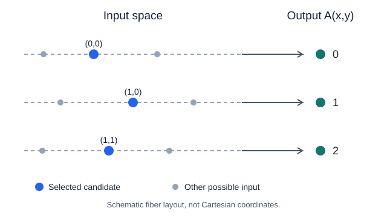

# Week 11, Day 1 — Mathematical Foundations of Visual Redaction

*90-minute lecture. Source: Week 11 of syllabus/weekly-schedule.md. Begins Part IV: Privacy Engineering and Irreversible Redaction.*

> **Scope:** All examples concern artificial signals and authorized privacy evaluation. A redaction claim must identify the protected attribute, released information, and threat model. Non-injectivity alone is not a privacy guarantee.

## Learning Objectives

1. Distinguish reconstruction fidelity from protection of a sensitive attribute.
2. Prove the restricted-domain injectivity criterion for a linear operator.
3. Define entropy, conditional entropy, and mutual information for discrete variables.
4. Explain why averaging and blurring can retain sensitive information.
5. Distinguish pixel replacement from independence of the complete released artifact.

## Timed Outline (90 min)

| Min | Segment |
|-----|---------|
| 10 | From forensic reconstruction to privacy engineering |
| 15 | Threat models and definitions of effective redaction |
| 20 | Non-injectivity and restricted-domain invertibility |
| 5 | Break |
| 15 | Information-theoretic measures of privacy |
| 15 | Mathematical limitations of blurring and pixelation |
| 10 | Masking, replacement, and residual leakage |
| **90** | **Total** |

## Content Notes

### 1. From forensic reconstruction to privacy engineering (10 min)

Parts I–III studied the extent to which an observation supports an inference about an original image. We now ask how a release mechanism can prevent an inference about designated information while retaining authorized utility.

An adversary need not recover the original raster. A single sensitive attribute may be sufficient to defeat the intended protection. Conversely, a plausible but incorrect reconstruction is not necessarily a successful disclosure.

Distinguish destruction of some information, destruction of information relevant to a specified attribute, and protection against an explicitly defined adversary. These are not equivalent.

~~~mermaid
flowchart TD
    A["Original image and protected attribute"] --> B["Release mechanism"]
    B --> C["Released artifact"]
    C --> D["Inference about protected attribute"]
    E["Prior knowledge and auxiliary information"] --> D
    C --> F["Authorized downstream task"]
    D --> G["Evaluate privacy"]
    F --> H["Evaluate utility"]
~~~

*Figure 1. Privacy and utility concern different tasks on the same release.*

### 2. Threat models and definitions (15 min)

Let $F$ denote the original image, $X$ a protected attribute, $Y$ the released information, and $Z$ auxiliary information. The attribute may be a function of the image or a separately supplied label. A release mechanism may be deterministic or randomized.

Specify the protected attribute, the information legitimately available to the observer, the entire release surface, the intended utility, and the criterion for a privacy failure. The release surface includes rendered pixels, other frames, metadata, embedded previews, and any associated files or representations.

An operational privacy test measures the performance of a specified inference procedure against a baseline using auxiliary information alone. An information-theoretic claim is stronger: it describes the statistical dependence of the release and the protected attribute under a stated joint distribution.

The threat model is not a claim that every possible observer has identical knowledge. Distinguish a guarantee proved under assumptions from empirical resistance measured on a finite dataset. A failure of one tested inference procedure does not establish that no other procedure could succeed.

Use a classroom example in which an artificial label is encoded into a small numerical vector. The intended utility is the overall brightness, while the sensitive attribute is an independently assigned label. Discuss cases where brightness itself is correlated with the label. There may be no way to preserve that utility exactly while eliminating all statistical leakage.

### 3. Non-injectivity and restricted-domain invertibility (20 min)

Let $A:\mathbb R^N\to\mathbb R^M$ be linear with $M<N$. By rank-nullity,

$$
\dim\ker A=N-\mathrm{rank}(A)\ge N-M.
$$

Thus $A$ is non-injective on the ambient space. This says nothing by itself about its restriction to a subset of admissible inputs.

**Restricted-domain theorem.** Let $\mathcal C$ be a nonempty subset of $\mathbb R^N$. Define

$$
\mathcal C-\mathcal C=\{x-y:x,y\in\mathcal C\}.
$$

Then $A$ is injective on $\mathcal C$ if and only if

$$
\ker A\cap(\mathcal C-\mathcal C)=\{0\}.
$$

*Proof.* If the intersection contains a nonzero vector $v$, write $v=x-y$ for distinct $x,y\in\mathcal C$. Since $Av=0$, we have $Ax=Ay$, contradicting injectivity. Conversely, if distinct members have the same output, their nonzero difference lies in both sets. This proves the equivalence.

For example, take $A(x,y)=x+y$. The kernel is the line $x+y=0$, yet the artificial candidate set $\{(0,0),(1,0),(1,1)\}$ has three distinct outputs, 0, 1, and 2.

*Figure 2. Each dashed line is a fiber of the sum map. The three selected candidates lie in distinct fibers, despite the nontrivial ambient kernel.*

An attribute-specific condition can be weaker than input injectivity. Suppose a label function $s:\mathcal C\to\mathcal X$ assigns a protected attribute to each candidate. The attribute is determined by the released value if and only if

$$
Ax=Ay\ \Longrightarrow\ s(x)=s(y)
$$

for all $x,y\in\mathcal C$. This means that $s$ factors through the restricted release map. Prove the statement by defining the induced label function on the image of $\mathcal C$; the displayed implication is exactly the condition that the definition be well-defined.

The release might therefore destroy the ability to recover the entire input while preserving all information about a particular label.

### 4. Information-theoretic measures of privacy (15 min)

For a finite discrete random variable $X$ with probability mass function $p$, define Shannon entropy in bits:

$$
H(X)=-\sum_x p(x)\log_2 p(x).
$$

Use the convention $0\log_2 0=0$. Conditional entropy is the average of the entropy of the conditional distributions:

$$
H(X\mid Y)=\sum_y p(y)H(X\mid Y=y).
$$

Mutual information is

$$
I(X;Y)=H(X)-H(X\mid Y).
$$

It can also be written as

$$
I(X;Y)=\sum_{x,y}p(x,y)
\log_2\frac{p(x,y)}{p(x)p(y)}.
$$

The last expression is the relative entropy between the joint law and the product of the marginals. Nonnegativity follows from the relative entropy inequality; equality holds precisely when the distributions agree.

| Condition | Interpretation |
|-----------|----------------|
| $H(X\mid Y)=0$ | The attribute is determined almost surely by the release. |
| $I(X;Y)=0$ | The attribute and release are independent. |
| $0<I(X;Y)<H(X)$ | The release provides partial information. |

The first and second conditions can both hold for a constant attribute, so interpret them in relation to the initial uncertainty.

With auxiliary knowledge $Z$, the additional information provided by the release is

$$
I(X;Y\mid Z)=H(X\mid Z)-H(X\mid Y,Z).
$$

Zero additional leakage does not imply that $X$ was secret to begin with: $Z$ may already determine it.

**Worked example.** Let $X$ be a fair binary label. Release $Y=X$ with probability $1/2$, and a distinct erasure symbol otherwise, independently of $X$. Then $H(X)=1$ bit, $H(X\mid Y)=1/2$ bit, and $I(X;Y)=1/2$ bit. Although half the releases are uninformative, the remaining releases disclose the label exactly.

For a Markov chain $X\to F\to Y$, the data-processing inequality gives $I(X;Y)\le I(X;F)$. Processing alone cannot increase mutual information under this model, but the inequality provides no guarantee that the remaining mutual information is small. Introducing additional side information requires revisiting the model.

All definitions here use discrete distributions. Continuous differential entropy has different properties and is not interchangeable with discrete entropy; mutual information extends to continuous variables through relative entropy.

### 5. Mathematical limitations of blurring and pixelation (15 min)

Block averaging is a linear map from a raster to a smaller set of block values. Repeating each mean over its original block produces a pixelated display but does not add independent measurements.

For a four-component block,

$$
P(x)=\frac{x_1+x_2+x_3+x_4}{4}.
$$

The kernel has dimension three. Nevertheless, if the protected attribute is whether a block's mean exceeds a fixed value, the released mean can determine it exactly. Thus a visibly coarse image need not protect a coarse attribute.

Gaussian convolution attenuates frequencies according to the ideal transfer function introduced in Week 5:

$$
H_\sigma(\rho)=\exp(-2\pi^2\sigma^2\rho^2).
$$

Although inversion may be unstable, attenuation is not equivalent to annihilation. Exact discrete behavior depends on kernel sampling, boundaries, quantization, and the encoding of the release. The relevant question is whether the sensitive attribute remains distinguishable, not whether every original pixel can be reconstructed.

~~~mermaid
flowchart TD
    A["Original raster"] --> B["Block averaging or blur"]
    B --> C["Quantization and encoding"]
    C --> D["Released representation"]
    D --> E["Information removed"]
    D --> F["Information retained"]
    F --> G["Assess dependence on protected attribute"]
~~~

*Figure 3. Information loss and attribute protection are different properties of the release.*

The arrows from the released representation to the two information categories denote an analysis of the transformation, not a literal recovery of discarded information. No single blur strength can be asserted to provide a universal privacy guarantee.

### 6. Masking, replacement, and residual leakage (10 min)

Let $M$ be a binary mask equal to one on the protected region. For a replacement raster $c$, define

$$
g=(1-M)\odot f+M\odot c.
$$

For fixed $M,c$, and fixed pixels outside the mask, every change confined to the masked input coordinates leaves $g$ unchanged. This gives an exact noninterference property with respect to those coordinates in the specified raster model.

It does not establish statistical independence between an identity attribute and the full released artifact. Outside pixels may be correlated with the attribute; mask geometry may reveal information; metadata or other frames may contain original content. Replacement content derived from sensitive input may itself leak information.

~~~mermaid
flowchart TD
    A["Original raster"] --> B["Remove protected pixels"]
    C["Independent replacement content"] --> D["Construct release"]
    B --> D
    E["Context and mask geometry"] --> D
    D --> F["Check rendered output and associated data"]
    F --> G["Evaluate remaining attribute leakage"]
~~~

*Figure 4. Removing source pixels is a direct protection for those coordinates, not a complete guarantee about contextual or metadata leakage.*

This distinction prepares the discussion of randomized mechanisms in Week 12 and generative replacement in Week 13.

## Instructor Preparation

- Prepare the restricted-domain example and a small artificial block-averaging demonstration.
- Use discrete probability tables to illustrate entropy and conditional mutual information.
- Distinguish source-pixel noninterference from attribute independence in every privacy example.

## Exercises

1. Prove the restricted-domain injectivity theorem and give a nonlinear example where ambient non-injectivity does not imply restricted non-injectivity.
2. For the sum map on three-dimensional vectors, find the kernel dimension and a three-element candidate set on which it is injective.
3. For a fair binary attribute released with an independent erasure probability $q$, compute its conditional entropy and mutual information.
4. Construct a discrete example where $I(X;Y\mid Z)=0$ although $H(X\mid Y,Z)=0$.
5. Explain why two images with identical block means need not have identical sensitive attributes.
6. Prove the raster noninterference property of fixed masking and identify two ways the complete release can nevertheless leak an attribute.

## Instructor Answer Sketch

1. Use the difference-set argument above. The map $x\mapsto x^2$ is non-injective on the real line but injective on nonnegative reals.
2. Rank one, nullity two; for example $(0,0,0),(1,0,0),(1,1,0)$.
3. Conditional entropy $q$ bits; mutual information $1-q$ bits.
4. Let $Z=X$ and let $Y$ be constant.
5. Block means describe only averages; within-block structure may differ. Whether the particular attribute is retained depends on its definition.
6. For a perturbation $v$ supported on the mask, $(1-M)\odot v=0$. Context and metadata are possible remaining leakage channels.

## References

- Shannon, C. E. (1948). A Mathematical Theory of Communication. *Bell System Technical Journal*, 27, 379–423 and 623–656.
- Cover, T. M., & Thomas, J. A. (2006). *Elements of Information Theory*, 2nd ed. Wiley.
- Course notes: Weeks 1–6 (operators, sampling, convolution), Week 9 (validation), and Week 10 (non-identifiability).
