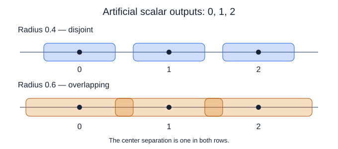
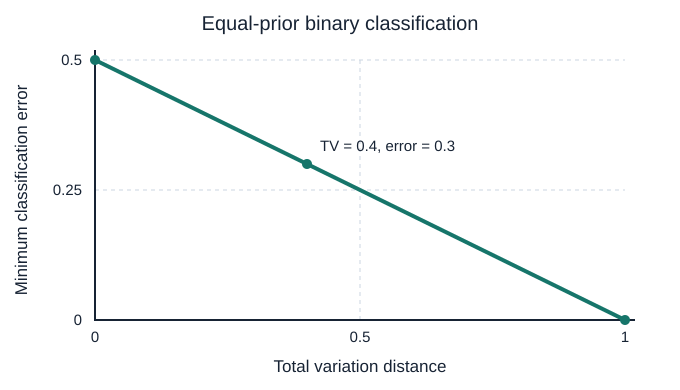

# Week 11, Day 2 — Forward-Matching Attacks and Redaction Security

*90-minute lecture. Continues Week 11, Day 1 and prepares for Lab 6 (Part A) and Week 12.*

> **Scope:** Study distinguishability using artificial numerical signals and authorized privacy tests. The objective is to understand and prevent disclosure, not recover protected information from actual redacted material. No real identifiers, passwords, or private images are required.

## Learning Objectives

1. Distinguish unrestricted inverse reconstruction from inference on a restricted domain.
2. Relate minimum output separation to restricted injectivity and robustness.
3. Derive the optimal binary classification error in terms of total variation distance.
4. Design a controlled privacy evaluation with explicit assumptions, baselines, and uncertainty.
5. Explain why neural restoration and visual concealment do not establish privacy or authenticity.
6. Describe a release workflow that removes sensitive content and checks associated representations.

## Timed Outline (90 min)

| Min | Segment |
|-----|---------|
| 10 | Inverse reconstruction versus forward matching |
| 20 | Candidate-space distinguishability |
| 15 | Statistical inference under noisy redaction |
| 5 | Break |
| 15 | Controlled adversarial evaluation and privacy metrics |
| 10 | Neural reconstruction and learned priors |
| 10 | Secure redaction practices and government guidance |
| 5 | Lab 6 introduction and transition to Week 12 |
| **90** | **Total** |

## Content Notes

### 1. Inverse reconstruction versus forward matching (10 min)

Return to the theorem from Day 1. A many-to-one operator on the ambient image space can distinguish all members of a smaller candidate set. Inference about a protected label need not entail recovery of the original image.

Forward matching describes the general principle of comparing the released observation with predictions associated with possible inputs, rather than attempting to invert an arbitrary image operator. It is relevant to privacy evaluation because a restricted family may retain distinguishable outputs even where unrestricted restoration is impossible.

~~~mermaid
flowchart TD
    A["Information-losing observation"] --> B["Unrestricted inverse problem"]
    A --> C["Restricted attribute inference"]
    B --> D["Assess recovery of entire input"]
    C --> E["Assess distinguishability of protected labels"]
    D --> F["Possible reconstruction failure"]
    E --> G["Possible privacy failure"]
~~~

*Figure 1. Failure of unrestricted reconstruction does not imply protection of a restricted attribute.*

The example throughout this lecture is a small artificial signal, with no connection to an actual person's information. The point is to characterize the release mechanism rather than devise a procedure for recovering private identifiers.

### 2. Candidate-space distinguishability (20 min)

Let $\mathcal C$ be a finite candidate set containing at least two distinct elements. For a deterministic map $A$, define

$$
\delta_A(\mathcal C)=
\min_{\substack{x,y\in\mathcal C\\x\ne y}}
\|Ax-Ay\|_2.
$$

The notation $Ax$ denotes application of the map; linearity is not required for this definition.

**Proposition.** The restriction of $A$ to $\mathcal C$ is injective if and only if $\delta_A(\mathcal C)>0$.

*Proof.* If distinct candidates have equal outputs, the minimum is zero. Otherwise the finitely many pairwise distances are positive and their minimum is positive. Finiteness is essential: an injective map on an infinite set can have arbitrarily small output separations.

For a synthetic example, let $A(x_1,x_2)=x_1+x_2$ and $\mathcal C=\{(0,0),(1,0),(1,1)\}$. The outputs are 0, 1, and 2, so the separation is one.

Consider uncertainty balls of radius $\epsilon$ around each output. If $2\epsilon<\delta_A(\mathcal C)$, these balls are disjoint by the triangle inequality. If two balls overlap, the corresponding observation can be compatible with more than one candidate under the bounded-error model. This is a statement about distinguishability under stated assumptions, not a universal guarantee of practical recovery.

*Figure 2. Schematic comparison of disjoint and overlapping uncertainty regions for artificial scalar outputs.*

Quantization changes the effective release map. Analyze the composition $Q\circ A$ rather than $A$ alone. Two distinct unquantized outputs may yield the same stored value. The exact effect depends on quantizer bins and the distribution of the inputs.

For an attribute rather than an entire input, consider separation only between inputs with different attribute labels. If within-label variation is substantial, the output distributions of the different labels may overlap even when individual noiseless candidate outputs are distinct.

### 3. Statistical inference under noisy redaction (15 min)

A randomized mechanism associates an input with a conditional distribution of released values. For two discrete distributions $P$ and $Q$ on the same alphabet, define

$$
d_{\mathrm{TV}}(P,Q)=\frac12\sum_y|P(y)-Q(y)|.
$$

This lies between zero and one. It vanishes exactly when the distributions coincide; it is one when their supports are disjoint.

For two equally probable hypotheses with conditional output distributions $P$ and $Q$, the optimal binary classification error is

$$
P_e^*=\frac{1-d_{\mathrm{TV}}(P,Q)}{2}.
$$

**Derivation.** The minimum contribution to the error at observation $y$ is one half of the smaller of $P(y)$ and $Q(y)$. Summing gives

$$
P_e^*=\frac12\sum_y\min(P(y),Q(y)).
$$

Since $\min(a,b)=(a+b-|a-b|)/2$ and each distribution sums to one, substitution proves the result.

For unequal priors $\pi$ and $1-\pi$, the corresponding optimal error is instead

$$
P_e^*=\sum_y\min(\pi P(y),(1-\pi)Q(y)).
$$

Do not use the equal-prior formula for a population with unequal priors.

**Worked example.** Let $P=(0.7,0.3)$ and $Q=(0.3,0.7)$ on a two-symbol alphabet. Total variation is 0.4 and the optimal equal-prior error is 0.3. If the output distributions are identical, the equal-prior error is 0.5; if disjoint, it is zero.

*Figure 3. Exact relationship for the equal-prior binary problem. This is not an empirical curve for an image-redaction algorithm.*

For continuous distributions with densities, replace the sum in the total variation expression with the corresponding integral. The binary result extends to that setting. A finite experiment does not by itself determine the total variation between arbitrary unknown high-dimensional distributions.

### 4. Controlled adversarial evaluation and privacy metrics (15 min)

Reuse Week 9's independent validation methodology, but reverse the performance objective. Use artificial targets with predefined labels, known release conditions, and independent calibration and evaluation sets.

~~~mermaid
flowchart TD
    A["Independent artificial targets and protected labels"] --> B["Apply specified release mechanism"]
    B --> C["Measure authorized utility"]
    B --> D["Evaluate predefined privacy test"]
    E["Separate calibration and side-information baseline"] --> D
    D --> F["Record decisions and outcomes"]
    A --> G["Reveal held-out labels"]
    F --> G
    G --> H["Compare inference performance and uncertainty"]
    C --> I["Report privacy and utility jointly"]
    H --> I
~~~

*Figure 4. Controlled privacy evaluation with separate calibration, evaluation, and utility measurement.*

Report the protected attribute, release configuration, auxiliary information, independent sampling unit, baseline performance, test performance, uncertainty, and any inconclusive outcomes. Compare results with inference using auxiliary information alone. The relevant leakage may be an increase above that baseline, rather than absolute accuracy.

Use the confusion counts and confidence intervals developed in Week 9 where their assumptions apply. For multiple classes, consider class-specific performance and class balance rather than using an unqualified binary chance level. Do not exclude unsuccessful runs or choose favorable test conditions retrospectively.

A successful test demonstrates a weakness under the stated conditions. An unsuccessful test establishes only the observed limitation of that tested procedure. It is not evidence that all possible adversaries fail.

### 5. Neural reconstruction and learned priors (10 min)

Recall Week 10: learned restoration can produce plausible output that is either supported by surviving information or synthesized from learned regularities. A plausible image does not by itself demonstrate that protected information has been disclosed.

A privacy evaluation must compare a predefined protected attribute with independently known reference labels. Separate actual disclosure from convincing but incorrect guesses. The same requirement applies to a conventional method that introduces misleading structures.

A strong prior can make an output appear recognizable even if the release has no additional information beyond the prior. Compare with a prior-only baseline, and do not treat visually plausible results as evidence of successful recovery.

### 6. Secure redaction practices and government guidance (10 min)

Separate visual concealment from actual removal of underlying sensitive information. An opaque visual overlay can leave original pixels or text embedded in a file. A flattened raster can still retain contextual information or metadata. The complete release artifact, not merely the displayed image, is the object of verification.

~~~mermaid
flowchart TD
    A["Original sensitive material"] --> B["Identify protected content and release requirements"]
    B --> C["Remove or replace protected content"]
    C --> D["Sanitize associated representations and metadata"]
    D --> E["Create independent release artifact"]
    E --> F["Verify artifact against privacy requirements"]
    F --> G{"Requirements met?"}
    G -->|Yes| H["Approve release under applicable policy"]
    G -->|No| I["Revise or withhold release"]
    I --> C
~~~

*Figure 5. Defensive release workflow. Verification includes all associated data and does not assume that visual inspection alone is sufficient.*

NIST IR 8053, *De-Identification of Personal Information*, and NIST SP 800-188, *De-Identifying Government Datasets: Techniques and Governance*, provide general background on disclosure risk and de-identification. Neither establishes that a particular blur or masking algorithm provides adequate protection.

Document-redaction guidance from the NSA is a related topic; the instructor should select and verify the applicable current publication and its scope before assigning it. Document sanitization requirements are not automatically identical to those for image or video anonymization.

For sensitive operational releases, use the applicable organizational policies and authorized procedures; the classroom exercises are not certification or approval for release of actual personal information.

### 7. Lab 6 introduction and transition to Week 12 (5 min)

Use a small, explicitly defined artificial signal family to assess whether different release transformations retain label information. Compare block averaging, blur, quantization, and complete replacement under the same declared privacy and utility objectives. Do not use actual redacted images or real identifiers.

The experiment should document assumptions and report both leakage and retained utility. The next lecture will consider randomized releases and large-scale privacy pipelines, where detection and replacement must operate reliably over many images.

## Instructor Preparation

- Prepare small artificial scalar or raster examples with independently assigned labels.
- Use the separation and total variation figures to distinguish deterministic and statistical ambiguity.
- Prepare independent calibration and evaluation data and a prior-only baseline.
- Review the relevant current organizational and government guidance before teaching operational redaction.

## Exercises

1. Prove that positive minimum output separation is equivalent to injectivity on a finite candidate set. Explain why finiteness matters.
2. For the sum-map example, compute the minimum separation and show that uncertainty balls of radius 0.4 are disjoint.
3. For $P=(0.8,0.2)$ and $Q=(0.4,0.6)$, compute total variation and optimal equal-prior error.
4. Derive the unequal-prior binary error expression. Evaluate it for the distributions in Exercise 3 with prior 0.9 for $P$.
5. Explain why failure to reconstruct an entire image does not establish protection of a sensitive label.
6. Explain how to evaluate a randomized release on independent artificial targets and why a failed privacy test does not prove universal protection.

## Instructor Answer Sketch

1. Finitely many positive pairwise distances have positive minimum; a collision gives distance zero. On an infinite set the infimum may vanish despite injectivity.
2. The separation is one. Twice the radius is 0.8, strictly less than one.
3. Total variation is 0.4 and optimal error is 0.3.
4. At each observation the error-minimizing decision contributes the smaller prior-weighted mass. The masses are $(0.72,0.18)$ and $(0.04,0.06)$; the summed minimum is 0.10.
5. The attribute may factor through the release map even when the full input cannot be recovered.
6. Fix the threat model, evaluation rule and independent targets; compare with a baseline and report uncertainty. A finite test covers only the tested procedure and conditions.

## References

- Cover, T. M., & Thomas, J. A. (2006). *Elements of Information Theory*, 2nd ed. Wiley.
- NIST, [De-Identification of Personal Information (IR 8053)](https://doi.org/10.6028/NIST.IR.8053).
- NIST, [De-Identifying Government Datasets: Techniques and Governance (SP 800-188)](https://doi.org/10.6028/NIST.SP.800-188).
- Course notes: Week 9 (experimental validation), Week 10 (generative restoration), and Week 11, Day 1.

Check applicable guidance revisions before operational use.
