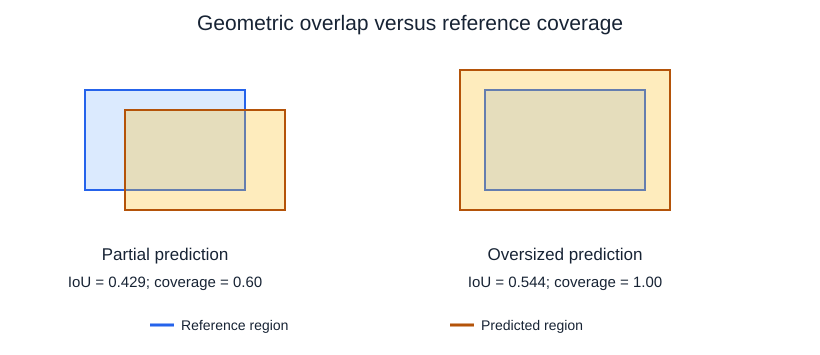
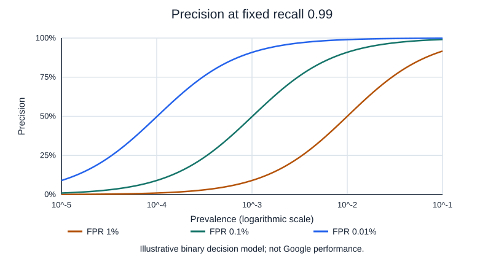
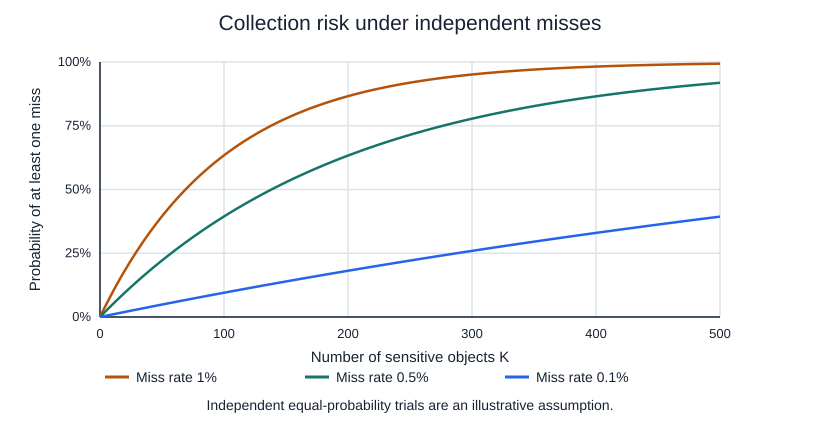

# Week 12, Day 1 — Web-Scale Detection and Privacy Coverage

*90-minute lecture. Part IV: Privacy Engineering and Irreversible Redaction. Builds on Week 11's threat models and Week 9's statistical validation.*

> **Scope:** Google Street View is a historical engineering case study. The documented 2009 system is not assumed to describe current production internals. Public Google examples are for viewing in their original context only; numerical exercises use independently generated synthetic data.

## Learning Objectives

1. Distinguish object detection, adequate redaction, and protection of an entire release.
2. Derive the relationship between prevalence, recall, false-positive probability, and precision.
3. Analyze cascading detection systems and the privacy consequences of missed objects.
4. Explain the historical Google Street View pipeline and its evaluation methodology.
5. Design a representative evaluation of privacy coverage at scale.

## Timed Outline (90 min)

| Min | Segment |
|-----|---------|
| 10 | From individual redaction to web-scale coverage |
| 15 | Detection geometry and object-level evaluation |
| 20 | Recall, precision, prevalence, and operating thresholds |
| 5 | Break |
| 15 | Cascaded detection and contextual post-processing |
| 15 | Google Street View: documented historical system |
| 10 | Population coverage, validation, and discussion |
| **90** | **Total** |

## Content Notes

### 1. From individual redaction to web-scale coverage (10 min)

Week 11 considered the effectiveness of an operator applied to a known sensitive region. In a large collection, the locations of those regions are themselves unknown. The engineering problem is therefore the composition of detection, protection, and release.

Let $D(f)$ return a set of candidate regions in image $f$, let $M(D(f))$ construct a mask, and let $R$ denote the release transformation. The resulting raster is

$$
g=R(f,M(D(f))).
$$

Even if the replacement is independent of the original pixels inside the mask, sensitive pixels outside the mask remain unprotected. Conversely, detecting an object does not ensure that the transformation makes its attributes sufficiently private.

~~~mermaid
flowchart TD
    A["Captured image"] --> B["Detect candidate sensitive objects"]
    B --> C["Construct protected regions"]
    C --> D["Redact"]
    D --> E["Verify release"]
    E --> F["Publish only if requirements met"]
    E -->|Failure or uncertainty| G["Review, revise, or withhold"]
    G --> C
~~~

*Figure 1. A privacy pipeline must address missed detections, incomplete protection, and the integrity of the complete release.*

### 2. Detection geometry and object-level evaluation (15 min)

For a reference bounding box $B$ and a predicted box $\widehat B$, define intersection over union:

$$
\mathrm{IoU}(B,\widehat B)=
\frac{|B\cap\widehat B|}{|B\cup\widehat B|}.
$$

Here $|\cdot|$ denotes area (or a count of pixels under a specified raster convention). A second useful measure is reference coverage:

$$
c(B,\widehat B)=\frac{|B\cap\widehat B|}{|B|}.
$$

IoU penalizes excessive predicted area as well as missing area. Coverage alone does not penalize a box that is unnecessarily large. Neither metric identifies which pixels carry the protected information.

*Figure 2. Two predicted regions of the same reference object. Geometric overlap and reference coverage quantify different properties; neither establishes anonymization.*

Use a fixed matching rule for predictions and annotations, including how duplicate detections are handled. Object-level recall counts protected reference objects according to a declared criterion. A pixel-level false-positive rate counts incorrectly protected nonsensitive pixels. These have different denominators and must not be combined into an ordinary object-level confusion matrix.

When reporting detection recall, distinguish it from effective-redaction recall: the latter requires a separately defined test of whether the sensitive information was sufficiently protected.

### 3. Recall, precision, prevalence, and operating thresholds (20 min)

For a defined binary decision unit (such as a fixed candidate region), let $X=1$ denote a sensitive object and $D=1$ a positive detection. Set

$$
r=\Pr(D=1\mid X=1),\qquad
q=\Pr(D=1\mid X=0).
$$

These are recall and false-positive probability. With prevalence $\pi=\Pr(X=1)$, Bayes' theorem gives

$$
\Pr(X=1\mid D=1)=
\frac{\pi r}{\pi r+(1-\pi)q}.
$$

For example, with prevalence 0.001, recall 0.99, and false-positive probability 0.01, precision is approximately 9.02%. Most detections are false positives despite apparently strong conditional performance. These numbers are illustrative, not reported Google performance.

*Figure 3. Precision as a function of prevalence at fixed recall 0.99 and several false-positive probabilities.*

For a threshold-based detector, lowering the threshold typically increases the set of positive detections, hence cannot decrease recall or the false-positive probability on the same fixed evaluation set. Increasing threshold can improve utility by reducing unnecessary redaction, but may expose sensitive objects.

A simple expected-loss model for a fixed unit of analysis is

$$
L(t)=C_{\mathrm{FN}}\pi[1-r(t)]
+C_{\mathrm{FP}}(1-\pi)q(t).
$$

The costs represent the intended decision problem, not universal numerical values. Privacy failures and utility losses may be highly asymmetric. Expected loss alone may conceal unacceptable failures in particular groups, so also impose explicit coverage requirements and examine strata.

Discuss why precision is not the same as specificity, and why object prevalence cannot be inferred from a deliberately balanced validation dataset.

### 4. Cascaded detection and contextual post-processing (15 min)

Consider a candidate generator followed by a post-processor that accepts or rejects its candidates. Let $D_1$ denote initial detection and $D_2$ acceptance by the second stage.

$$
\Pr(D_1=1,D_2=1\mid X=1)=r_1r_{2|1},
$$

where $r_{2|1}=\Pr(D_2=1\mid D_1=1,X=1)$. Likewise,

$$
q_{\mathrm{final}}=q_1q_{2|1}.
$$

These follow from conditional probability, not an independence assumption. The post-processor cannot restore recall lost at the first stage if it can only reject existing proposals.

A hypothetical initial detector with recall 0.995 and conditional true-positive retention 0.98 has final recall 0.9751. If its false-positive probability is 0.04 and the second stage retains 10% of false positives, the final false-positive probability is 0.004.

~~~mermaid
flowchart LR
    A["Camera image"] --> B["High-recall proposal detector"]
    B --> C["Candidate features and contextual information"]
    C --> D["Post-processor"]
    D --> E["Accepted regions"]
    D --> F["Rejected regions"]
    E --> G["Redaction and validation"]
~~~

*Figure 4. A cascade can reduce excessive redaction while losing some genuine detections. Evaluate the entire cascade rather than just either stage.*

Context may help distinguish false detections from genuine objects. It can also introduce biases when deployment conditions differ from training data. Validate across camera angles, illumination, scale, occlusion, geography, and other relevant acquisition conditions.

### 5. Google Street View: documented historical system (15 min)

The primary case study is Frome et al., *Large-scale Privacy Protection in Google Street View*, ICCV 2009. The authors describe a two-stage detection architecture and evaluate it on street-level imagery. Their system first proposed candidate regions and then used additional contextual information to improve precision. The authors reported approximately 89% adequate face redaction and approximately 94–96% adequate license-plate redaction on their evaluation sets. These were historical, dataset-specific results, not current guarantees.

The paper separates automated box-based evaluation from human assessment of whether an object was sufficiently obscured. These criteria do not necessarily agree; a small but important region may carry much of the identifying content. Their pixel false-positive measure is also distinct from candidate-level precision.

#### Public Google examples — assigned viewing

- [Google-hosted ICCV 2009 paper](https://research.google.com/archive/papers/cbprivacy_iccv09.pdf): Figure 1 shows a redacted panorama, Figure 2 the camera configuration, Figure 7 examples of redaction, and Figure 12 historical license-plate evaluation curves.
- [Google Street View privacy page](https://www.google.com/intl/en-GB/help/maps/streetview/privacy.html): public explanation of automatic blurring and further-blurring requests.
- [Google's Street View: Behind the Scenes video](https://www.youtube.com/watch?v=e5bALLcEygc): public historical demonstration.

View the examples in their published context. Do not download, crop, redistribute, or computationally analyze actual Street View imagery for the laboratory. The paper carries an IEEE copyright notice, and Google's [Geo Guidelines](https://about.google/brand-resource-center/products-and-services/geo-guidelines/) restrict independent reuse of Street View imagery. The lecture's original diagrams and synthetic inputs are separate from Google imagery. Obtain appropriate reuse permission before reproducing third-party photographs in a textbook.

Google's public descriptions explain automatic face and plate protection and mechanisms for requesting additional blurring. They do not establish that the historical detector architecture remains in use.

#### Openly licensed photographic examples

*141-145 Main Street, Ossining, NY.jpg* — photograph by Doug Kerr (2010), cropped, color-corrected and retouched (including license-plate blurring) by Daniel Case (2011). [Source](https://commons.wikimedia.org/wiki/File:141-145_Main_Street,_Ossining,_NY.jpg) · [CC BY-SA 2.0](https://creativecommons.org/licenses/by-sa/2.0/). Displayed at reduced size; no additional content modifications.

This independently published street photograph is not a Google Street View capture. Discuss the visible redaction and retained scene utility; the photograph does not establish automated detector performance. See the [sample attribution record](../media/samples/README.md).

### 6. Population coverage, validation, and discussion (10 min)

Suppose an image contains $K$ sensitive objects, each independently missed with probability $p$. Then

$$
\Pr(\text{at least one miss})=1-(1-p)^K.
$$

For $p=0.01$ and $K=100$, this is approximately 63.4%. The expected number of misses is $Kp=1$ and does not require independence if every marginal probability equals $p$.

Without independence, the union bound gives an upper bound:

$$
\Pr\left(\bigcup_{i=1}^{K}E_i\right)
\le\min\left(1,\sum_{i=1}^{K}\Pr(E_i)\right).
$$

*Figure 5. Illustrative independent-object model. A high per-object recall does not imply that an entire collection is free of misses.*

Real observations are clustered by person, scene, camera, and capture conditions. Do not treat thousands of adjacent frames as independent subjects. Report denominators, uncertainty, coverage criteria, relevant subgroup performance, and operational responses to failures. A complaint-based correction channel is useful but does not replace preventive protection before publication.

## Exercises

1. A reference box has area 100 and a predicted box area 140; their intersection has area 80. Calculate IoU and reference coverage.
2. Derive the prevalence-adjusted precision expression and evaluate it for prevalence 0.01, recall 0.98, and false-positive probability 0.02.
3. A first-stage detector has recall 0.99 and false-positive probability 0.05. The second stage retains 97% of its true positives and 8% of its false positives. Compute the cascade's conditional rates.
4. Under independence, compute the probability of at least one miss among 200 objects with per-object miss probability 0.005. State the corresponding union bound.
5. Explain why an IoU threshold, object recall, and actual privacy protection are different evaluation criteria.
6. Explain why historical Street View performance cannot be reported as a current production guarantee.

## Instructor Answer Sketch

1. IoU = 80/160 = 0.5; coverage = 0.8.
2. Precision = 0.0098/(0.0098+0.0198), approximately 33.11%.
3. Recall 0.9603; false-positive probability 0.004.
4. $1-0.995^{200}$, approximately 63.30%; union bound 1.
5. IoU evaluates geometric overlap, recall counts reference objects meeting a criterion, and privacy requires independent evaluation of remaining attribute leakage.
6. The system, evaluation population, criteria, and imaging conditions may have changed; current internals and performance are not established by a historical study.

## References

- Frome, A., et al. (2009). [Large-scale Privacy Protection in Google Street View](https://research.google/pubs/large-scale-privacy-protection-in-google-street-view/). ICCV, 2373–2380. [Full paper](https://research.google.com/archive/papers/cbprivacy_iccv09.pdf). DOI: 10.1109/ICCV.2009.5459413.
- Google, [Street View privacy](https://www.google.com/intl/en-GB/help/maps/streetview/privacy.html), [Blur Street View Imagery](https://support.google.com/maps/answer/15439776), and [Geo Guidelines](https://about.google/brand-resource-center/products-and-services/geo-guidelines/).
- Course notes: Week 9, Day 2 (validation and conditional rates); Week 11 (information leakage).
