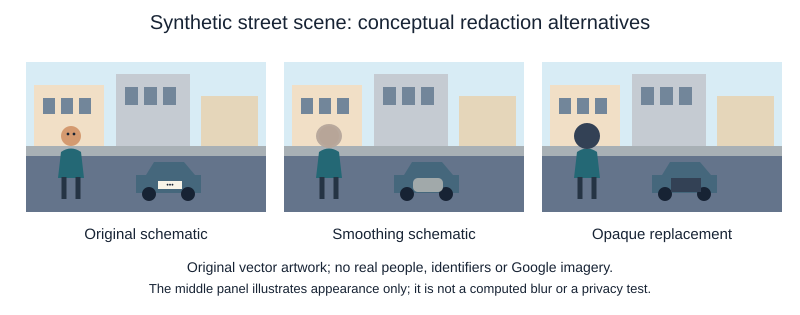
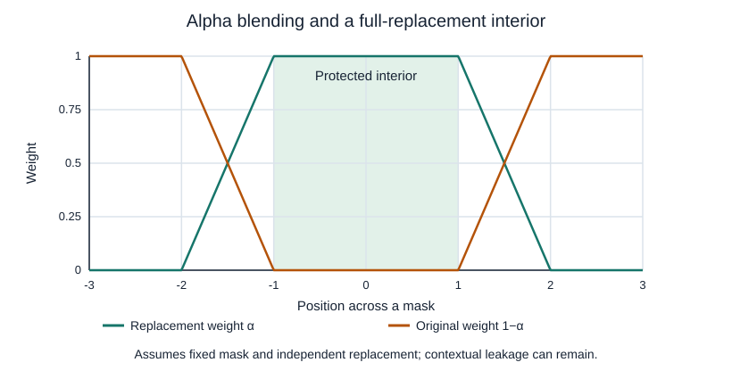

# Week 12, Day 2 — Randomized Redaction and Panorama Publication

*90-minute lecture. Continues Day 1 and prepares for Lab 6 (Part B) and Week 13.*

> **Scope:** The mathematical models are instructional abstractions, not a reverse-engineering description of Google production software. Experiments use synthetic imagery and artificial labels only. No attempt is made to recover actual protected attributes from public imagery.

## Learning Objectives

1. Model blur, randomized perturbation, blending, and quantization as release operations.
2. Distinguish stochastic information reduction from provable noninterference.
3. Explain the privacy implications of partial opacity and repeated releases.
4. Analyze redaction before stitching, including overlapping source views and derivative artifacts.
5. Design a privacy–utility evaluation that does not confuse a failed test with a proof of anonymity.

## Timed Outline (90 min)

| Min | Segment |
|-----|---------|
| 10 | Recap and historical publication architecture |
| 20 | Gaussian smoothing and randomized releases |
| 15 | Alpha blending and mask geometry |
| 5 | Break |
| 15 | Panorama stitching and multiple observations |
| 15 | Controlled privacy–utility evaluation |
| 10 | Lab 6 Part B and transition to Week 13 |
| **90** | **Total** |

## Content Notes

### 1. Recap and historical publication architecture (10 min)

Section 5 of Frome et al. (2009) describes applying privacy transformations to individual camera images before composing the panorama. The published method combines substantial smoothing with noise and a smooth transition at the detected region boundary.

The authors' objectives included visual acceptability and making the presence of redaction apparent. Their historical objective of irreversibility must be distinguished from a mathematical proof that every protected attribute is independent of the complete released artifact.

~~~mermaid
flowchart TD
    A["Synchronized camera images"] --> B["Detect sensitive regions in source views"]
    B --> C["Apply redaction to source images"]
    C --> D["Stitch protected views into panorama"]
    D --> E["Generate publication derivatives"]
    E --> F["Validate complete release"]
    F --> G["Published panorama"]
    F -->|Failure or uncertainty| H["Revise or withhold"]
~~~

*Figure 1. Historical pre-stitching placement, supplemented by a proposed defensive release verification stage. The latter is an instructional recommendation, not an assertion about undocumented Google internals.*

Refer students to Figure 1 of the [Google-hosted research paper](https://research.google.com/archive/papers/cbprivacy_iccv09.pdf) for the published panorama, and Figure 7 for redaction examples. Observe appearance only; all computational work below uses synthetic inputs. See Day 1 for reuse restrictions.

### 2. Gaussian smoothing and randomized releases (20 min)

Recall the ideal Gaussian transfer function from Week 5,

$$
H_\sigma(\nu)=\exp(-2\pi^2\sigma^2\|\nu\|^2).
$$

Greater smoothing attenuates more spatial frequencies, but does not by itself establish attribute privacy. The ideal continuous transfer function is nonzero for every finite frequency.

A simplified stochastic release model is

$$
V=Q(H_\sigma f+\eta),
$$

where $Q$ denotes the specified quantization and clipping operation, and $\eta$ is an independent random vector drawn according to a declared distribution. Independent additive Gaussian perturbation is a teaching example, not a claim about the exact noise distribution or parameters used by Google.

The output is now a conditional distribution given the input. Recall the Week 11 relationship for two equally probable artificial labels:

$$
P_e^*=\frac{1-d_{\mathrm{TV}}(P,Q)}{2}.
$$

Here $P,Q$ denote conditional probability laws, not the quantizer. Independent noise can reduce statistical distinguishability, but a finite noise level need not make those laws identical. A visual appearance of uniformity is not proof of statistical independence.

If $X\to V_0\to V_1$ is a Markov chain, with $V_1$ obtained by randomized post-processing of $V_0$, the data-processing inequality implies

$$
I(X;V_1)\le I(X;V_0).
$$

This is a nonincrease statement, not a zero-leakage bound. The assumptions can fail if the post-processing also accesses the original sensitive information.

*Figure 2. Original synthetic street-scene schematic and illustrative protection alternatives. Not Google imagery, not a reproduction of its implementation, and not a validation of a particular blur strength.*

The diagram illustrates conceptual differences in visible appearance. Actual validation uses quantitative independent controls; do not infer privacy from the figure.

### 3. Alpha blending and mask geometry (15 min)

Let $\alpha$ be a spatial weight in $[0,1]$, where one means complete use of the replacement raster $c$ and zero means complete use of the original raster $f$.

$$
g=(1-\alpha)\odot f+\alpha\odot c.
$$

A smooth transition can reduce visible seams, but if $\alpha$ is less than one on a sensitive coordinate then the expression retains an explicit contribution from the original value.

For a fixed independent replacement, the derivative with respect to that original coordinate is

$$
\frac{\partial g_i}{\partial f_i}=1-\alpha_i.
$$

If $c$ depends on $f$, the dependence of the replacement must also be accounted for. For example, with fixed mask and a linear blur replacement, the derivative as an operator is

$$
J=\mathrm{diag}(1-\alpha)+
\mathrm{diag}(\alpha)H_\sigma.
$$

Thus complete opacity does not imply source-pixel noninterference when the replacement is itself computed from the protected pixels.

*Figure 3. Schematic alpha profile. The protected region is covered by the full-replacement interior; any transition region requires separate consideration of its content and dependence.*

The defensive design objective is to avoid leaving original sensitive content in a transition region. This involves coverage, uncertainty in localization, and the provenance of the replacement itself. Use fixed independent replacement as a baseline for direct source-pixel noninterference; even that baseline does not establish full attribute anonymity because context can remain.

### 4. Panorama stitching and multiple observations (15 min)

A simplified panorama model uses geometric resampling operators $W_i$ for camera views and nonnegative blend weights $w_i$ whose sum is one on covered output pixels:

$$
g=\sum_{i=1}^{m}w_i\odot W_i(g_i).
$$

Each $g_i$ is the protected source view. The weights and warps are treated as fixed for this illustrative equation. A real stitching system may estimate geometry and blending from image data.

If each protected source view is independent of changes confined to the designated protected source coordinates, and the warps and weights are also independent of those changes, the stitched output inherits that noninterference property. This follows by substitution in the displayed equation.

~~~mermaid
flowchart LR
    A["Protected source view 1"] --> C["Warp and combine"]
    B["Protected source view 2"] --> C
    C --> D["Panorama"]
    D --> E["Tiles and alternate resolutions"]
    D --> F["Other published derivatives"]
    E --> G["Release-level validation"]
    F --> G
~~~

*Figure 4. All contributing source views and all released derivatives belong to the privacy boundary.*

Overlapping views, adjacent capture times, multiple resolutions, and caches create release-level risks even when an individual view appears protected. A later correction cannot be assumed to retract all copies already obtained by third parties.

For multiple releases, the chain rule gives

$$
I(X;Y_1,Y_2)=I(X;Y_1)+I(X;Y_2\mid Y_1).
$$

The joint disclosure can exceed that from either observation alone. Even two individually independent releases can be jointly informative, as the exclusive-or example in the Week 11 workbook illustrates. Therefore individual-image testing cannot establish protection of a collection.

### 5. Controlled privacy–utility evaluation (15 min)

The intended utility may include viewing road geometry, recognizing public signage, or assessing broad scene layout. The privacy target is a separately defined artificial label or protected region.

For a synthetic experiment, record the release mechanism, its parameters, the reference labels, independent sampling unit, and allowed auxiliary information. Include a prior-only baseline and a fixed independent replacement baseline. Use different synthetic reference targets for calibration and evaluation.

Compare leakage measurements and utility across conditions. A scatter plot can display a privacy–utility frontier, but no empirical curve proves absence of undiscovered leakage. A method is dominated under a chosen pair of objectives if another method is at least as good on both and strictly better on one.

~~~mermaid
flowchart TD
    A["Synthetic independent reference targets"] --> B["Predeclared release configurations"]
    B --> C["Measure retained task utility"]
    B --> D["Measure protected-label leakage"]
    C --> E["Compare configurations with uncertainty"]
    D --> E
    F["Prior-only and independent-replacement baselines"] --> E
    E --> G["Report trade-offs and unsupported claims"]
~~~

*Figure 5. Joint evaluation of privacy and utility, with independent targets and explicit baselines.*

Report missed regions separately from failures of the redaction mechanism. Evaluate the complete release and do not use an unsuccessful inference test as proof of universal privacy.

### 6. Lab 6 Part B and transition to Week 13 (10 min)

Extend the artificial-signal experiments of Lab 6 Part A. Compare deterministic smoothing, randomized smoothing, quantized outputs, and fixed replacement using declared utility and label-leakage measures. Preserve experiment settings and assess variation across independent targets and random realizations. Treat repeated realizations of the same target as clustered observations.

The experiment is a simplified defensive model, not an attempt to reproduce or test Google's live service. Google examples are viewed only in their original publications.

Week 13 replaces visible regions with generated content. The key mathematical question is whether the generative mechanism depends on protected source information and whether permitted conditioning variables can still reveal identity.

## Exercises

1. Explain why the data-processing inequality is insufficient to establish zero leakage.
2. With fixed independent replacement, derive the sensitivity of an output sample to the corresponding original sample at opacity 0, 0.5, and 1.
3. For a fixed alpha mask and linear blur replacement, derive the release Jacobian. Explain why the complete-opacity region may still depend on its input.
4. Prove the noninterference result for the simplified stitching operator under the stated fixed-geometry assumptions.
5. Give an abstract example of two releases that individually disclose no information about a fair binary label but jointly determine it.
6. Explain why a privacy test must include both missed detections and conditional redaction failures.

## Instructor Answer Sketch

1. The inequality bounds leakage by its previous value; it does not require the bound or the actual leakage to be zero.
2. The derivative is $1-\alpha$: respectively 1, 0.5, and 0.
3. The Jacobian is $\mathrm{diag}(1-\alpha)+\mathrm{diag}(\alpha)H_\sigma$. With full opacity the blur contribution can remain input-dependent.
4. Changing protected source coordinates leaves each protected source view unchanged. With the same fixed warps and weights, their weighted sum is unchanged.
5. For independent fair bits $X,Z$, release $Y_1=Z$ and $Y_2=X\mathbin{\mathrm{xor}}Z$. Each alone is independent of $X$, but their exclusive-or determines it.
6. An undetected object bypasses protection; a detected object may still retain identifying information. The combined release must be assessed.

## References

- Frome, A., et al. (2009). [Large-scale Privacy Protection in Google Street View](https://research.google.com/archive/papers/cbprivacy_iccv09.pdf), particularly Section 5.
- Cover, T. M., & Thomas, J. A. (2006). *Elements of Information Theory*, 2nd ed. Wiley.
- Google, [Street View privacy](https://www.google.com/intl/en-GB/help/maps/streetview/privacy.html) and [Geo Guidelines](https://about.google/brand-resource-center/products-and-services/geo-guidelines/).
- Course notes: Week 11 (randomized releases and statistical distinguishability).
