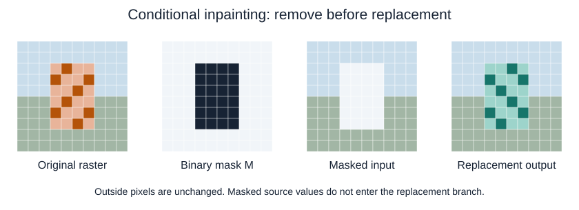
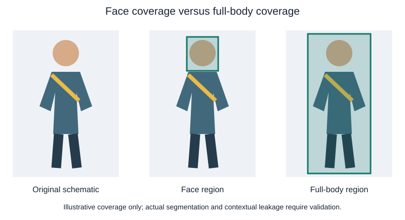
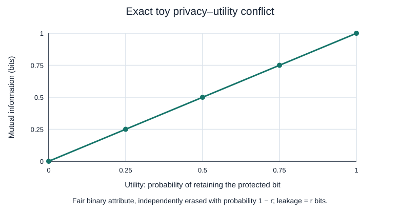

# Week 13, Day 1 — Generative Anonymization and Identity–Utility Decoupling

*90-minute lecture. Part IV: Privacy Engineering and Irreversible Redaction. The syllabus's zero-leakage objective is a theoretical target, not an established property of existing anonymizers.*

## Learning Objectives

1. Distinguish generative replacement from restoration and destructive redaction.
2. Prove a sufficient condition for zero mutual-information leakage.
3. Establish source-pixel noninterference for a fixed-mask inpainting model.
4. Explain the published DeepPrivacy and DeepPrivacy2 architectures and their limitations.
5. Formulate a privacy–utility objective for independent evaluation.

## Timed Outline (90 min)

| Min | Segment |
|-----|---------|
| 10 | From destructive redaction to generative replacement |
| 20 | Mathematical conditions for zero information leakage |
| 15 | Conditional generative inpainting |
| 5 | Break |
| 15 | DeepPrivacy: facial anonymization |
| 15 | DeepPrivacy2: full-body anonymization |
| 10 | Residual identity leakage and retained utility |
| **90** | **Total** |

## Content Notes

### 1. From destructive redaction to generative replacement (10 min)

Recall Week 10: a restoration model estimates missing content using learned image statistics. In a forensic setting, invented identifying details may undermine the intended inference. An anonymizer instead deliberately replaces such details, while retaining authorized scene information.

| Restoration | Anonymization |
|-------------|---------------|
| Estimate original content | Replace protected content |
| Identity fidelity may be desirable | Identity fidelity may be a privacy failure |
| Unsupported synthesis is an evidentiary concern | Synthesis is intentional and must be disclosed |
| Evaluate reference fidelity | Evaluate privacy, utility and realism separately |

The fact that a generated person looks realistic says nothing by itself about whether the original identity has been protected.

### 2. Mathematical conditions for zero information leakage (20 min)

Let $X$ be the protected attribute, $F$ the original raster, $C$ the complete permitted conditioning information, $Z$ latent randomness, and $Y$ the entire released output. Include the retained background, mask, pose representation, and any other input influencing the release in $C$. Assume the model parameters are fixed and the random variable $Z$ is independent of $(X,C)$.

Write

$$
Y=G(C,Z).
$$

For discrete variables, conditional on $C=c$, the distribution of $Y$ is induced solely by $G(c,Z)$. Thus

$$
p(y\mid x,c)=p(y\mid c)
$$

where the conditioning event has positive probability. The analogous statement for general variables uses conditional probability kernels. Hence $X\to C\to Y$ is a Markov chain.

~~~mermaid
flowchart LR
    X["Protected attribute X"] --> C["Complete conditioning C"]
    C --> G["Release function"]
    Z["Independent randomness Z"] --> G
    G --> Y["Complete released output Y"]
~~~

*Figure 1. A statistical Markov model, not an assertion that the conditioning is independent of identity.*

The chain rule gives

$$
I(X;C,Y)=I(X;C)+I(X;Y\mid C).
$$

Conditional independence makes the second term zero. Expanding in the opposite order gives

$$
I(X;C,Y)=I(X;Y)+I(X;C\mid Y).
$$

Since conditional mutual information is nonnegative,

$$
I(X;Y)\le I(X;C).
$$

In particular, $I(X;C)=0$ implies $I(X;Y)=0$. This is a sufficient condition, not a necessary one: a constant output may discard even highly identifying conditioning information.

If the observer has auxiliary information $A$, use the conditional Markov assumption $X\to C\to Y$ given $A$. Then

$$
I(X;Y\mid A)\le I(X;C\mid A).
$$

This conditional version is important when the observer already knows the location or circumstances of capture. Marginal independence alone does not imply conditional independence; recall the exclusive-or example from Week 11.

**Worked example.** A fair binary label $X$ is independent of a fair binary pose class $C$. A generator receives only $C$ and independent randomness. Its output has zero mutual information with $X$. If instead $C=X$ and the output retains $C$ exactly, then the output reveals one bit. In general, if a deterministic utility feature $U=u(Y)$ must be preserved, then

$$
I(X;Y)\ge I(X;U).
$$

This follows from data processing applied to $X\to Y\to U$. If an authorized utility feature is intrinsically identifying, exact preservation imposes a lower bound on leakage.

### 3. Conditional generative inpainting (15 min)

With the convention $M=1$ on protected pixels, construct

$$
F_{\mathrm{masked}}=(1-M)\odot F.
$$

For a generator producing a replacement raster, set

$$
Y=(1-M)\odot F+
M\odot G(F_{\mathrm{masked}},M,C,Z).
$$

For this local equation, $C$ denotes additional permitted conditioning; the complete conditioning in Section 2 includes the masked raster and mask as well.

*Illustration 1. Original synthetic raster, protected mask, masked input and independently synthesized region. Colors represent illustrative pixel values, not neural model output.*

**Noninterference proposition.** Fix $M,C,Z$ and all other generator state. Let $V$ be a perturbation supported on the mask, such that both original and perturbed inputs are admissible. Then $(1-M)\odot V=0$, so the masked inputs are identical. Both arguments of the generator and the retained outside pixels are unchanged. Consequently,

$$
Y(F+V,Z)=Y(F,Z).
$$

The equality holds for each fixed latent realization, and therefore also for the output distribution under a common independent latent law.

This is a statement about direct dependence on designated source coordinates. It does not prove independence from identity. In particular, recomputing the mask, pose, segmentation, or other conditioning after changing protected pixels may change the output. A retained original thumbnail, cache, or audio channel would also violate the stated release model.

~~~mermaid
flowchart TD
    A["Original raster"] --> B["Detect and mask sensitive region"]
    A --> C["Extract permitted conditioning"]
    B --> D["Masked raster"]
    C --> E["Conditional generator"]
    D --> E
    F["Independent latent randomness"] --> E
    E --> G["Composite replacement"]
    D --> G
    G --> H["Verify source-pixel removal"]
    G --> I["Evaluate identity leakage and utility"]
~~~

*Figure 2. Defensive replacement workflow. All paths from source to release must be accounted for.*

### 4. DeepPrivacy: facial anonymization (15 min)

Hukkelås, Mester and Lindseth (ISVC 2019) propose a conditional GAN for replacing facial regions. Their approach combines surrounding scene context with sparse facial pose information to guide synthesis. The original sensitive facial pixels are excluded from the generator input within the designated region.

The authors' privacy claims should be interpreted with their architecture and assumptions in view. In the model developed above, pose and context are not automatically independent of identity. A missed detection or an incomplete mask can retain identifying content.

Assign the [original paper](https://arxiv.org/abs/1909.04538) and [official implementation](https://github.com/hukkelas/DeepPrivacy) as viewing and reading material. The paper's examples are not copied into the course repository.

Discuss the use of context for visual continuity, the distinction between adversarial realism and identity protection, and the potential mismatch between a rectangular face region and all identifying features.

### 5. DeepPrivacy2: full-body anonymization (15 min)

Hukkelås and Lindseth (WACV 2023) extend the approach to complete human figures. Their published system combines detection and segmentation with several synthesis branches: a dense surface-correspondence-conditioned full-body generator, a full-body generator without that dense conditioning, and a face generator for remaining facial detections.

~~~mermaid
flowchart TD
    A["Input image"] --> B["Detection and region association"]
    B --> C["Dense surface correspondence available"]
    B --> D["Other segmented human figures"]
    B --> E["Remaining face detections"]
    C --> F["Conditioned body generator"]
    D --> G["Body generator without dense correspondence"]
    E --> H["Face generator"]
    F --> I["Composite synthesis"]
    G --> I
    H --> I
    I --> J["Independent privacy and utility evaluation"]
~~~

*Figure 3. Instructional abstraction of the published multi-branch approach; it is not a complete implementation specification.*

*Illustration 2. Synthetic figure illustrating why facial replacement alone leaves other body features and clothing visible.*

The paper and supplementary material provide examples and experimental comparisons. The [official repository](https://github.com/hukkelas/deep_privacy2) describes implementation and checkpoint licensing. Its main code is Apache-2.0 with exceptions; checkpoint terms depend on the associated datasets. Code licensing alone does not authorize every use of the weights or source images.

Full-body replacement can remove more original visual cues than facial replacement, but body shape, pose, motion, scene context and other retained information may remain identifying. Do not equate the paper's comparative privacy claims with a proof of zero mutual information.

### 6. Residual identity leakage and retained utility (10 min)

A conceptual optimization is

$$
\min_G I(X;Y)
$$

subject to

$$
\mathbb E[L_{\mathrm{utility}}(F,Y)]\le\epsilon.
$$

The expectation is over the specified input population and generator randomness. Utility is task-specific: pedestrian presence, body position, pose accuracy, or scene layout may matter more than exact pixel fidelity.

*Illustration 3. An exact toy erasure model with a fair binary attribute: retaining the attribute with probability r gives r bits of leakage and utility r for an attribute-retention task. This deliberately conflicting objective is not an empirical model benchmark.*

For a realistic evaluation, use independent synthetic or appropriately consented data, separate calibration from testing, and report detection coverage, conditional redaction quality, privacy measures and downstream utility. A finite unsuccessful privacy test does not establish zero leakage. Mark synthesized regions and outputs as generated wherever provenance matters.

## Exercises

1. Derive the data-processing bound from the two mutual-information chain-rule expansions.
2. Give an example where conditioning contains identity information but the output does not.
3. Prove fixed-mask source-pixel noninterference and explain why recomputing the mask may invalidate it.
4. Explain how background and pose can be identifying even when face pixels are removed.
5. Show that preserving a deterministic utility feature imposes the stated information lower bound.
6. Compare facial and full-body replacement in terms of protected coverage and authorized utility.

## Instructor Answer Sketch

1. Equate the expansions; conditional independence removes one term and nonnegativity bounds the remaining term.
2. Let $C=X$ and output a constant.
3. The masked perturbation vanishes; fixed conditioning and latent state imply identical generator inputs. A recomputed mask may differ.
4. They may be statistically correlated with identity or auxiliary knowledge.
5. Apply data processing to $X\to Y\to U$.
6. A larger region can remove additional identifying pixels but may alter more task-relevant content; neither coverage nor realism alone proves anonymity.

## References

- Hukkelås, H., Mester, R., & Lindseth, F. (2019). [DeepPrivacy: A Generative Adversarial Network for Face Anonymization](https://arxiv.org/abs/1909.04538). ISVC.
- Hukkelås, H., & Lindseth, F. (2023). [DeepPrivacy2: Towards Realistic Full-Body Anonymization](https://openaccess.thecvf.com/content/WACV2023/html/Hukkelas_DeepPrivacy2_Towards_Realistic_Full-Body_Anonymization_WACV_2023_paper.html). WACV, 1329–1338. DOI: 10.1109/WACV56688.2023.00138.
- [DeepPrivacy2 implementation and licensing](https://github.com/hukkelas/deep_privacy2).
- Cover, T. M., & Thomas, J. A. (2006). Elements of Information Theory, 2nd ed.
- Course notes: Weeks 10–12.
