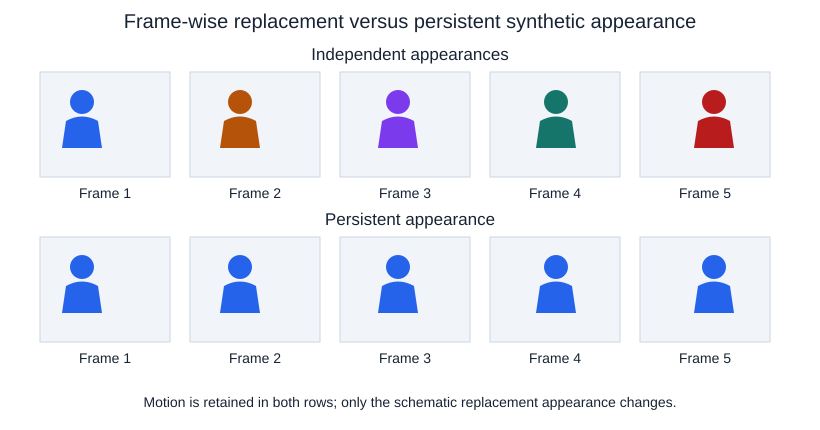
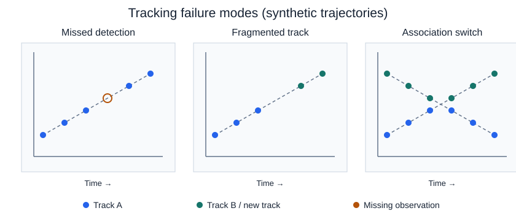
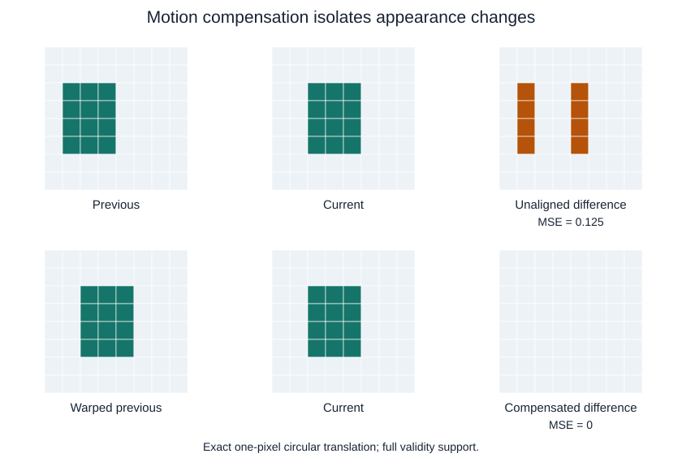

# Week 13, Day 2 — Video Anonymization and Temporal Consistency

*90-minute lecture. Continues Day 1 and prepares for Lab 6 Part C and the capstone.*

## Learning Objectives

1. Explain the distinction between frame-wise and sequence-wise anonymization.
2. Describe a tracking state-space model and the consequences of association failures.
3. Formulate a motion-compensated temporal consistency measure.
4. Distinguish persistent latent conditioning from joint video generation.
5. Apply the mutual-information chain rule to sequence releases and discuss linkability.

## Timed Outline (90 min)

| Min | Segment |
|-----|---------|
| 10 | Extending image anonymization to video |
| 15 | Object tracking and temporal association |
| 20 | Temporal consistency and flickering |
| 5 | Break |
| 15 | Temporally conditioned generation and video diffusion |
| 15 | Sequence-level information leakage |
| 10 | Evaluation and capstone preparation |
| **90** | **Total** |

## Content Notes

### 1. Extending image anonymization to video (10 min)

An independent image generator can produce distinct replacement appearances in successive frames. A useful video release may instead require coherent synthetic appearance across time, while preserving legitimate motion and illumination changes.

*Illustration 1. Original schematic sequence comparing independent replacement appearances with persistent synthetic appearance. No model performance is implied.*

Temporal consistency and privacy are different objectives. A consistent synthetic appearance may support scene interpretation while allowing a viewer to link the same synthetic track across frames. Whether linkage is allowed must be defined in the threat model.

### 2. Object tracking and temporal association (15 min)

For a simple constant-velocity model, let $s_t=(x_t,y_t,v_{x,t},v_{y,t})^T$ denote a geometric state. Use

$$
s_t=As_{t-1}+w_t,
$$

with time increment $\Delta t$ and

$$
A=\begin{pmatrix}
1&0&\Delta t&0\\
0&1&0&\Delta t\\
0&0&1&0\\
0&0&0&1
\end{pmatrix}.
$$

A detector yields positional measurements

$$
z_t=Hs_t+v_t.
$$

Here $H$ selects the position coordinates. The process and measurement noise terms are distinct. Under the linear Gaussian assumptions with known covariances, Kalman filtering provides a recursive state estimate.

Give the prediction equations

$$
\widehat s_{t|t-1}=A\widehat s_{t-1|t-1},
$$

$$
P_{t|t-1}=AP_{t-1|t-1}A^T+Q_w,
$$

and introduce the correction using the innovation $z_t-H\widehat s_{t|t-1}$. A full filter derivation is beyond this lecture's scope. Association between multiple objects is a separate problem from single-track state estimation.

*Illustration 2. Synthetic trajectories and examples of a missed observation, fragmentation and an association switch.*

A missed detection can leave a protected region unmodified. Occlusion and track fragmentation can create inconsistent replacement appearances; an association switch can attach a synthetic appearance to the wrong track. Evaluate track coverage and privacy failures independently of visual continuity.

For the DeepPrivacy2 practical, inspect the selected implementation revision and its tracking facilities before claiming particular tracking behavior. A generic Kalman model is presented here as background, not a verified specification of every release.

### 3. Temporal consistency and flickering (20 min)

A direct difference $Y_t-Y_{t-1}$ mixes motion with changes in appearance. Use a backward-resampling warp $W_{t-1\to t}$ from the preceding frame into the current coordinate grid. Let $V_t$ be a binary validity mask selecting corresponding, nonoccluded pixels in the region of interest.

For scalar rasters with nonempty validity support,

$$
E_t=
\frac{\|V_t\odot(Y_t-W_{t-1\to t}Y_{t-1})\|_2^2}
{\|V_t\|_1}.
$$

For multichannel images, specify whether the numerator sums channel errors or averages them; the latter also divides by the channel count. An empty validity mask is an undefined measurement and must be reported as such, not as zero error.

*Illustration 3. Exact synthetic translation of a binary raster. Without alignment the difference is nonzero; after the known translation the valid pixels agree.*

**Worked example.** For circular one-dimensional signals $Y_{t-1}=(0,1,1,0)$ and $Y_t=(0,0,1,1)$, the unaligned MSE is $2/4=0.5$. A right circular shift by one sample of the previous signal gives the current signal exactly, so compensated MSE is zero. If the final sample in the current signal changes from one to 0.5, compensated MSE becomes $0.25/4=0.0625$ under full validity.

Motion estimation may be inaccurate, and lighting, deformation, or genuine visibility changes can produce residuals. A low temporal error can also result from an output that suppresses legitimate movement. Pair temporal metrics with utility, independent coverage measures and human assessment under predefined criteria.

~~~mermaid
flowchart LR
    A["Previous released frame"] --> B["Warp into current coordinates"]
    C["Current released frame"] --> D["Compare valid corresponding pixels"]
    B --> D
    E["Validity and occlusion mask"] --> D
    D --> F["Temporal error and coverage report"]
~~~

*Figure 1. Motion compensation before temporal comparison.*

### 4. Temporally conditioned generation and video diffusion (15 min)

A frame-wise generator may use $Y_t=G(C_t,Z_t)$ with independent latent variables. A track-conditioned design may instead share a randomly sampled latent code $Z_k$ for a synthetic track $k$, while conditioning on permitted per-frame geometry.

Sharing a latent code is not sufficient to guarantee stable appearance: varying conditioning, changes in masks, and model sensitivity can still alter outputs. Tracking failures also affect the correspondence between latent codes and regions. Do not derive persistent codes from protected identifiers if independence from those identifiers is required.

A joint sequence generator models $Y_{1:T}=G(C_{1:T},Z)$, allowing temporal interactions. Revisit the diffusion model of Week 10, now with $x_0$ representing a whole video tensor:

$$
x_\tau=\sqrt{\bar\alpha_\tau}x_0+
\sqrt{1-\bar\alpha_\tau}\epsilon.
$$

The diffusion index $\tau$ is distinct from the video frame index $t$. A learned reverse model can use spatiotemporal interactions to generate coherent outputs. Ho et al. (NeurIPS 2022) provide an early video diffusion formulation. Video generation is not inherently anonymization; every permitted input and retained output must satisfy the privacy specification.

~~~mermaid
flowchart TD
    A["Video frames"] --> B["Detection and tracking"]
    B --> C["Remove protected source content"]
    B --> D["Permitted motion and pose conditioning"]
    C --> E["Temporally conditioned generator"]
    D --> E
    F["Independent latent state"] --> E
    E --> G["Released video"]
    G --> H["Temporal consistency"]
    G --> I["Sequence-level privacy"]
    G --> J["Downstream utility"]
~~~

*Figure 2. Defensive temporal generation architecture, abstracted from implementation-specific choices.*

### 5. Sequence-level information leakage (15 min)

For a finite sequence, the chain rule gives

$$
I(X;Y_1,\ldots,Y_T)=
\sum_{t=1}^{T}I(X;Y_t\mid Y_1,\ldots,Y_{t-1}).
$$

Each term is nonnegative. The sequence may disclose more than any individual frame, and individual marginal independence is insufficient.

**Worked example.** Let $X$ and $Z$ be independent fair bits, and release $Y_1=Z$, $Y_2=X\mathbin{\mathrm{xor}}Z$. Each output alone is independent of $X$. Together they determine $X$, so $I(X;Y_1,Y_2)=1$ bit. This is a theoretical illustration of joint disclosure, not a procedure for recovering private video content.

If the complete conditioning sequence $C_{1:T}$ is independent of $X$ and the whole release is a function only of that conditioning and independent randomness, Day 1's data-processing argument extends directly to the sequence. Per-frame independence of conditioning does not suffice.

Temporal behavior, gait, surroundings and other modalities can be correlated with protected attributes. Include audio, metadata, alternate encodings and any retained originals in the release boundary. Distinguish identity protection from unlinkability: a stable synthetic appearance can preserve track association while obscuring appearance, but may be unsuitable for a requirement that separate observations cannot be linked.

### 6. Evaluation and capstone preparation (10 min)

Use authorized synthetic or appropriately consented targets. Evaluate detection and mask coverage, source-pixel noninterference under controlled perturbations, sequence-level attribute protection, motion-compensated temporal error, association failures and downstream utility.

Separate calibration and held-out evaluation by independent subjects or sequences. Adjacent frames are correlated and must not be counted as independent identities. Report missing detections, invalid correspondences and model failures explicitly.

For Lab 6 Part C, the instructor must verify the DeepPrivacy2 revision, installation, checkpoint terms and computing requirements, and supply precomputed authorized outputs if local execution is impractical. No new model training is required. Preserve the distinction between generated imagery and authentic source material. Week 14 will synthesize these methods into end-to-end evaluation.

## Exercises

1. Explain why a single-object state estimator does not solve multi-object association.
2. Predict the next state for $(10,20,2,-1)$ with unit time increment and zero process noise.
3. Compute unaligned and compensated MSE for the circular-shift example above.
4. Explain why zero valid pixels cannot be reported as zero temporal error.
5. Prove the sequence mutual-information expansion by induction and explain the exclusive-or example.
6. Explain why stable synthetic identity and unlinkability can conflict.

## Instructor Answer Sketch

1. Association determines which observation belongs to which track; the state estimator assumes that assignment.
2. $(12,19,2,-1)$.
3. Unaligned 0.5; compensated zero for the exact shift.
4. The denominator vanishes; report missing coverage instead.
5. Apply the two-variable chain rule recursively. Each marginal is independent but the pair determines the protected bit.
6. Persistent appearance facilitates linking observations even if original appearance is removed.

## References

- Ho, J., et al. (2022). [Video Diffusion Models](https://arxiv.org/abs/2204.03458). NeurIPS.
- Kalman, R. E. (1960). A New Approach to Linear Filtering and Prediction Problems. Journal of Basic Engineering, 82(1), 35–45.
- [DeepPrivacy2 paper and implementation](https://github.com/hukkelas/deep_privacy2).
- Course notes: Weeks 1–2, 9–12 and Week 13 Day 1.
