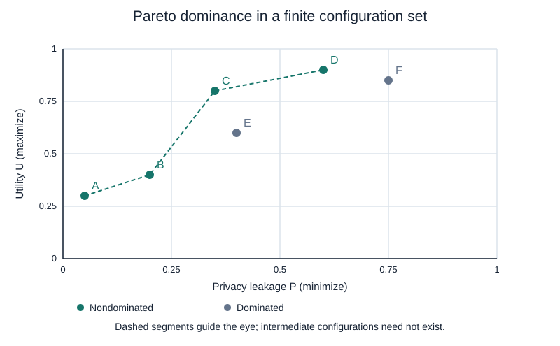
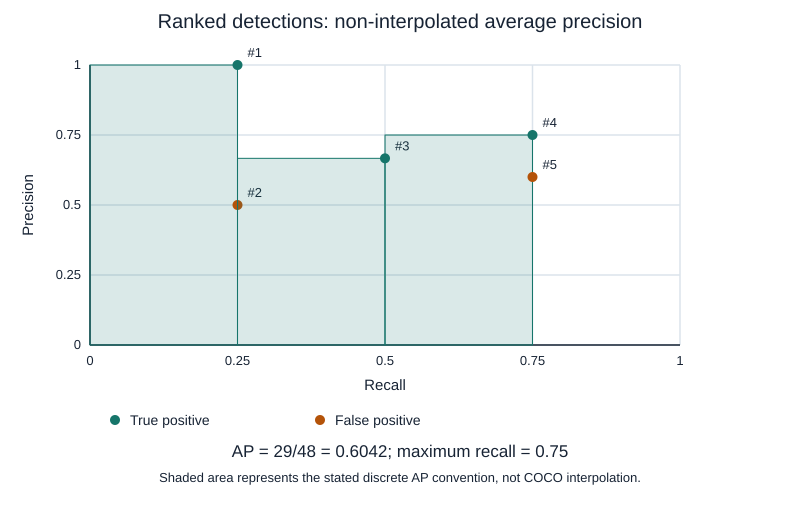
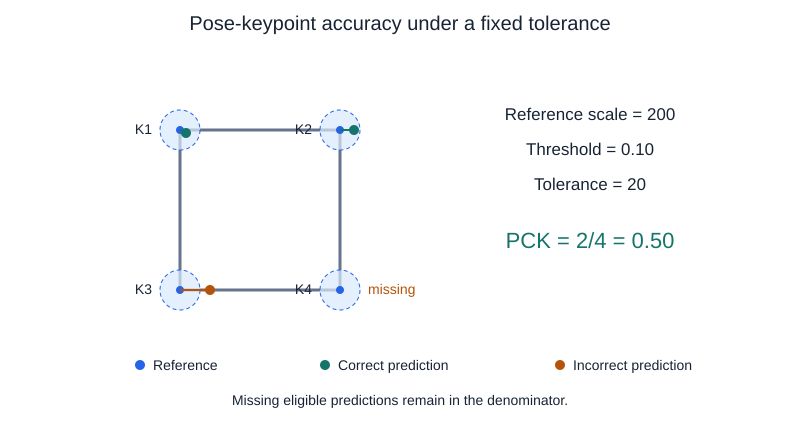
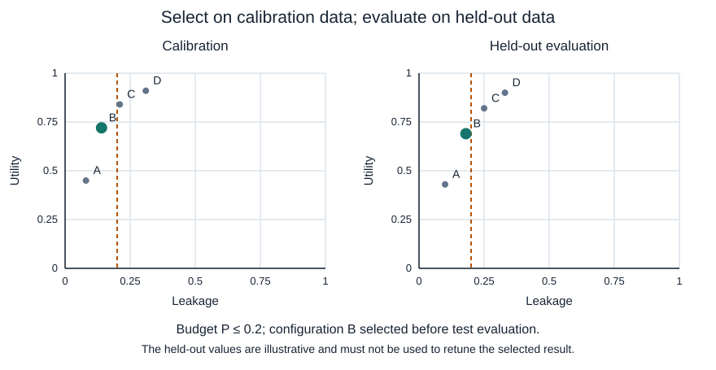

# Week 14, Day 1 — Integrated Privacy–Utility Evaluation

*90-minute lecture. Part IV: Privacy Engineering and Irreversible Redaction. Synthesizes Weeks 1–13 and prepares the capstone defense.*

## Learning Objectives

1. Formulate an end-to-end privacy pipeline and its release boundary.
2. Identify Pareto-optimal configurations and explain limitations of weighted scalarization.
3. Compute detection AP, mAP, and pose-keypoint accuracy under explicit conventions.
4. Interpret privacy test results and statistical uncertainty.
5. Design a reproducible joint privacy–utility evaluation.

## Timed Outline (90 min)

| Min | Segment |
|-----|---------|
| 10 | Synthesis of mathematical foundations |
| 15 | End-to-end anonymization architecture |
| 20 | Multi-objective optimization and Pareto optimality |
| 5 | Break |
| 15 | Downstream computer-vision utility metrics |
| 15 | Statistical evaluation of privacy |
| 10 | Capstone evaluation methodology |
| **90** | **Total** |

## Content Notes

### 1. Synthesis of mathematical foundations (10 min)

The course began with continuous and discrete image spaces, injectivity, interpolation, and geometric mappings. Sampling, quantization, and compression introduced information loss. Fourier analysis and inverse problems then distinguished exact invertibility from stable recoverability. Regularization and learned restoration made explicit the assumptions required to estimate missing information.

Forensic integrity and experimental validation established the distinction between a plausible result and a supported inference. Privacy engineering reversed the objective: a release must prevent specified inferences while retaining authorized information.

The following distinctions remain essential:

| Mathematical or experimental property | What it does not establish |
|---------------------------------------|----------------------------|
| Non-injectivity on the ambient space | Non-identifiability of a restricted attribute |
| Small forward residual | Fidelity to the actual original |
| Realistic generated content | Identity preservation or anonymity |
| Fixed-mask source-pixel noninterference | Independence of identity from the complete release |
| No observed privacy failures | Zero population failure probability |
| High downstream utility | Adequate privacy |

### 2. End-to-end anonymization architecture (15 min)

An integrated pipeline includes detection and tracking, region construction, removal or replacement, temporal processing, and publication. Its complete release includes all frames, metadata, associated files, previews and alternate encodings.

~~~mermaid
flowchart TD
    A["Source images or video"] --> B["Detection and tracking"]
    B --> C["Construct protected regions"]
    C --> D["Remove sensitive source pixels"]
    D --> E["Replacement"]
    F["Permitted conditioning and independent randomness"] --> E
    E --> G["Temporal consistency processing"]
    G --> H["Sanitize release artifacts"]
    H --> I["Candidate release"]
    I --> J["Privacy evaluation"]
    I --> K["Utility evaluation"]
    I --> L["Integrity and provenance evaluation"]
    J --> M{"Release criteria satisfied?"}
    K --> M
    L --> M
    M -->|Yes| N["Eligible for authorized release"]
    M -->|No| O["Revise or withhold"]
    O --> B
~~~

*Figure 1. Defensive architecture with evaluation gates. Passing the declared tests is not a universal privacy guarantee.*

The detector determines coverage; the replacement determines direct dependence within the protected region; subsequent operations determine the final release. A stage may preserve a privacy property only under the assumptions required by the corresponding proof. For example, stitching fixed independently protected views preserves source-pixel noninterference when the weights and geometry are fixed independently of the protected coordinates.

Define a configuration $\theta$ to include thresholds, mask rules, model revision, replacement parameters, temporal association and publication settings. Evaluate the complete configuration rather than isolated components.

### 3. Multi-objective optimization and Pareto optimality (20 min)

Let $P(\theta)$ be a privacy leakage measure to minimize and $U(\theta)$ a utility measure to maximize. Both must be defined for the same evaluation domain and specified threat model.

Configuration $\theta_1$ dominates $\theta_2$ when

$$
P(\theta_1)\le P(\theta_2),
\qquad U(\theta_1)\ge U(\theta_2),
$$

and at least one inequality is strict. A feasible configuration is Pareto-optimal if no other feasible configuration dominates it.

Consider the following artificial objective pairs (not measured performance):

| Configuration | Leakage P | Utility U |
|---------------|----------:|----------:|
| A | 0.05 | 0.30 |
| B | 0.20 | 0.40 |
| C | 0.35 | 0.80 |
| D | 0.60 | 0.90 |
| E | 0.40 | 0.60 |
| F | 0.75 | 0.85 |

A, B, C and D are nondominated. C dominates E, and D dominates F.

*Illustration 1. Computed dominance classifications for the table. Joining nondominated points is a visual guide, not evidence that intermediate configurations are feasible.*

Constrained optimization selects the best utility subject to a specified leakage budget:

$$
\max_{\theta} U(\theta)
\quad\text{subject to}\quad P(\theta)\le\epsilon.
$$

In the example, with $\epsilon=0.25$, B is optimal. With $\epsilon=0.40$, C is optimal.

Weighted scalarization instead selects

$$
\max_{\theta}\bigl[U(\theta)-\lambda P(\theta)\bigr],
\qquad \lambda>0.
$$

Every maximizer for strictly positive weight is nondominated: a dominating configuration would strictly improve the scalar objective. The converse does not hold in general.

**Counterexample.** For B to be at least as good as A under the scalar objective requires

$$
0.40-0.20\lambda\ge0.30-0.05\lambda,
$$

so $\lambda\le2/3$. For B to be at least as good as C requires

$$
0.40-0.20\lambda\ge0.80-0.35\lambda,
$$

so $\lambda\ge8/3$. No weight satisfies both. B is Pareto-optimal but unsupported by this scalarization.

This is a finite example of a nonconvex attainable objective set. A weighted objective is not a substitute for mandatory privacy constraints. Moreover, empirical estimates of the frontier have sampling uncertainty; point estimates alone cannot establish that differences are statistically or practically meaningful.

### 4. Downstream computer-vision utility metrics (15 min)

**Detection metrics.** Recall Week 12's intersection over union (IoU). For a fixed class and matching threshold, sort detections by confidence, assign each eligible reference at most once, and count true and false positives. Let $N_+$ be the number of reference objects. At rank $k$,

$$
p_k=\frac{\mathrm{TP}_k}{k},
\qquad r_k=\frac{\mathrm{TP}_k}{N_+}.
$$

For a simple non-interpolated AP convention,

$$
\mathrm{AP}=\sum_k (r_k-r_{k-1})p_k.
$$

Missed references contribute no recall increment. With four references and ranked outcomes TP, FP, TP, TP, FP, recall reaches 0.75 and

$$
\mathrm{AP}=\frac14(1+2/3+3/4)=\frac{29}{48}.
$$

*Illustration 2. Exact ranked example; AP uses the non-interpolated convention stated above.*

Benchmark AP may instead use an interpolated precision envelope at specified recall levels. COCO-style detection AP averages over IoU thresholds 0.50 through 0.95 in steps of 0.05 and applicable classes, with evaluator-specific limits and matching rules. AP50 is not interchangeable with this aggregate. Record the evaluator, version, class set, matching conventions, confidence ranking, treatment of absent classes, and detection limits.

For a simple class-average definition with $K$ evaluated classes,

$$
\mathrm{mAP}=\frac1K\sum_{j=1}^{K}\mathrm{AP}_j.
$$

When comparing original and anonymized data, keep the downstream model fixed unless retraining is explicitly part of the study. Use corresponding independent reference annotations and report absolute and relative changes, including failure counts.

**Pose estimation.** Define Percentage of Correct Keypoints (PCK) for a declared set of valid reference keypoints, reference scale $s_i>0$, and threshold $\tau$:

$$
\mathrm{PCK}_\tau=
\frac{1}{|\mathcal V|}
\sum_{i\in\mathcal V}
\mathbf 1\{\|\widehat k_i-k_i\|_2\le\tau s_i\}.
$$

State the reference scale, visibility and missing-prediction conventions. A missing prediction for an eligible reference keypoint is a failure, not a reason to remove it from the denominator. Empty reference support is undefined. COCO keypoint AP uses object keypoint similarity rather than this PCK formula; do not conflate the two.

*Illustration 3. Artificial keypoints and tolerance circles under a common reference scale.*

### 5. Statistical evaluation of privacy (15 min)

Specify the protected attribute, allowed auxiliary information, independent unit of analysis, baseline inference using auxiliary information alone, and failure criterion. Assess coverage failures separately from failures conditional on successful detection.

If $D$ denotes adequate detection and $R$ denotes adequate protection, then the overall probability of success is

$$
\Pr(D\cap R)=\Pr(D)\Pr(R\mid D).
$$

This expression does not require independence. A missed object must not silently disappear from the evaluation denominator.

For zero observed failures in $N$ independent Bernoulli trials with common failure probability $p$, the exact one-sided upper confidence bound at level $1-\alpha$ is

$$
p_{\mathrm{upper}}=1-\alpha^{1/N}.
$$

At 95% confidence, zero failures in 300 independent trials gives an upper bound of about 0.994%. This is not a posterior probability of safety, nor a bound on arbitrary untested adversaries or deployment conditions.

For correlated video frames, use independent scenes, subjects, or sequences as appropriate. Where the sampling design permits, report cluster-aware uncertainty. Report inconclusive outcomes and failures of the evaluation procedure. An empirical score is not a mathematical proof of independence.

### 6. Capstone evaluation methodology (10 min)

Compare predeclared candidate configurations on calibration data, select a configuration without consulting held-out outcomes, record the decision, and then evaluate on independent test targets. If a test result prompts a redesign, treat the same data as development data and obtain a fresh independent evaluation set.

*Illustration 4. Artificial calibration and held-out objective pairs for the same four configurations; selection is performed only on calibration data.*

Include at least a simple baseline, a complete-replacement baseline where applicable, and a proposed pipeline. Record source and output digests, software and model versions, settings, random seeds where relevant, and evaluation definitions.

Report privacy, utility, temporal consistency and computational feasibility separately. State what was proved, what was measured and what remains unknown.

## Exercises

1. Determine the nondominated configurations in the six-point table.
2. Prove that a maximizer of positive weighted scalarization is nondominated.
3. Prove that B in the table cannot maximize the stated weighted objective for any positive weight.
4. Compute non-interpolated AP for five references and ranked outcomes TP, FP, TP, FP, TP.
5. Four eligible keypoints have normalized errors 0.02, 0.05, 0.11, and one missing prediction. Find PCK at threshold 0.10.
6. Derive the number of independent zero-failure trials required to obtain a one-sided 95% upper bound of at most 0.005.

## Instructor Answer Sketch

1. A, B, C and D.
2. A dominating point strictly improves the objective because both objective directions have positive weights.
3. The comparisons with A and C require mutually incompatible bounds on the weight.
4. AP = $(1+2/3+3/5)/5=34/75$.
5. Two correct out of four eligible references: 0.5.
6. Require $N\ge\log(0.05)/\log(0.995)$; the minimum integer is 598.

## References

- Course notes: Weeks 1–13, particularly Weeks 9 and 11–13.
- Miettinen, K. (1999). *Nonlinear Multiobjective Optimization*. Springer.
- Lin, T.-Y., et al. (2014). Microsoft COCO: Common Objects in Context. ECCV.
- [COCO evaluation implementation](https://github.com/cocodataset/cocoapi/blob/master/PythonAPI/pycocotools/cocoeval.py). Specify the actual evaluator revision used in experiments.
- Yang, Y., & Ramanan, D. (2013). Articulated Human Detection with Flexible Mixtures of Parts. IEEE TPAMI, 35(12), 2878–2890.
